# STAGE 1 — SYSTEM DESIGN

## NADI ASN DPMPTSP

**Navigasi dan Analitik Data Internal ASN**  
**Tagline:** Data ASN dalam Satu Pandangan

| Atribut | Nilai |
|---|---|
| Versi dokumen | 1.0 |
| Tanggal | 10 September 2026 |
| Status | Rancangan lengkap untuk review dan persetujuan System Design |
| Sumber kebutuhan | PRD NADI ASN DPMPTSP, versi 1.0, bagian 1–102 |
| Cakupan | Desain sistem MVP untuk satu instansi DPMPTSP |
| Target produk | MVP 1–3 bulan sesuai PRD; estimasi pelaksanaan dirinci pada Stage 3 |
| Tahap berikutnya | Stage 2 — UI/UX Blueprint, setelah persetujuan desain |

Dokumen ini menerjemahkan PRD menjadi keputusan arsitektur, kontrak data, kontrol akses, alur transaksi, dan rancangan operasional yang dapat digunakan sebagai dasar implementasi. Dokumen ini belum merupakan aplikasi, migrasi database yang sudah dijalankan, atau bukti pengujian production.

**Cara membaca keputusan:** ketentuan yang disebut “wajib PRD” berasal dari PRD. “Keputusan desain” adalah pendekatan teknis yang dipilih dalam rancangan ini. Nilai yang disebut “baseline usulan” merupakan konfigurasi awal untuk direview, bukan ketentuan regulasi yang telah disahkan. Nomor regulasi, formula DUK/KP/KGB, dan format resmi yang tidak disertakan dalam PRD tidak dibuat-buat.

## Daftar isi

1. Batas sistem dan keputusan utama
2. Arsitektur dan batas modul
3. Struktur proyek
4. Model waktu, data resmi, dan transaksi
5. ERD
6. Data dictionary, constraint, dan index
7. Roles, permissions, dan critical fields
8. State machines dan workflow
9. Import, migrasi, dan rollback
10. Ruleset, calculation engine, dan radar
11. Snapshot, DUK, dan laporan
12. Dashboard, privasi publik, dan search
13. Desain API
14. Authentication dan keamanan
15. Audit, job, cache, dan observability
16. Docker dan deployment
17. Backup dan disaster recovery
18. Kapasitas, pengujian, dan acceptance
19. Traceability PRD dan dokumentasi
20. Register keputusan dan gerbang persetujuan
21. Referensi

## 1. Batas sistem dan keputusan utama

### 1.1 Tujuan desain

Satu transaksi data pegawai yang telah disetujui menjadi sumber untuk Master Pegawai, Ringkasan ASN 360, DUK, KP/KGB Radar, dashboard, dan laporan. Dashboard publik hanya menerima agregat yang telah melewati perlindungan privasi di server. Data historis dan dokumen terbit tetap dapat ditelusuri.

Delapan kemampuan wajib MVP tetap lengkap: Master Pegawai, Import Excel, Public Dashboard, Admin Command Center, DUK Digital, KP Radar, KGB Radar, dan Export Laporan. Modul pendukung—authentication, approval, audit, ruleset, referensi, notification, dan operasi—merupakan bagian yang diperlukan untuk menjalankan kemampuan tersebut dengan benar.

ASN 360 lengkap, histori pendidikan penuh, radar pensiun/kontrak/Satyalancana, proyeksi lanjutan, ad-hoc report builder, Time Machine, tren publik historis, TTE, integrasi dokumen Google Drive, WhatsApp/email kepegawaian, Dark Mode, microservices, dan HA tetap di luar MVP.

### 1.2 Keputusan arsitektur

| ID | Keputusan desain | Alasan dan konsekuensi |
|---|---|---|
| ADR-01 | Modular monolith Laravel, satu repository, satu PostgreSQL | Transaksi lintas modul dapat atomik; cocok untuk tim internal kecil |
| ADR-02 | Vue 3 + TypeScript + Tailwind, REST API, domain yang sama | Pemisahan tampilan dan logika tanpa kompleksitas lintas domain |
| ADR-03 | Session server-side dengan cookie dan TOTP | Logout, deaktivasi, dan perubahan hak dapat mencabut akses segera |
| ADR-04 | UUID untuk seluruh entitas domain; NIP sebagai business key unik | Koreksi NIP tidak mengubah hubungan histori dan audit |
| ADR-05 | Proposal perubahan terpisah dari tabel resmi | Data pending tidak menggantikan data resmi yang sedang digunakan |
| ADR-06 | Histori bertanggal efektif untuk pangkat, jabatan, unit, status, dan dasar radar | Future-effective dan koreksi retroaktif memiliki perilaku konsisten |
| ADR-07 | Snapshot menyimpan salinan nilai, dasar hitung, dan versi template | Regenerasi tidak bergantung pada nama/referensi/ruleset yang dapat berubah |
| ADR-08 | Ruleset berupa konfigurasi berskema yang dibaca evaluator teruji | Tidak mengeksekusi PHP, SQL, atau formula bebas dari pengguna |
| ADR-09 | PostgreSQL menyimpan job dan outbox; Redis belum diperlukan untuk MVP | Mengurangi komponen operasional; cache awal juga di database |
| ADR-10 | Worker dan scheduler terpisah, image aplikasi sama | Import, kalkulasi besar, dan export tidak memblokir request web |
| ADR-11 | Public API memakai proyeksi agregat dan serializer tersendiri | Tidak ada serialisasi model pegawai pada rute publik |
| ADR-12 | Rollback import adalah transaksi kompensasi | Perubahan lanjutan terlindungi; tidak menghapus bukti import |

Versi runtime/dependency dipilih dari rilis yang masih didukung dan saling kompatibel saat Stage 3, kemudian dikunci pada lockfile serta image digest. Tidak menggunakan tag `latest` untuk production. Keputusan ini tidak mengubah stack wajib PRD. Pemilihan versi patch bukan penghambat review arsitektur.

### 1.3 Batas eksternal

Tidak ada sinkronisasi SIASN, ASN Digital, atau e-Kinerja pada MVP. URL folder Google Drive dimasukkan manual dan hanya dibuka melalui browser pengguna yang berwenang. Sistem tidak mengunduh dokumen dari URL tersebut.

Backup terenkripsi ke Google Drive adalah proses infrastruktur terpisah. Penafsiran batas ini dicatat pada K-06: larangan integrasi Google Drive pada modul dokumen tidak menghapus kebutuhan transfer backup otomatis yang diwajibkan PRD.

## 2. Arsitektur dan batas modul

### 2.1 Diagram konteks dan container

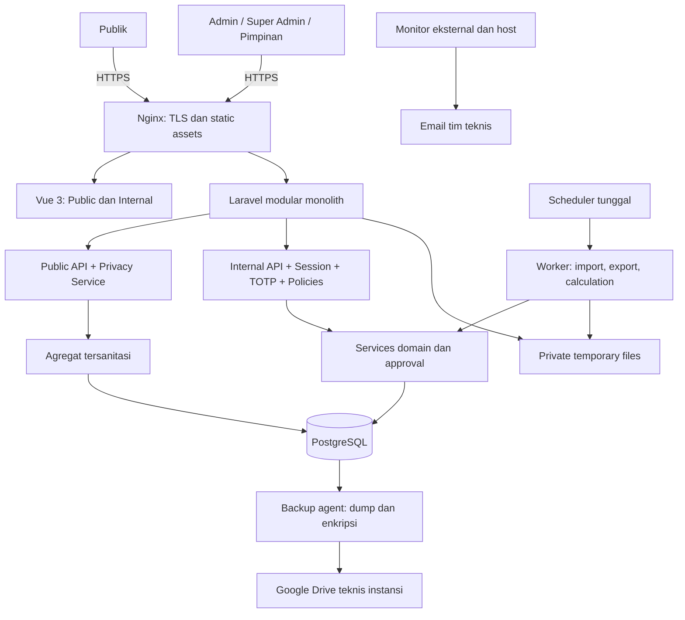

Public dan internal merupakan batas authorization/logika dalam satu aplikasi, bukan deployment microservices. Halaman `/` bersifat publik; `/internal` mengharuskan sesi lengkap. Bundle internal bukan mekanisme keamanan: setiap endpoint tetap memeriksa izin di server.

### 2.2 Kepemilikan modul

| Modul | Tanggung jawab dan data milik modul | Antarmuka yang dipakai modul lain |
|---|---|---|
| IdentityAccess | Akun, role, permission, sesi, TOTP, recovery | `Authorize`, `FieldVisibility`, `Reauthenticate` |
| ReferenceData | Unit, jabatan, pangkat/golongan, pendidikan, status | `ValidateReference`, pembacaan kode/label |
| Personnel | Pegawai, pendidikan ringkas, kontrak, histori, dasar kalkulasi | `GetEffectiveEmployee(asOf)`, `ApplyApprovedChange` |
| Governance | Proposal, critical policy, approval, pemeriksaan versi | `Submit`, `Decide`, `Apply` |
| Imports | Upload, staging, mapping, rekonsiliasi, batch, rollback | `PrepareBatch`, proposal ke Governance |
| Rules | Versi ruleset, simulasi, aktivasi, evaluator | `ResolveRuleset`, `Calculate`, `Explain` |
| DUK | Live dataset, review publikasi, revisi | `BuildDUK`, `SubmitPublication` |
| SnapshotsReports | Snapshot immutable, template, export dan regenerasi | `Freeze`, `Render`, `Download` |
| Analytics | Command Center, executive projection, agregat publik | `InternalSummary`, `SafePublicSummary` |
| Quality | Validasi dan completeness kontekstual | `AssessEmployee`, `AssessDataset` |
| Notifications | Alert operasional, acknowledgement, inbox per akun | `UpsertAlert`, `Acknowledge`, `ListInbox` |
| Audit | Jejak operasional/security, arsip dan metadata aktivitas | `AppendEvent`, pembacaan terotorisasi |
| Operations | Outbox, jobs, konfigurasi, health, backup metadata | `DispatchAfterCommit`, maintenance, health |

Hanya modul pemilik yang menulis tabel domainnya. Controller tidak menghitung DUK/KP/KGB. Modul lain memakai service/application action atau read projection, bukan memperbarui model lintas modul secara langsung. Governance memanggil action pemilik domain di dalam transaksi yang sama. Tidak membangun event sourcing penuh atau message broker untuk MVP.

### 2.3 Alur perubahan data

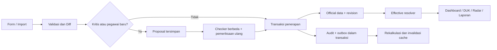

## 3. Struktur proyek

```text
nadi-asn-dpmptsp/
  app/
    Modules/
      IdentityAccess/   ReferenceData/   Personnel/   Governance/
      Imports/          Rules/           DUK/         SnapshotsReports/
      Analytics/        Quality/         Notifications/ Audit/ Operations/
        Actions/       # satu use case: SubmitEmployeeChange, PublishDUK
        DTOs/          # input/output eksplisit, field allowlist
        Models/        # persistence milik modul
        Policies/      # permission + keadaan objek
        Queries/       # pembacaan efektif dan daftar
        Services/      # logika domain yang dipakai ulang
        Http/          # Controllers, Requests, Resources
        Jobs/          # pekerjaan idempotent
        Events/        # event domain dan payload outbox
    Shared/            # Clock, UUID, transaksi, error; bukan logika bisnis
  bootstrap/
  config/              # konfigurasi deployment; bukan ruleset aktif
  database/
    migrations/        # urutan global dengan ownership modul
    seeders/           # permission dan referensi yang telah diverifikasi
    factories/         # dummy data
  resources/
    js/
      apps/public/     # halaman publik dan public API client
      apps/internal/   # layout internal dan route guard
      modules/         # personnel, imports, duk, radar, governance, ...
      components/      # tabel, form, status, chart, dialog konsisten
      api/             # client REST bertipe dari kontrak API
      types/
    css/
    views/reports/     # template PDF versioned
  routes/
    web.php            # shell, root publik dan login
    auth.php
    api_public.php
    api_internal.php
    console.php
  storage/app/private/ # imports dan exports; tidak di-public symlink
  tests/
    Unit/              # rules, dates, score, privacy
    Feature/           # authorization, approval, import, publish
    Integration/       # PostgreSQL, worker, file rendering
    Browser/           # alur operasional utama
  docs/
    architecture/ database/ api/ user/ super-admin/ operations/
    migration/ rulesets/ git/ releases/
  infra/
    docker/ nginx/ backup/ monitoring/
    compose.yaml
    compose.production.yaml
  scripts/             # preflight, deploy, rollback, restore verification
  composer.json
  composer.lock
  package.json
  package-lock.json
  .env.example         # nama variabel tanpa secret
```

Nama field/API/kode menggunakan bahasa Inggris yang konsisten; label UI dan pesan pengguna menggunakan Bahasa Indonesia. Enum dipetakan ke label Indonesia. Backend menjadi sumber validasi, frontend membantu interaksi. Shared component mencakup label, focus, keyboard, validasi yang dapat dibaca screen reader, dan status teks di samping warna.

## 4. Model waktu, data resmi, dan transaksi

### 4.1 Empat konsep yang dipisahkan

| Konsep | Arti | Contoh |
|---|---|---|
| Verification state | Apakah data sudah disetujui | Draft, Pending, Official |
| Effective date | Kapan fakta kepegawaian berlaku | TMT jabatan 1 Oktober |
| Recorded/approved time | Kapan sistem mengetahui/menyetujui fakta | Input 10 September, disetujui 11 September |
| Publication time | Kapan salinan resmi diterbitkan | DUK terbit 15 September |

`date` digunakan untuk tanggal lahir, TMT, kontrak, dan tanggal acuan. `timestamptz` digunakan untuk kejadian sistem, disimpan sebagai waktu UTC. Tanggal “hari ini” dihitung dalam timezone kantor yang configurable; baseline usulan `Asia/Makassar` mengikuti konteks kerja saat dokumen disusun, belum dianggap keputusan organisasi. Perubahan timezone harus ditinjau dampaknya.

### 4.2 Data resmi dan proposal

Pegawai baru manual/import disimpan sebagai payload bertipe pada `change_requests`, bukan langsung sebagai baris official. Proposal memiliki UUID pegawai yang dicadangkan. Halaman Master dapat menampilkan tab Draft/Pending dari projection proposal. Baris `employees` baru dibuat ketika transaksi persetujuan berhasil. Karena itu query dashboard tidak pernah perlu menyaring draft dari tabel official.

Untuk pegawai existing, seluruh nilai sebelum perubahan tetap berlaku sampai proposal disetujui. Satu proposal berisi perubahan satu pegawai beserta histori, pendidikan, dan kontrak terkait. Bila satu field kritis berubah, seluruh proposal ditahan. Koreksi proposal setelah submit membuat versi proposal baru; hasil review lama tidak boleh dipakai untuk payload yang berbeda.

Ketidaklengkapan tidak identik dengan belum resmi. Pegawai yang telah diverifikasi keberadaannya dapat menjadi official walaupun sebagian data belum tersedia; field yang belum diketahui tetap `NULL` dan muncul di quality summary. NIP valid, nama, jenis ASN/kategori yang konsisten, serta awal status yang diketahui merupakan minimum penerimaan official. Tidak mengarang TMT untuk memenuhi constraint; histori yang TMT-nya belum diketahui ditahan sebagai masalah migrasi, bukan dipaksakan masuk.

### 4.3 Pemilihan histori efektif

Untuk setiap domain histori pegawai dan tanggal acuan D:

1. Ambil record official dengan `record_state = VALID` dan `effective_from <= D`.
2. Pilih `effective_from` terbesar. Satu pegawai hanya boleh memiliki satu record VALID per domain pada TMT yang sama.
3. Jika tidak ada, hasil domain adalah tidak diketahui, bukan nilai dari record masa depan.
4. Batas akhir merupakan turunan: satu hari sebelum TMT VALID berikutnya. Tidak menyimpan dua sumber batas interval yang harus selalu disinkronkan.

Status `VALID` berarti fakta masih dipakai dalam garis waktu, bukan berarti sedang berlaku hari ini. Pangkat lama tetap VALID dan tetap dapat dipilih untuk tanggal acuan lama. `CANCELLED` meniadakan fakta tersebut; `REPLACED` dipakai untuk record yang dikoreksi oleh record pengganti. Payload historis tidak ditimpa. Transisi state dicatat bersama actor, waktu, dan alasan.

Pembatalan record future-effective menggunakan proposal dan approval. Setelah dibatalkan, record valid sebelumnya kembali menjadi fakta efektif sampai ada fakta berikutnya. Penggantian dengan TMT sama mengubah record lama menjadi REPLACED dan menambah record baru dalam satu transaksi; unique partial index mencegah dua kebenaran pada TMT yang sama.

**Future-effective tidak bergantung pada job berhasil tepat tengah malam.** Resolver selalu memakai tanggal acuan. Scheduler memperbarui cache dan alert; pembacaan mendeteksi tanggal/revision cache yang tidak sesuai sebelum menampilkan hasil.

### 4.4 Batas laporan historis MVP

Laporan bertanggal acuan menggunakan histori efektif yang tersedia, berdasarkan pengetahuan terbaru. Nama, gelar, tempat/tanggal lahir, dan ringkasan pendidikan menggunakan nilai terkoreksi terbaru karena tidak memiliki histori bisnis penuh pada MVP. Laporan harus menyebut “berdasarkan data terkini untuk tanggal acuan …”; field nonhistoris tidak boleh diberi kesan sebagai kondisi yang benar-benar tersimpan pada masa itu.

Kebutuhan reproduksi persis dokumen lama dilayani melalui snapshot terbit. Ini memenuhi pendekatan hybrid PRD tanpa menjanjikan Time Machine. Laporan yang mensyaratkan rekonstruksi historis field nonhistoris ditolak atau menggunakan snapshot yang tersedia.

### 4.5 Konkurensi dan konsistensi

Setiap pegawai mempunyai `lock_version`. Proposal menyimpan `base_version`, hash payload, dan policy version. Penerapan mengunci pegawai serta proposal; perubahan versi menghasilkan `409 STALE_VERSION`, diff dihitung ulang, dan checker perlu melakukan review kembali.

Setiap perubahan official, referensi yang memengaruhi hasil, atau rules/config aktif menaikkan `system_revisions.data_revision` dalam transaksi yang sama. Snapshot dan simulasi menyimpan revision tersebut. Untuk skala MVP, satu baris revision yang dikunci menjadi mekanisme sederhana untuk mencegah publikasi berdasarkan data stale. Pekerjaan berat membaca transaksi `REPEATABLE READ`, menghasilkan candidate immutable, lalu memvalidasi ulang revision dalam transaksi singkat sebelum publikasi.

Official write, audit penting, status approval, serta outbox harus commit bersama. Kegagalan audit menggagalkan perubahan bisnis. Notifikasi/export/rekalkulasi dilakukan setelah commit; retry tidak mengulangi perubahan data.

## 5. ERD

ERD dibagi berdasarkan domain agar terbaca. Relasi actor seperti `created_by → users.id` berlaku sesuai kamus data dan tidak diulang pada setiap diagram. Tabel infrastruktur generik dibahas di bagian 6.8. Kardinalitas `o|` berarti nol atau satu; relasi histori ke pegawai selalu satu pegawai dengan banyak fakta.

### 5.1 Identity dan pegawai

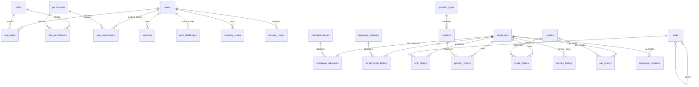

### 5.2 Governance dan import

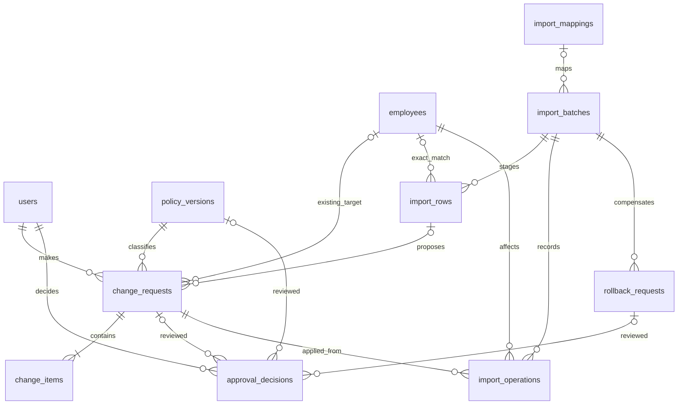

### 5.3 Rules, hasil, dan publikasi

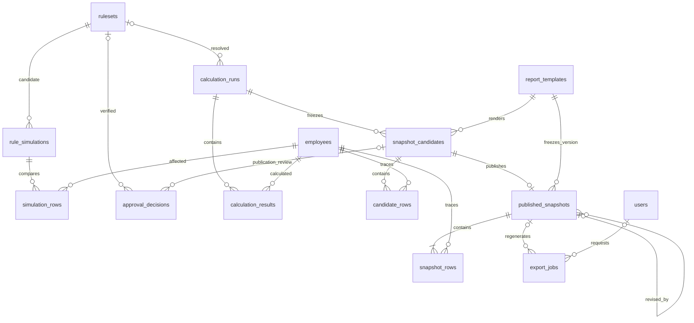

### 5.4 Quality, notification, dan operasi

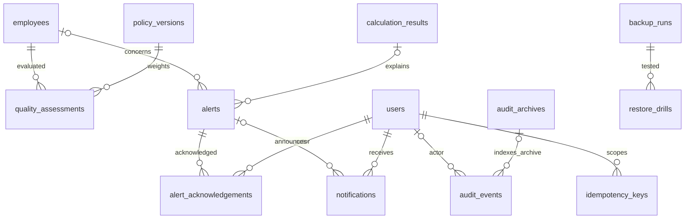

Relasi lintas diagram tetap merupakan relasi yang sama. `system_settings`, `system_revisions`, `outbox_events`, serta tabel driver queue/cache berdiri sebagai infrastruktur; payload event merujuk ID untuk penelusuran, tidak menjadi sumber relasi official.

## 6. Data dictionary, constraint, dan index

### 6.1 Konvensi yang berlaku untuk seluruh tabel

Notasi `field:type` berarti NOT NULL kecuali bertanda `?`. `→ table` adalah FK ke `table.id`. `UQ(a,b)` adalah unique constraint, `IX(a,b)` adalah index B-tree. Semua FK diindeks kecuali sudah menjadi awalan PK/unique index yang sesuai. FK domain menggunakan `ON DELETE RESTRICT`; official data, akun, ruleset, dan referensi tidak dihapus secara fisik. Penghapusan tabel sementara menggunakan service retensi khusus.

Paket kolom berikut **merupakan bagian fisik tabel** ketika disebut pada baris kamus:

- **B**: `id:uuid PK`, `created_at:timestamptz`, `updated_at:timestamptz`.
- **A**: `id:uuid PK`, `created_at:timestamptz`; append-only, tanpa `updated_at`.
- **R**: B + `code:varchar(50) UQ`, `name:varchar(200)`, `is_active:boolean=true`, `lock_version:bigint=1`.
- **H**: B + `employee_id:uuid → employees`, `effective_from:date`, `record_state:varchar(16)`, `replaces_id:uuid? → tabel histori yang sama`, `source_request_id:uuid → change_requests`, `created_by:uuid → users`, `approved_by:uuid → users`, `approved_at:timestamptz`, `decision_number:varchar(150)?`, `decision_date:date?`, `state_changed_at:timestamptz?`, `state_changed_by:uuid? → users`, `state_reason:text?`.

H memakai `record_state ∈ {VALID,CANCELLED,REPLACED}`, `UQ(employee_id,effective_from) WHERE record_state='VALID'`, `IX(employee_id,effective_from DESC) WHERE record_state='VALID'`, serta `UQ(replaces_id) WHERE replaces_id IS NOT NULL`. Semua histori berasal dari proposal yang sudah diterapkan; FK melingkar pegawai baru/proposal diselesaikan dalam satu transaksi dengan FK deferrable bila diperlukan. `replaces_id` harus milik pegawai yang sama, diperiksa service dan constraint trigger.

JSONB dipakai hanya untuk konfigurasi versioned, payload proposal/diff, hasil kalkulasi, dan snapshot. Identitas, referensi, kontrak, dan fakta resmi utama tetap kolom relasional. Setiap JSONB memiliki `schema_version` pada payload atau pemiliknya, validator server, allowlist field, dan batas ukuran. JSON `null` berbeda dari field yang tidak dikirim.

### 6.2 Identity dan authorization

| Tabel | Kolom | Constraint/index dan makna |
|---|---|---|
| `users` | B; `username:varchar(80)`, `email:varchar(254)`, `display_name:varchar(200)`, `password_hash:text`, `status:varchar(16)`, `must_change_password:boolean`, `totp_secret_ciphertext:text?`, `totp_key_id:varchar(50)?`, `totp_confirmed_at:timestamptz?`, `last_totp_step:bigint?`, `security_version:bigint=1`, `password_changed_at:timestamptz?`, `disabled_at:timestamptz?`, `disabled_by:uuid? → users` | UQ lower(username); UQ lower(email); ACTIVE/DISABLED/INVITED. Username tidak boleh mengandung `@` agar identifier login tidak ambigu. Tidak memiliki NIP sebagai kredensial atau FK wajib ke pegawai |
| `roles` | R; `is_system:boolean` | Code SUPER_ADMIN, ADMIN_KEPEGAWAIAN, PIMPINAN; public bukan akun/role tersimpan |
| `permissions` | A; `code:varchar(100) UQ`, `description:text`, `category:varchar(50)` | Katalog permission dikelola code migration |
| `user_roles` | `user_id:uuid → users`, `role_id:uuid → roles`, `granted_by:uuid → users`, `created_at:timestamptz` | PK(user_id,role_id); IX(role_id,user_id) |
| `role_permissions` | `role_id:uuid → roles`, `permission_id:uuid → permissions`, `created_at:timestamptz` | PK(role_id,permission_id) |
| `user_permissions` | `user_id:uuid → users`, `permission_id:uuid → permissions`, `granted_by:uuid → users`, `created_at:timestamptz` | PK(user_id,permission_id); grant tambahan untuk verifier/publisher, tanpa wildcard |
| `sessions` | `id:varchar(255) PK`, `user_id:uuid? → users`, `payload:text`, `ip_address:inet?`, `user_agent:text?`, `last_activity:bigint`, `security_version:bigint`, `authenticated_at:timestamptz?`, `reauthenticated_at:timestamptz?`, `absolute_expires_at:timestamptz` | Bentuk driver session disesuaikan Laravel; payload dilindungi; IX(user_id), IX(last_activity); pre-auth tidak mempunyai hak internal |
| `auth_challenges` | B; `user_id:uuid → users`, `token_hash:char(64) UQ`, `purpose:varchar(30)`, `attempt_count:smallint`, `expires_at:timestamptz`, `consumed_at:timestamptz?`, `session_binding_hash:char(64)` | PASSWORD_VERIFIED/TOTP_ENROLL/REAUTH; IX(expires_at); konsumsi atomik |
| `recovery_codes` | A; `user_id:uuid → users`, `generation:integer`, `code_hash:text`, `used_at:timestamptz?`, `revoked_at:timestamptz?` | IX(user_id,generation); hanya metadata pemakaian/pencabutan yang boleh berubah |
| `security_resets` | B; `user_id:uuid → users`, `requested_by:uuid → users`, `kind:varchar(20)`, `token_hash:char(64)?`, `identity_verification_note:text`, `expires_at:timestamptz?`, `consumed_at:timestamptz?`, `revoked_at:timestamptz?` | PASSWORD/TOTP; hash token reset password unik jika ada; tidak menyimpan jawaban keamanan atau salinan identitas |

### 6.3 Master reference

| Tabel | Kolom | Constraint/index dan makna |
|---|---|---|
| `units` | R; `parent_id:uuid? → units` | CHECK parent_id ≠ id; service mencegah siklus hierarki |
| `position_types` | R; `public_group_code:varchar(50)` | Klasifikasi jabatan resmi diverifikasi instansi |
| `positions` | R; `position_type_id:uuid → position_types` | Tidak menyimpan urutan DUK di tabel ini |
| `grades` | R; `asn_type:varchar(4)`, `rank_name:varchar(150)?`, `group_label:varchar(50)` | asn_type PNS/PPPK; pangkat PNS dan golongan PPPK dipisah melalui tipe; ordering berada di ruleset |
| `education_levels` | R; `public_group_code:varchar(50)` | Label jenjang, bukan formula otomatis prioritas DUK |
| `employee_statuses` | R; `counts_as_active:boolean`, `requires_end_reason:boolean=false` | Baseline kode ACTIVE, RETIRED, TRANSFERRED_OUT, DECEASED, RESIGNED, STUDY_ASSIGNMENT; klasifikasi Tugas Belajar perlu verifikasi K-03 |

Kode referensi tidak digunakan ulang. Referensi yang telah dipakai tidak dihapus; dapat dinonaktifkan untuk pilihan baru. Koreksi label dicatat pada audit. Perubahan kategori, hierarki, dan `counts_as_active` diperlakukan kritis melalui proposal policy/reference dan simulasi dampak. Untuk MVP, perubahan referensi kritis dapat memakai `policy_versions(kind=REFERENCE_CHANGE)` dengan payload daftar perubahan terstruktur dan FK target divalidasi service saat approval. Snapshot tetap menyimpan label pada saat terbit.

### 6.4 Pegawai dan histori

| Tabel | Kolom | Constraint/index dan makna |
|---|---|---|
| `employees` | B; `nip:varchar(18)`, `full_name:varchar(250)`, `gender_code:varchar(20)?`, `birth_place:varchar(150)?`, `birth_date:date?`, `drive_folder_url:text?`, `verified_at:timestamptz`, `verified_by:uuid → users`, `origin_request_id:uuid → change_requests`, `lock_version:bigint=1`, `record_state:varchar(16)=VALID`, `withdrawn_at:timestamptz?`, `withdrawal_reason:text?` | UQ(nip), CHECK nip sesuai 18 digit ASCII sebagai baseline format; exact value disimpan string. `WITHDRAWN` hanya untuk penarikan record keliru/rollback, bukan pensiun. IX(full_name) atau GIN trigram untuk search. Nama termasuk gelar satu field |
| `employee_education` | B; `employee_id:uuid → employees`, `education_level_id:uuid? → education_levels`, `selection_basis:varchar(12)`, `major:varchar(200)?`, `institution:varchar(200)?`, `graduation_year:smallint?`, `source_request_id:uuid → change_requests` | UQ(employee_id); selection_basis HIGHEST/LATEST, pilihan organisasi K-04; CHECK tahun 1900–9999, validasi tahun tidak melebihi tahun saat input. Tidak membangun histori pendidikan penuh |
| `employment_history` | H; `asn_type:varchar(4)`, `pppk_category:varchar(12)?`, `status_id:uuid → employee_statuses`, `status_reason:text?` | CHECK PNS ⇒ kategori NULL; PPPK ⇒ FULL_TIME/PART_TIME. Resolver menentukan jenis, kategori, dan status per tanggal |
| `unit_history` | H; `unit_id:uuid → units` | Satu unit utama per pegawai pada satu tanggal untuk MVP |
| `position_history` | H; `position_id:uuid → positions` | Satu jabatan utama; rangkap jabatan belum dimodelkan sebagai kebutuhan MVP |
| `grade_history` | H; `grade_id:uuid → grades`, `promotion_basis_date:date?`, `promotion_scheme_code:varchar(50)?` | Grade harus konsisten dengan jenis ASN pada tanggal efektif; basis KP hanya bila ada bukti, tidak otomatis dianggap = TMT pangkat |
| `service_history` | H; `cpns_tmt:date?`, `pns_tmt:date?`, `pppk_tmt:date?`, `recognized_service_months:integer?`, `recognized_service_extra_days:smallint?`, `service_reference_date:date?` | Basis masa kerja yang diakui; month ≥ 0, extra_days 0–30; nilai numerik dan tanggal referensi harus berpasangan. Formula pemakaian ditentukan ruleset |
| `pay_history` | H; `last_kgb_tmt:date?`, `salary_grade_id:uuid? → grades`, `recognized_pay_service_months:integer?`, `recognized_pay_service_extra_days:smallint?`, `pay_service_reference_date:date?`, `pay_scheme_code:varchar(50)?` | Data dasar KGB, bukan payroll; tidak menyimpan nominal gaji yang belum diperlukan. months ≥ 0, extra_days 0–30; validasi pasangan basis |
| `employee_contracts` | H; `contract_start:date`, `contract_end:date`, `period_number:integer?`, `contract_status:varchar(20)`, `agreement_number:varchar(150)?` | CHECK end ≥ start; CHECK effective_from = contract_start; period_number > 0 jika ada; PLANNED/ACTIVE/ENDED/TERMINATED adalah status administratif, kondisi berjalan juga memeriksa tanggal |

Kontrak VALID tidak boleh beririsan untuk pegawai yang sama, memakai exclusion constraint rentang tanggal `[start,end+1)` dengan `btree_gist`, atau constraint trigger terkunci bila extension tidak tersedia. Pengakhiran/koreksi kontrak membuat record pengganti; kontrak lama tidak ditimpa. TMT PPPK tersimpan pada service history, tidak disalin ke setiap kontrak. Riwayat PNS → PPPK hanya diterima jika dokumen dan verifikasi mendukung; tidak diputuskan dari pola NIP.

Validasi lintas tabel (jenis ASN vs grade, overlap kontrak, urutan TMT CPNS/PNS, domain referensi) dijalankan saat submit dan saat apply. Tidak menggunakan CHECK SQL yang membaca baris tabel lain. PostgreSQL menyediakan FK, unique/partial index dan exclusion constraint sebagai lapisan integritas; constraint lintas baris tertentu membutuhkan trigger atau transaksi terkunci. [PostgreSQL — Constraints](https://www.postgresql.org/docs/current/ddl-constraints.html).

### 6.5 Governance dan import

| Tabel | Kolom | Constraint/index dan makna |
|---|---|---|
| `policy_versions` | B; `kind:varchar(30)`, `version:integer`, `effective_from:date`, `status:varchar(24)`, `schema_version:integer`, `payload:jsonb`, `payload_hash:char(64)`, `impact_summary:jsonb?`, `maker_id:uuid → users`, `approved_by:uuid? → users`, `approved_at:timestamptz?`, `notes:text?` | UQ(kind,version); CRITICAL_FIELDS/COMPLETENESS/PRIVACY/ALERT_THRESHOLDS/REFERENCE_CHANGE/DEACTIVATE_RULESET. Payload immutable setelah submit; state menurut jenis policy pada §6.10 |
| `change_requests` | B; `employee_id:uuid? → employees`, `proposed_employee_id:uuid?`, `maker_id:uuid → users`, `import_row_id:uuid? → import_rows`, `policy_id:uuid → policy_versions`, `operation:varchar(24)`, `status:varchar(24)`, `base_version:bigint?`, `schema_version:integer`, `payload:jsonb`, `payload_hash:char(64)`, `impact_summary:jsonb`, `reason:text`, `supersedes_request_id:uuid? → change_requests`, `submitted_at:timestamptz?`, `applied_at:timestamptz?` | CREATE: reserved UUID wajib; UPDATE: employee_id wajib. Proposed UUID hanya reservasi, bukan FK sebelum apply; UQ untuk CREATE aktif. IX(status,created_at); satu pending request per pegawai, termasuk reservasi NIP yang diserialkan pada apply |
| `change_items` | A; `request_id:uuid → change_requests`, `domain:varchar(50)`, `field_path:varchar(150)`, `target_record_id:uuid?`, `before_value:jsonb`, `after_value:jsonb`, `is_critical:boolean`, `critical_reason:text?` | UQ(request_id,domain,field_path,target_record_id) dengan null disetarakan melalui index ekspresi; target_record_id bertipe menurut domain, validasi service. Payload request menjadi sumber command; items adalah diff audit/preview |
| `approval_decisions` | A; `request_id:uuid? → change_requests`, `ruleset_id:uuid? → rulesets`, `candidate_id:uuid? → snapshot_candidates`, `policy_id:uuid? → policy_versions`, `rollback_id:uuid? → rollback_requests`, `actor_id:uuid → users`, `decision:varchar(16)`, `reviewed_hash:char(64)`, `reviewed_revision:bigint?`, `reason:text?` | CHECK tepat satu target non-NULL; APPROVE/REJECT. Satu keputusan final per target versi; IX tiap target dan actor. Actor ≠ maker ditegakkan action terkunci dan trigger untuk approved state |
| `import_mappings` | B; `name:varchar(150)`, `version:integer`, `schema_version:integer`, `mapping:jsonb`, `created_by:uuid → users`, `is_active:boolean` | UQ(name,version); mapping yang pernah dipakai immutable; batch juga menyimpan salinan |
| `import_batches` | B; `uploaded_by:uuid → users`, `original_filename:varchar(255)`, `source_sha256:char(64)`, `private_storage_key:text?`, `source_size:bigint`, `source_expires_at:timestamptz`, `source_deleted_at:timestamptz?`, `mapping_id:uuid? → import_mappings`, `mapping_snapshot:jsonb?`, `status:varchar(30)`, `row_counts:jsonb`, `duplicate_of_id:uuid? → import_batches`, `duplicate_confirmed_by:uuid? → users`, `duplicate_confirmed_at:timestamptz?`, `preview_hash:char(64)?`, `confirmed_at:timestamptz?`, `completed_at:timestamptz?` | IX(source_sha256), IX(status), IX(source_expires_at). Hash tidak unique karena reimport boleh setelah konfirmasi |
| `import_rows` | B; `batch_id:uuid → import_batches`, `sheet_name:varchar(150)`, `row_number:integer`, `nip_raw:varchar(100)?`, `nip_normalized:varchar(18)?`, `employee_id:uuid? → employees`, `normalized_payload:jsonb`, `validation_errors:jsonb`, `diff:jsonb`, `reconciliation_decision:jsonb?`, `reconciled_by:uuid? → users`, `reconciled_at:timestamptz?`, `base_version:bigint?`, `status:varchar(30)` | UQ(batch_id,sheet_name,row_number); IX(batch_id,status); raw hanya kolom yang dipetakan, bukan salinan semua data sensitif Excel |
| `import_operations` | A; `batch_id:uuid → import_batches`, `row_id:uuid → import_rows`, `employee_id:uuid → employees`, `request_id:uuid → change_requests`, `before_state:jsonb`, `after_state:jsonb`, `before_version:bigint?`, `after_version:bigint`, `affected_record_ids:jsonb` | UQ(request_id); before/after cukup untuk kompensasi, termasuk status histori |
| `rollback_requests` | B; `batch_id:uuid → import_batches`, `maker_id:uuid → users`, `status:varchar(24)`, `reason:text`, `impact:jsonb`, `plan:jsonb`, `plan_hash:char(64)`, `base_revision:bigint`, `compensation_request_ids:jsonb?`, `applied_at:timestamptz?` | IX(batch_id,status); satu rollback aktif per batch. Plan immutable sesudah submit |

`target_record_id` pada diff tidak menjadi relasi penyimpanan resmi yang dapat ditulis bebas. Semua operasi dipetakan ke DTO bertipe, menegakkan employee ownership dan FK tabel domain. `compensation_request_ids` merupakan indeks penelusuran; relasi nyata dikembalikan melalui audit dan request terkait, bukan pengganti constraint official.

### 6.6 Rules, calculation, snapshot, dan export

| Tabel | Kolom | Constraint/index dan makna |
|---|---|---|
| `rulesets` | B; `kind:varchar(10)`, `scope_code:varchar(50)`, `version:integer`, `effective_from:date`, `status:varchar(24)`, `regulation_name:text`, `regulation_number:varchar(200)`, `regulation_reference:text`, `schema_version:integer`, `parameters:jsonb`, `parameters_hash:char(64)`, `engine_version:varchar(50)`, `maker_id:uuid → users`, `approved_by:uuid? → users`, `approved_at:timestamptz?`, `verification_note:text?`, `supersedes_id:uuid? → rulesets` | kind DUK/KP/KGB; UQ(kind,scope_code,version); unique accepted effective_from per kind/scope; IX(kind,scope_code,effective_from DESC). Dasar regulasi wajib sebelum submit |
| `rule_simulations` | B; `candidate_ruleset_id:uuid → rulesets`, `baseline_ruleset_id:uuid? → rulesets`, `as_of:date`, `data_revision:bigint`, `candidate_hash:char(64)`, `input_hash:char(64)`, `status:varchar(20)`, `summary:jsonb`, `requested_by:uuid → users`, `finished_at:timestamptz?` | IX(candidate_ruleset_id,created_at); hasil hanya valid untuk revision/hash yang diuji |
| `simulation_rows` | A; `simulation_id:uuid → rule_simulations`, `employee_id:uuid → employees`, `old_result:jsonb`, `new_result:jsonb`, `change_reasons:jsonb` | UQ(simulation_id,employee_id) |
| `calculation_runs` | B; `kind:varchar(10)`, `scope_code:varchar(50)`, `as_of:date`, `ruleset_id:uuid? → rulesets`, `engine_version:varchar(50)`, `data_revision:bigint`, `input_hash:char(64)`, `dedupe_key:char(64) UQ`, `status:varchar(30)`, `started_at:timestamptz?`, `finished_at:timestamptz?`, `error_code:varchar(80)?` | IX(kind,as_of,data_revision); ruleset boleh NULL hanya hasil blocked |
| `calculation_results` | A; `run_id:uuid → calculation_runs`, `employee_id:uuid → employees`, `status:varchar(30)`, `due_date:date?`, `urgency:varchar(16)?`, `official_order:integer?`, `result:jsonb`, `explanation:jsonb`, `source_values:jsonb`, `source_record_ids:jsonb` | UQ(run_id,employee_id); IX(run_id,urgency,due_date). Payload immutable setelah run selesai |
| `report_templates` | A; `code:varchar(80)`, `version:integer`, `title:varchar(250)`, `schema_version:integer`, `render_spec:jsonb`, `renderer_version:varchar(80)`, `assets_manifest:jsonb`, `content_hash:char(64)` | UQ(code,version); template immutable, asset font/logo tetap tersedia untuk regenerasi |
| `snapshot_candidates` | B; `run_id:uuid → calculation_runs`, `template_id:uuid → report_templates`, `kind:varchar(20)`, `scope_code:varchar(50)`, `as_of:date`, `data_revision:bigint`, `status:varchar(24)`, `maker_id:uuid → users`, `previous_snapshot_id:uuid? → published_snapshots`, `revision_reason:text?`, `publication_note:text?`, `validation_summary:jsonb`, `ruleset_snapshot:jsonb`, `reference_snapshot:jsonb`, `institution_snapshot:jsonb`, `content_hash:char(64)`, `row_count:integer` | Candidate payload/rows immutable setelah submit; stale ⇒ kandidat baru, bukan edit |
| `candidate_rows` | A; `candidate_id:uuid → snapshot_candidates`, `employee_id:uuid → employees`, `row_number:integer`, `official_order:integer`, `data:jsonb`, `explanation:jsonb` | UQ(candidate_id,row_number); UQ(candidate_id,employee_id) |
| `published_snapshots` | A; `candidate_id:uuid → snapshot_candidates UQ`, `previous_snapshot_id:uuid? → published_snapshots`, `series_id:uuid`, `revision_number:integer`, `kind:varchar(20)`, `scope_code:varchar(50)`, `as_of:date`, `data_revision:bigint`, `template_id:uuid → report_templates`, `maker_id:uuid → users`, `publisher_id:uuid → users`, `published_at:timestamptz`, `publication_note:text?`, `revision_reason:text?`, `ruleset_snapshot:jsonb`, `reference_snapshot:jsonb`, `institution_snapshot:jsonb`, `validation_summary:jsonb`, `content_hash:char(64)`, `row_count:integer` | UQ(series_id,revision_number); maker ≠ publisher; revisi > 0 wajib previous dan alasan; immutable seluruh kolom; satu root series per kind/scope/as_of |
| `snapshot_rows` | A; `snapshot_id:uuid → published_snapshots`, `employee_id:uuid → employees`, `row_number:integer`, `official_order:integer`, `data:jsonb`, `explanation:jsonb` | UQ(snapshot_id,row_number); UQ(snapshot_id,employee_id); immutable; employee_id hanya trace, rendering membaca data salinan |
| `export_jobs` | B; `requested_by:uuid? → users`, `audience:varchar(10)`, `format:varchar(4)`, `report_kind:varchar(50)`, `snapshot_id:uuid? → published_snapshots`, `template_id:uuid → report_templates`, `as_of:date`, `filters:jsonb`, `authorized_fields:jsonb`, `security_version:bigint?`, `data_revision:bigint`, `privacy_policy_id:uuid? → policy_versions`, `request_metadata:jsonb`, `temporary_input_key:text?`, `status:varchar(20)`, `private_storage_key:text?`, `download_token_hash:char(64)?`, `expires_at:timestamptz`, `file_deleted_at:timestamptz?`, `error_code:varchar(80)?` | Public hanya PDF; INTERNAL wajib requested_by; IX(status,created_at), IX(expires_at); signatory manual per request ada di metadata, tidak menjadi master penandatangan |

Export operasional membekukan input sementara saat transaksi pembacaan agar file konsisten. Input/file sementara dihapus sesuai TTL; metadata cukup untuk audit, bukan janji regenerasi export live identik. Hanya published snapshot menjamin reproduksi isi data resmi. Export tidak menyimpan daftar pegawai permanen kedua.

### 6.7 Quality, alerts, dan audit

| Tabel | Kolom | Constraint/index dan makna |
|---|---|---|
| `quality_assessments` | B; `employee_id:uuid → employees`, `policy_id:uuid → policy_versions`, `as_of:date`, `employee_version:bigint`, `data_revision:bigint`, `score:numeric(5,2)?`, `missing_fields:jsonb`, `invalid_fields:jsonb`, `calculation_blocks:jsonb` | UQ(employee_id,policy_id,as_of,data_revision); score 0–100; derived, boleh diregenerasi |
| `alerts` | B; `employee_id:uuid? → employees`, `calculation_result_id:uuid? → calculation_results`, `kind:varchar(30)`, `logical_key:varchar(200) UQ`, `status:varchar(16)`, `urgency:varchar(16)`, `deadline:date?`, `generation:integer`, `escalation_version:integer`, `title:varchar(250)`, `detail:jsonb`, `resolved_at:timestamptz?` | OPEN/RESOLVED; IX(status,urgency,deadline); logical_key stabil per pegawai/jenis/kejadian |
| `alert_acknowledgements` | A; `alert_id:uuid → alerts`, `actor_id:uuid → users`, `generation:integer`, `escalation_version:integer`, `acknowledged_at:timestamptz` | UQ(alert_id,generation,escalation_version); acknowledgement bersama tim, actor dapat ditelusuri |
| `notifications` | B; `user_id:uuid → users`, `alert_id:uuid? → alerts`, `dedupe_key:varchar(200)`, `category:varchar(30)`, `payload:jsonb`, `read_at:timestamptz?` | UQ(user_id,dedupe_key); IX(user_id,read_at,created_at); payload minimum, detail diambil ulang melalui policy |
| `audit_events` | A; `event_sequence:bigint GENERATED`, `actor_id:uuid? → users`, `actor_snapshot:jsonb`, `category:varchar(20)`, `action:varchar(80)`, `object_type:varchar(60)`, `object_id:uuid?`, `request_id:uuid?`, `correlation_id:uuid`, `before_data:jsonb?`, `after_data:jsonb?`, `metadata:jsonb`, `ip_address:inet?`, `user_agent:text?`, `retention_class:varchar(20)`, `event_hash:char(64)`, `previous_hash:char(64)?`, `archive_id:uuid? → audit_archives` | UQ(event_sequence); IX(object_type,object_id,created_at), IX(actor_id,created_at), IX(category,created_at). Object polymorphic adalah trace, tidak dipakai untuk mengubah domain |
| `audit_archives` | A; `period_start:timestamptz`, `period_end:timestamptz`, `event_count:bigint`, `first_sequence:bigint`, `last_sequence:bigint`, `encrypted_storage_key:text`, `sha256:char(64)`, `key_id:varchar(80)`, `verified_at:timestamptz` | Arsip audit penting retensi sepanjang umur sistem; manifest juga disalin off-server |

Audit merupakan append-only, kecuali proses pengarsipan berwenang dapat menambahkan pointer arsip atau memindahkan partisi yang telah diverifikasi. Kolom before/after bukan log password/TOTP/token. IP/user agent hanya diakses sesuai kategori audit; batas panjang dan sanitasi tetap diterapkan.

### 6.8 Tabel infrastruktur

| Tabel | Kolom | Constraint/index dan makna |
|---|---|---|
| `system_settings` | B; `key:varchar(100) UQ`, `value:jsonb`, `schema_version:integer`, `updated_by:uuid → users`, `lock_version:bigint` | Nama instansi, timezone, email teknis, TTL, maintenance; tidak untuk secret atau formula ruleset |
| `system_revisions` | `id:smallint PK`, `data_revision:bigint`, `updated_at:timestamptz` | CHECK id=1; satu revision seluruh official dataset/config hasil |
| `outbox_events` | B; `event_type:varchar(100)`, `aggregate_id:uuid?`, `dedupe_key:varchar(200) UQ`, `payload:jsonb`, `available_at:timestamptz`, `status:varchar(16)`, `attempts:integer`, `locked_until:timestamptz?`, `processed_at:timestamptz?`, `last_error:text?` | IX(status,available_at); PENDING/PROCESSING/DONE/FAILED |
| `jobs` | `id:bigint PK`, `queue:varchar(255)`, `payload:text`, `attempts:smallint`, `reserved_at:bigint?`, `available_at:bigint`, `created_at:bigint` | Tabel driver queue Laravel; IX(queue,reserved_at,available_at); payload hanya ID, bukan PII penuh |
| `failed_jobs` | `id:bigint PK`, `uuid:varchar(255) UQ`, `connection:text`, `queue:text`, `payload:text`, `exception:text`, `failed_at:timestamptz` | Driver Laravel; exception harus disanitasi sebelum persist |
| `cache` | `key:varchar(255) PK`, `value:text`, `expiration:bigint` | Cache driver database; data turunan, retensi TTL |
| `cache_locks` | `key:varchar(255) PK`, `owner:varchar(255)`, `expiration:bigint` | Lock driver; tidak menggantikan row lock transaksi official |
| `idempotency_keys` | B; `user_id:uuid → users`, `route:varchar(150)`, `key:varchar(150)`, `request_hash:char(64)`, `resource_type:varchar(50)?`, `resource_id:uuid?`, `status_code:smallint?`, `expires_at:timestamptz` | UQ(user_id,route,key); replay beda payload ⇒ 409; respons direkonstruksi setelah policy check |
| `backup_runs` | B; `started_at:timestamptz`, `snapshot_at:timestamptz`, `finished_at:timestamptz?`, `status:varchar(20)`, `local_key:text?`, `remote_key:text?`, `sha256:char(64)?`, `encryption_key_id:varchar(80)`, `size_bytes:bigint?`, `retention_class:varchar(20)`, `release_version:varchar(100)`, `schema_version:varchar(100)`, `remote_verified_at:timestamptz?`, `error_summary:text?` | IX(status,snapshot_at); dianggap berhasil off-server hanya setelah verifikasi remote |
| `restore_drills` | B; `backup_id:uuid → backup_runs`, `started_at:timestamptz`, `finished_at:timestamptz?`, `environment_reference:varchar(200)`, `executed_by:varchar(200)`, `status:varchar(20)`, `checks:jsonb`, `issues:text?`, `follow_up:text?`, `rto_minutes:integer?` | Catatan bukti pemulihan dan tindak lanjut |

Tabel driver memakai tipe ID yang diwajibkan library sebagai pengecualian teknis UUID domain. Tidak terekspos sebagai identitas pegawai/akun. Migrasi driver harus dibandingkan dengan versi framework yang akhirnya dikunci.

### 6.9 Constraint lintas modul dan indexing tambahan

- Tidak boleh menonaktifkan/mencabut role hingga tersisa kurang dari dua Super Admin ACTIVE yang telah menyelesaikan setup keamanan. Transaksi perubahan akun mengunci invariant bersama; pengecualian hanya bootstrap/break-glass yang diaudit.
- Semua approval menolak maker sebagai checker, termasuk Super Admin. Permission tidak meniadakan invariant ini.
- `official_order > 0`; hasil blocked tidak memiliki due_date atau official_order buatan. Nilai kosong harus memiliki alasan.
- Histori official, published tables, template terpakai, dan ruleset yang telah diajukan dibatasi UPDATE/DELETE melalui privilege dan trigger. Perubahan state menggunakan jalur yang diizinkan, bukan update massal.
- NIP unik lintas seluruh record termasuk nonaktif/withdrawn. Pegawai yang sama dikembalikan melalui reaktivasi UUID lama, bukan membuat identitas kedua.
- Pencarian nama dapat menggunakan `pg_trgm`; NIP exact memakai unique B-tree, NIP prefix memakai index pattern, substring memakai trigram setelah profiling. Query selalu parameterized.
- Tambahkan index `effective_from` untuk pemindaian aktivasi harian; `status,created_at` untuk approval/jobs; deadline untuk radar. Tidak menambah index JSONB tanpa query yang membutuhkannya.
- Delete fisik hanya untuk file sementara, sesi kedaluwarsa, challenge, cache, queue selesai, dan log rutin sesuai retensi. Penghapusan record temporary yang relevan dicatat sebagai metadata, bukan seluruh isinya.

### 6.10 Enum dan state penyimpanan

Enum stabil diwujudkan sebagai enum aplikasi bertipe dan CHECK database; daftar referensi organisasi tetap tabel master agar dapat dikonfigurasi. Label tampilan tidak menjadi nilai penyimpanan. Status teknis yang belum disebut pada kamus dirinci berikut agar implementasi tidak menambah state tanpa kontrak.

| Pemilik field | Nilai yang diperbolehkan |
|---|---|
| users.status | INVITED, ACTIVE, DISABLED |
| employees.record_state | VALID, WITHDRAWN |
| employees.gender_code | MALE, FEMALE; NULL berarti belum diketahui, bukan kategori yang diasumsikan |
| change_requests.operation | CREATE, UPDATE, WITHDRAW, REACTIVATE, COMPENSATE; aksi histori berada dalam payload bertipe |
| change_requests.status | DRAFT, PENDING_APPROVAL, APPLIED, REJECTED, STALE, CANCELLED |
| rulesets.status dan policy konfigurasi berkelanjutan | DRAFT, PENDING_APPROVAL, ACTIVE, SUPERSEDED, INACTIVE, REJECTED, STALE |
| policy aksi REFERENCE_CHANGE/DEACTIVATE_RULESET | DRAFT, PENDING_APPROVAL, APPLIED, REJECTED, STALE; tidak dipilih sebagai konfigurasi aktif berkelanjutan |
| rule_simulations.status | QUEUED, RUNNING, SUCCEEDED, FAILED, STALE |
| calculation_runs.status | QUEUED, RUNNING, SUCCEEDED, FAILED; SUCCEEDED dapat berisi hasil blocked yang sah |
| calculation_results.status | COMPUTED, DATA_INCOMPLETE, DATA_INVALID, RULESET_UNVERIFIED, RULESET_UNAVAILABLE, NOT_APPLICABLE, ERROR |
| snapshot_candidates.status | BUILDING, DRAFT, BLOCKED, PENDING_APPROVAL, PUBLISHED, REJECTED, STALE |
| export_jobs.status | QUEUED, RUNNING, READY, FAILED, EXPIRED, REVOKED |
| export_jobs.audience / format | INTERNAL atau PUBLIC; XLSX atau PDF; PUBLIC hanya PDF |
| alerts.urgency | CRITICAL, HIGH, MEDIUM, LOW |
| backup_runs.status | RUNNING, LOCAL_READY, REMOTE_VERIFIED, FAILED |
| restore_drills.status | RUNNING, SUCCEEDED, FAILED |
| audit_events.category | OPERATIONAL, SECURITY, SYSTEM |
| audit_events.retention_class | LIFETIME, ROUTINE |

State batch/baris/rollback mengikuti §9.2; transisi tidak valid ditolak. Policy aksi hanya berlaku sekali saat approval/apply; `effective_from` untuk aksi adalah tanggal perubahan yang diminta, dan perubahan masa depan wajib menggunakan mekanisme penjadwalan domain yang sesuai, bukan menganggap aksi sudah diterapkan. Baseline MVP membatasi aksi referensi/deaktivasi ruleset ke hari penerapan; konfigurasi berkelanjutan dapat memiliki tanggal masa depan. Penonaktifan konfigurasi yang menjadi prasyarat keamanan/hasil menimbulkan status unavailable, tidak kembali diam-diam ke konfigurasi lama.

## 7. Roles, permissions, dan critical fields

### 7.1 Matriks permission baseline

`Ya` berarti grant default; `Grant` berarti izin tambahan eksplisit oleh Super Admin; `Tidak` berarti tidak tersedia untuk role tersebut pada baseline. Super Admin tetap wajib mengikuti maker-checker, field restriction, dan re-authentication. Public tidak pernah memperoleh permission internal melalui role assignment.

| Permission / kemampuan | Super Admin | Admin Kepegawaian | Pimpinan | Publik |
|---|---|---|---|---|
| `dashboard.public.view`, PDF agregat | Ya | Ya | Ya | Ya |
| `dashboard.command.view` | Ya | Ya | Tidak | Tidak |
| `dashboard.executive.view` | Ya | Ya | Ya | Tidak |
| `personnel.view`, ASN 360, search | Ya | Ya | Ya, field terbatas | Tidak |
| `personnel.sensitive.view` | Ya | Ya | Tidak | Tidak |
| `personnel.drive.view` | Ya | Ya | Tidak | Tidak |
| `personnel.create`, `personnel.update` | Ya | Ya | Tidak | Tidak |
| `personnel.approve` | Ya | Grant | Tidak | Tidak |
| `references.view` | Ya | Ya | Terbatas untuk filter | Kode publik saja |
| `references.manage` | Ya | Grant | Tidak | Tidak |
| `imports.create`, `imports.review`, `imports.confirm` | Ya | Ya | Tidak | Tidak |
| `imports.rollback` | Ya | Tidak | Tidak | Tidak |
| `duk.view`, `calculation.explain` | Ya | Ya | Ya, field terbatas | Tidak |
| `duk.prepare`, `duk.submit` | Ya | Ya | Tidak | Tidak |
| `duk.publish` | Ya | Grant | Tidak | Tidak |
| `radar.view` | Ya | Ya | Ya, ringkasan | Tidak |
| `alerts.acknowledge` | Ya | Ya | Tidak | Tidak |
| `reports.export.operational` | Ya | Ya | Tidak | Tidak |
| `reports.export.official` | Ya | Ya | Grant, field terbatas | Tidak |
| `reports.export.sensitive` | Ya | Grant | Tidak | Tidak |
| `rules.view` | Ya | Ya | Ringkasan dasar yang diizinkan | Tidak |
| `rules.create`, `rules.simulate`, `rules.submit` | Ya | Tidak | Tidak | Tidak |
| `rules.approve`, `rules.activate` | Ya | Tidak | Tidak | Tidak |
| `policies.configure`, `policies.approve` | Ya | Tidak | Tidak | Tidak |
| `audit.operational.view` | Ya | Ya, relevan | Tidak | Tidak |
| `audit.security.view`, `audit.archive.view` | Ya | Tidak | Tidak | Tidak |
| `users.manage`, `permissions.manage`, `security.reset` | Ya | Tidak | Tidak | Tidak |
| `system.configure`, `maintenance.manage` | Ya | Tidak | Tidak | Tidak |

Admin mengelola seluruh pegawai dalam instansi, tanpa pembatasan unit. `Grant` tidak berarti checkbox boleh mengaktifkan kombinasi berbahaya secara bebas: server menolak pemberian permission security/rules/rollback kepada role selain Super Admin pada baseline. Role dan grant akun disimpan terpisah agar Admin tertentu dapat menjadi verifier tanpa memperluas izin seluruh Admin.

### 7.2 Field/category-level authorization

| Kategori | Contoh field | Admin/Super Admin | Pimpinan | Publik |
|---|---|---|---|---|
| Identitas operasional dasar | Nama lengkap, jenis ASN, unit, jabatan, pangkat/golongan, status | Lihat | Lihat | Tidak ada identitas |
| Identitas terbatas | NIP penuh, tempat/tanggal lahir | Lihat | NIP dimasking; tanggal/tempat lahir tidak dikirim | Tidak |
| Ringkasan pendidikan | Jenjang, jurusan, institusi, tahun | Lihat | Jenjang; detail lain tidak dikirim pada baseline | Hanya agregat jenjang |
| Dasar administrasi | Nomor SK/perjanjian, tanggal detail, data masa kerja | Lihat | Hasil ringkas yang relevan; payload mentah tidak dikirim | Tidak |
| Drive | URL folder | Lihat dengan permission | Tidak | Tidak |
| Quality/governance | Field belum lengkap, diff, pending proposal | Lihat sesuai fungsi | Hitungan/ringkasan attention saja | Tidak |
| Security | Hash password, secret TOTP, recovery hash | Tidak pernah lewat API biasa | Tidak | Tidak |

Matriks field merupakan baseline usulan K-02. Serializer internal tidak memakai `model.toArray()` umum; memilih field menurut role, kategori, tujuan, dan tipe response. Penerapan identik pada detail pegawai, search, explanation, audit, download, dan notifikasi. Pencarian berdasarkan NIP untuk Pimpinan tidak otomatis memberi hak melihat NIP lengkap; hasil tetap dimasking.

Hak export terpisah dari view, tetapi **tidak memperluas** field yang boleh dilihat. Daftar field export adalah irisan permission view, kategori field, template, dan permission export. Template resmi yang memerlukan field terlarang ditolak untuk pengguna tersebut; bukan mengisi field sensitif diam-diam. Pengguna lain yang berwenang dapat mengekspornya.

### 7.3 Critical-field matrix

Semua usulan di bawah disimpan sebagai versi konfigurasi `CRITICAL_FIELDS`. Baseline mengambil pendekatan konservatif karena field menentukan identitas, statistik, dan hasil resmi. Mengurangi daftar kritis membutuhkan maker-checker untuk perubahan policy.

| Field / operasi | Kritis baseline | Alasan dan analisis dampak minimum |
|---|---|---|
| Pegawai baru, termasuk import | Selalu | Identitas baru masuk jumlah ASN resmi |
| NIP | Ya | Duplikasi, matching import, penelusuran identitas; UUID tetap |
| Nama lengkap termasuk gelar | Tidak, kecuali proposal juga memuat perubahan kritis | Audit before/after; isi snapshot terbit tetap |
| Tanggal lahir | Ya | Usia dan kemungkinan tie-break perhitungan |
| Tempat lahir | Tidak | Audit dan validasi, tidak dihitung sebagai dasar usia |
| Jenis kelamin | Ya | Mengubah statistik resmi/publik |
| Jenis ASN, kategori PPPK | Ya | Scope ruleset, kelengkapan, jumlah kategori |
| Status, TMT status, aktif/nonaktif | Ya | Populasi dashboard, DUK, dan radar |
| Unit, jabatan, pangkat/golongan dan seluruh TMT | Ya | Effective truth, DUK, breakdown statistik |
| Jenjang dan tahun pendidikan | Ya | Statistik dan input ruleset bila diperlukan |
| Jurusan/institusi | Tidak secara baseline | Menjadi kritis otomatis jika dipakai ruleset aktif |
| Basis KP, basis KGB, masa kerja, TMT CPNS/PNS/PPPK | Ya | Hasil reminder, masa kerja, dan urutan |
| Kontrak PPPK: tanggal/periode/status | Ya | Konsistensi status kontrak dan basis administrasi |
| Nomor/tanggal SK atau nomor perjanjian saja | Tidak secara baseline | Audit; menjadi kritis jika mengubah pembuktian perubahan tertahan |
| URL folder Drive | Ya | Risiko pegawai ditautkan ke folder yang salah |
| Record retroaktif, pembatalan/penggantian histori | Selalu | Dampak lintas tanggal, rekap, radar, dan revisi laporan |
| Withdrawal/reactivation record keliru | Selalu | Mengubah populasi resmi tanpa menghapus jejak |
| Referensi yang mengubah klasifikasi/keaktifan | Ya | Dapat memengaruhi banyak pegawai sekaligus |
| Ruleset, privacy threshold, bobot quality, threshold alert | Ya | Perubahan hasil/perlindungan publik dan perilaku sistem |
| Publish/revisi DUK | Selalu | Pengaju berbeda dari publisher |
| Rollback import | Selalu pada desain ini | Kompensasi beberapa record; dua Super Admin berbeda |

Criticality adalah gabungan **field + operasi + tanggal + dependensi ruleset**. Pergantian nilai hari ini mungkin biasa, tetapi perubahan TMT masa lalu tetap kritis. Service menggunakan policy yang aktif saat apply; apabila policy berubah sejak submit, proposal ditandai STALE dan diklasifikasikan ulang. Status atau maker tidak pernah diterima sebagai nilai bebas dari client.

## 8. State machines dan workflow

### 8.1 Proposal pegawai

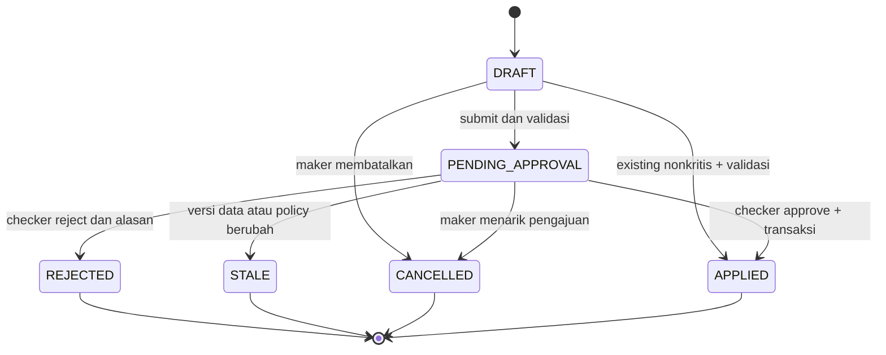

Perbaikan dari REJECTED/STALE membuat DRAFT baru dengan `supersedes_request_id`. Payload yang telah direview tidak diedit. “Approved” merupakan keputusan tersimpan; untuk perubahan pegawai tidak ada jeda APPROVED tanpa APPLIED, karena approval dan apply berlangsung satu transaksi. UI menggunakan label “Disetujui dan Diterapkan”. Future-effective yang disetujui sudah APPLIED tetapi belum menjadi fakta efektif hari ini.

### 8.2 Histori official

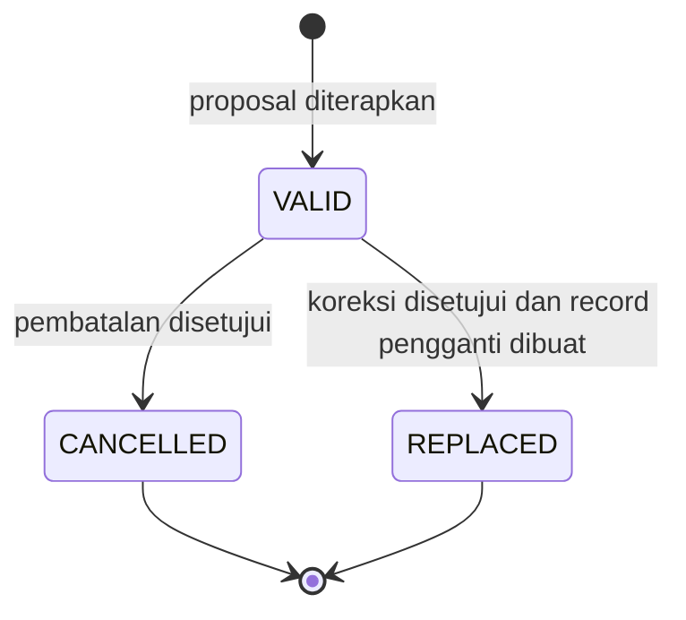

CURRENT/FUTURE/PAST adalah label turunan berdasarkan tanggal, bukan state yang harus diubah cron. Reactivation fakta yang dibatalkan membuat record baru, bukan menghapus histori pembatalan.

### 8.3 Ruleset dan policy

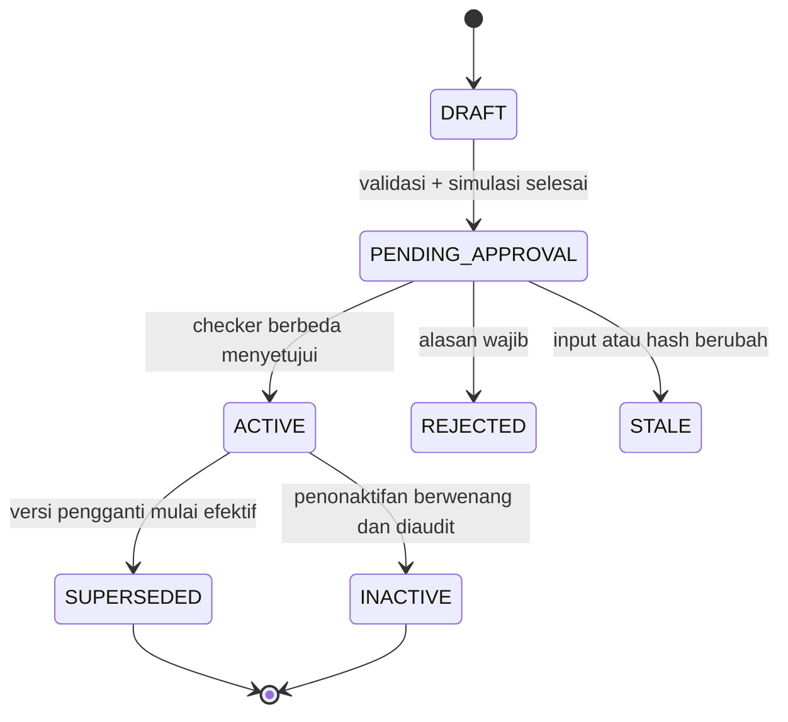

ACTIVE berarti terverifikasi dan tersedia untuk pemilihan, bukan pasti berlaku hari ini. Jika tanggal efektif masa depan, UI memberi sublabel “Terjadwal”. Versi lama tetap dipakai sampai tanggal tersebut. Resolver menentukan versi terakhir yang pernah disetujui dengan tanggal efektif terbesar ≤ tanggal acuan dalam scope yang tepat, termasuk melihat batas versi yang kini INACTIVE. Jika versi terpilih ACTIVE/SUPERSEDED, aturan dapat dievaluasi; jika INACTIVE, kalkulasi baru diblokir, bukan mundur otomatis ke versi sebelumnya. Snapshot lama tetap mengandung versi lama. Tidak boleh ada dua versi terverifikasi dengan kind/scope/TMT sama. Status administratif tidak menjadi satu-satunya dasar pemilihan aturan.

Penonaktifan aturan yang masih dipakai adalah perubahan kritis dengan alasan dan review dampak. Jika tidak ada aturan pengganti valid, hasil menjadi RULESET_UNVERIFIED atau RULESET_UNAVAILABLE, bukan kembali sembarang ke aturan yang tidak sesuai. Mengubah parameter memerlukan versi baru.

### 8.4 Publikasi DUK

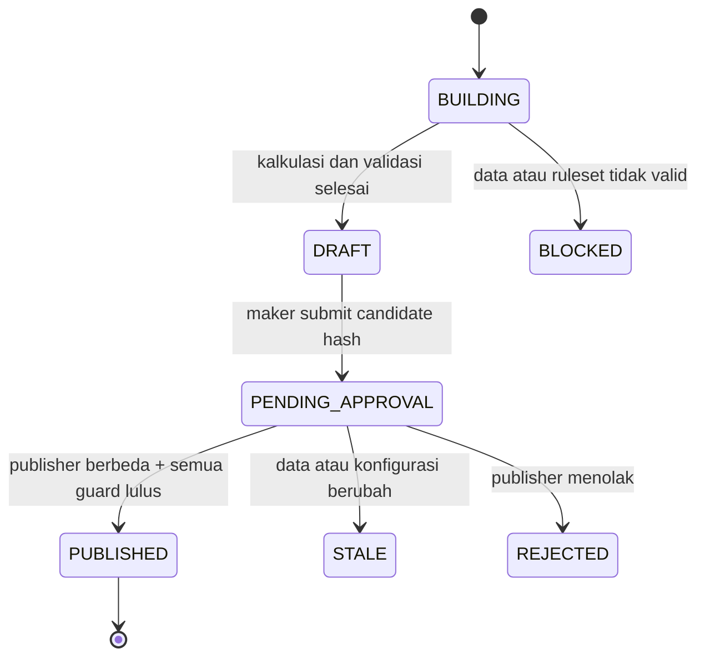

Revisi adalah candidate dan snapshot baru yang menaut ke snapshot sebelumnya. Tidak ada transisi yang mengubah snapshot PUBLISHED menjadi draft atau menimpa barisnya. Informasi “ada revisi baru” diturunkan dari relasi versi, tanpa mengubah isi terbit lama.

### 8.5 Alur persetujuan rinci

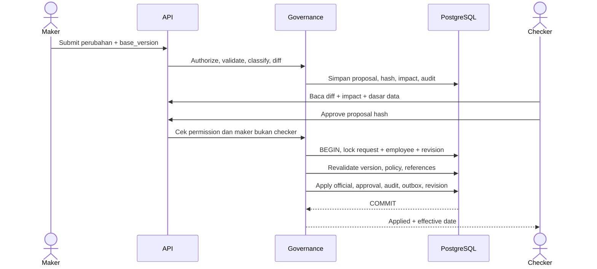

Jika salah satu guard gagal, tidak ada perubahan parsial. Checker tidak dapat mengedit payload sambil menyetujui; ia mengembalikan untuk diperbaiki. Aktivitas meninjau tidak mengubah kondisi official.

## 9. Import, migrasi, dan rollback

### 9.1 Pipeline import

1. **Upload:** authorize; batasi ukuran/tipe; simpan private; hitung SHA-256; tetapkan expiry 14 hari configurable. Filename asli hanya metadata, storage key acak.
2. **Duplicate check:** cari hash yang sama; tampilkan Batch ID, pelaku, tanggal, dan hasil batch terdahulu. Lanjut hanya setelah acknowledgement duplikasi eksplisit yang tercatat. Hash bukan pengganti idempotency transaksi.
3. **Mapping:** pilih sheet/header dan mapping versioned. Pengguna melihat contoh nilai; hanya kolom yang diperlukan diekstrak. Kolom tidak dipetakan tidak masuk staging persisten.
4. **Normalization:** trim whitespace luar; ubah tanggal Excel menurut date system workbook; pertahankan NIP sebagai string. Nilai numerik yang kehilangan digit/presisi tidak ditebak; masuk perbaikan manual.
5. **Validation:** field, referensi, NIP, duplikasi NIP dalam batch, tanggal, TMT, kategori ASN, kontrak, dan target histori. Referensi tidak dibuat otomatis dari typo.
6. **Matching:** hanya NIP exact setelah normalisasi aman. Tidak ada matching nama. NIP kosong/tidak valid menjadi NEEDS_REPAIR; konflik antar sumber menjadi NEEDS_RECONCILIATION.
7. **Diff:** current official → proposed untuk tiap field dan record histori. Blank dibedakan antara “tidak mengubah” (default) dan “kosongkan nilai” (opsi eksplisit per mapping/field); null wajib lulus validasi.
8. **Preview:** tampilkan ADD/UPDATE/NO_CHANGE/ERROR/PENDING_REQUIRED, critical reason, TMT, serta dampak DUK/radar/statistik. Current value diambil pada revision yang diketahui.
9. **Confirmation:** pengguna mengonfirmasi preview hash, pilihan baris valid, dan semua keputusan rekonsiliasi. Baris error tidak hilang diam-diam; tetap tercatat dan dapat diperbaiki.
10. **Apply:** existing nonkritis diterapkan; ADD dan baris kritis masuk proposal. Seluruh perubahan untuk satu pegawai tetap atomik dan tertahan bila ada perubahan kritis.
11. **Audit dan hasil:** simpan request, operation before/after, pelaku, keputusan, Batch ID, dan ringkasan status. Rekalkulasi dikirim melalui outbox setelah commit.

**Batas transaksi:** satu pegawai/satu proposal, bukan satu file besar sepanjang proses approval. Batch dapat memiliki sebagian baris APPLIED dan sebagian PENDING/INVALID; UI harus menyatakan status parsial dengan jelas. Ini merupakan keputusan desain untuk menafsirkan transactional import dalam PRD. Batch yang seluruhnya nonkritis tetap diproses per pegawai agar dapat dilanjutkan setelah crash tanpa menggandakan data.

### 9.2 State batch dan baris

| Entitas | State utama | Aturan |
|---|---|---|
| Batch | UPLOADED → MAPPING → VALIDATING → PREVIEW_READY → CONFIRMED → PROCESSING → COMPLETED / COMPLETED_WITH_ISSUES / WAITING_APPROVAL | WAITING_APPROVAL kembali dievaluasi ketika semua proposal terminal; FAILED untuk kegagalan teknis, dapat retry dari checkpoint |
| Baris | PARSED → VALID / NEEDS_REPAIR / NEEDS_RECONCILIATION → NO_CHANGE / PENDING_APPROVAL / APPLIED / REJECTED / STALE / SKIPPED | SKIPPED hanya keputusan eksplisit; alasan tersimpan |
| Rollback | DRAFT → PENDING_APPROVAL → APPLIED / REJECTED / STALE / BLOCKED | Kritis, hanya Super Admin, maker berbeda checker |

Duplikasi NIP dalam workbook ditahan seluruh kelompoknya, termasuk baris dari sheet berbeda. Jika pegawai yang sama memiliki beberapa baris histori, pengguna harus menggabungkan melalui rekonsiliasi yang jelas sebelum satu proposal dibuat; sistem tidak menerapkan “baris terakhir menang”.

Koreksi NIP existing dilakukan melalui Master Pegawai dan approval UUID tersebut. Import dengan NIP berbeda tidak dapat menebak bahwa pegawai itu sama berdasarkan nama. Nama mirip dapat ditampilkan sebagai informasi untuk pemeriksaan manusia, tetapi tidak menetapkan matching otomatis atau membuka jalan fuzzy matching.

### 9.3 Proteksi upload dan batas awal

Baseline usulan: `.xlsx` saja, maksimal 10 MiB, maksimal 10.000 baris terpetakan per batch, jumlah sheet dipilih eksplisit, dan batas total ukuran XML hasil dekompresi 100 MiB. Nilai dikalibrasi dengan workbook asli pada fase profiling. `.xlsm`, macro, embedded object, external link, dan formula pada kolom data wajib ditolak atau diminta dikonversi menjadi nilai; server tidak menjalankan formula/macro.

Validasi ekstensi, MIME, ZIP structure, jumlah entry, path traversal, compression ratio, memory/time budget, dan virus scan bila tersedia. Parser berjalan pada worker dengan resource limit. Tidak menampilkan ulang HTML dari cell tanpa escaping. Export Excel menulis data pengguna sebagai literal string untuk mencegah formula injection dari karakter pembuka `=`, `+`, `-`, `@`.

### 9.4 Ketahanan proses

Setiap command apply mempunyai idempotency key. `import_operations.request_id` unik; worker yang diulang membaca hasil sebelumnya. Worker yang mati sebelum commit tidak meninggalkan perubahan official; yang mati setelah commit menemukan operation yang sudah ada. Konflik versi menyebabkan STALE dan preview ulang, bukan overwrite otomatis.

Retensi 14 hari berlaku untuk file sumber, bukan batas umur metadata approval. Jika file telah dihapus, staging terpetakan, diff, dan keputusan masih tersedia; pekerjaan yang belum selesai mapping/parsing memerlukan unggah ulang. Proses penghapusan tidak menghapus audit, metadata batch, atau payload perubahan yang diperlukan untuk traceability.

### 9.5 Migrasi awal

Workbook DUK dan rekap asli belum disertakan pada tugas desain ini. Profiling sheet, nama header, kualitas NIP, pemetaan master, dan konflik antar workbook menjadi input migrasi berikutnya. Dokumen ini tidak mengklaim bahwa sumber Excel telah diperiksa.

Langkah migrasi: inventaris sumber dan tanggal acuan → profil kualitas → mapping ke model relasional → rekonsiliasi konflik oleh Admin → dry-run dengan data dummy/anonymized → migrasi production terkontrol → validasi jumlah aktif per kategori dan sampel histori → verifikasi pegawai → cutover. Setelah cutover, file Excel menjadi arsip sumber/pertukaran; update operasional dilakukan di NADI ASN.

Jumlah “sekitar 170” dari PRD adalah konteks awal, bukan angka migrasi yang sudah dibuktikan. Migration report menyimpan jumlah sumber, valid, perlu perbaikan, ditolak, pending, dan official. Dataset dapat masuk official setelah verifikasi walau sebagian field pendukung belum lengkap; publikasi DUK tetap diblokir jika input urutan belum valid.

### 9.6 Rollback yang mempertahankan histori

Rollback tidak menjalankan restore database dan tidak menghapus batch. Super Admin memilih batch, sistem membangun plan dari `import_operations`, lalu menilai perubahan sejak `after_version`.

| Situasi | Perilaku desain |
|---|---|
| Nilai belum berubah lagi | Buat inverse change yang mengembalikan before_state melalui transaksi kompensasi |
| Histori ditambahkan oleh import | Batalkan/ganti histori melalui proposal; record tetap tersimpan |
| Pegawai baru dari import, tanpa perubahan lanjutan | Withdraw record keliru setelah approval; UUID dan NIP tetap dicadangkan |
| Ada perubahan lanjutan pada pegawai atau dependent record | BLOCKED/STALE untuk rollback otomatis; tampilkan konflik sebelum/sesudah/current, minta resolusi per objek |
| Sudah digunakan dalam published snapshot | Tampilkan daftar snapshot terdampak; snapshot tetap utuh; koreksi resmi memerlukan revisi terpisah |
| Ada pending request yang bergantung pada hasil import | Batasi apply rollback sampai request ditarik/ditandai stale; tidak membiarkan proposal lama menerapkan ulang nilai |

Rancangan MVP memilih rollback atomik untuk seluruh **plan yang sudah direkonsiliasi**; jika satu konflik belum diselesaikan, plan tidak dieksekusi. Sistem tidak mengembalikan diam-diam hanya sebagian batch. Jika pengguna hanya ingin memperbaiki beberapa field, lakukan koreksi Master Pegawai sebagai perubahan tersendiri yang merujuk batch.

Sebelum apply, seluruh pegawai dikunci dengan urutan UUID konsisten, plan hash dan versi diperiksa ulang. Keputusan checker, perubahan kompensasi, version increment, audit, dan outbox commit bersama. Repeat request mengembalikan hasil rollback yang sama. Rollback batch besar dapat membutuhkan jendela maintenance untuk mencegah lock terlalu lama; batas diuji pada Stage 3.

## 10. Ruleset, calculation engine, dan radar

### 10.1 Kontrak ruleset

Setiap jenis DUK/KP/KGB memiliki scope eligibility terpisah, versi, tanggal efektif, dasar regulasi, referensi, schema version, parameter, hash, engine version, maker, checker, dan timestamp. Jenis ASN tidak otomatis dianggap eligible; ruleset menyatakan cakupan PNS/PPPK dan pengecualian yang telah diverifikasi.

Payload konfigurasi minimal mencakup `eligibility`, `required_inputs`, `date_semantics`, `criteria` untuk DUK atau `calculation_strategy` untuk KP/KGB, serta `explanation_labels`. Nilai parameter disetujui dari sumber regulasi dan contoh kasus, bukan hardcode asumsi “KP setiap sekian tahun” atau “KGB berlaku seragam”.

Evaluator memiliki registry strategi yang diuji melalui source code. Konfigurasi hanya memilih strategi/operator yang tersedia. Jika regulasi memerlukan input belum dimodelkan—misalnya bukti kualifikasi tambahan—aktivasi diblokir dengan REQUIRED_INPUT_UNSUPPORTED dan schema ditambah melalui desain/migrasi yang ditinjau. Jangan menyimpan seluruh data kepegawaian dalam JSON hanya agar formula baru lolos.

### 10.2 Kontrak hasil

```json
{
  "kind": "KP",
  "employee_id": "uuid",
  "as_of": "2026-09-10",
  "status": "DATA_INCOMPLETE",
  "due_date": null,
  "urgency": null,
  "ruleset": { "id": "uuid", "version": 1 },
  "missing_fields": ["grade_history.promotion_basis_date"],
  "explanation": {
    "message": "Tidak Dapat Dihitung — Data Belum Lengkap",
    "source_record_ids": [],
    "steps": []
  }
}
```

Contoh adalah bentuk kontrak dengan placeholder UUID, bukan hasil pegawai asli. Status perhitungan: `COMPUTED`, `DATA_INCOMPLETE`, `DATA_INVALID`, `RULESET_UNVERIFIED`, `RULESET_UNAVAILABLE`, `NOT_APPLICABLE`, dan `ERROR`. Status proses run (QUEUED/RUNNING/SUCCEEDED/FAILED) dipisah dari status hasil pegawai. “Tidak berlaku” berbeda dari “tidak dapat dihitung”. Hasil blocked tidak diberi tanggal estimasi/nomor urut palsu.

Explainability menyimpan sumber field dan record, nilai input, parameter, tahap evaluasi, alasan, dasar regulasi, ruleset version, engine version, tanggal acuan, waktu hitung, dan revision data. Explanation diproyeksikan menurut permission; metadata mentah tidak boleh membocorkan field terlarang kepada Pimpinan.

### 10.3 Pemilihan, simulasi, dan aktivasi

1. Resolve ruleset terverifikasi sesuai kind, scope, dan tanggal acuan.
2. Baca official effective input dan revision dalam satu consistent read.
3. Validasi input; jangan isi nilai hilang dengan nol/tanggal sekarang.
4. Jalankan evaluator murni: input yang sama + ruleset + engine version + tanggal acuan menghasilkan output yang sama.
5. Simpan hasil dan explanation; simulation membandingkan aturan baseline dengan candidate, termasuk jumlah terdampak dan perubahan urutan/tanggal/status.
6. Submit hanya jika contoh verifikasi, regulasi, dan simulasi tersedia. Checker berbeda memeriksa hash, revision, scope, dan contoh.
7. Aktivasi menaikkan revision, mencatat audit, mengirim rekalkulasi. Hasil cache lama tidak diberi label hasil aturan baru.

Ruleset masa depan ditampilkan “Terjadwal”. Scheduler mempercepat rekalkulasi saat berlaku, tetapi resolver tanggal menjaga kebenaran meskipun job tertunda. Aktivasi retroaktif menunjukkan dampak laporan tanggal lama dan tidak menyentuh snapshot terbit.

### 10.4 DUK ordering

Urutan kriteria, prioritas jenjang/pangkat/jabatan, perbandingan masa kerja/usia, dan tie-break seluruhnya berasal dari ruleset yang terverifikasi. `sort_index` pada UI/reference tidak menjadi urutan resmi. UUID hanya boleh membuat tampilan stabil untuk data belum berurutan; tidak digunakan sebagai tie-break resmi tanpa dasar.

Seluruh pegawai aktif muncul pada tampilan DUK. Scope yang disahkan menentukan DUK resmi atau pengelompokan PNS/PPPK; pegawai aktif di luar scope tetap terlihat dengan “Tidak termasuk cakupan ruleset”, bukan dicampur ke urutan resmi atau dihilangkan tanpa penjelasan. Cakupan ini merupakan keputusan organisasi K-01, belum dapat ditentukan dari PRD saja.

Data tidak lengkap menampilkan “Urutan Belum Dapat Dipastikan — Data Belum Lengkap” dengan `official_order = null`. Daftar valid dapat menunjukkan urutan sementara dalam subset valid, tetapi tidak mengklaim nomor final keseluruhan. Candidate publikasi diblokir selama peserta yang wajib masuk scope memiliki data penentu urutan invalid, ada eligibility yang belum dapat diputuskan, atau tie resmi belum terpecahkan.

Sorting kolom untuk eksplorasi web tidak mengubah nomor DUK resmi. Export resmi mempertahankan official_order; export tampilan yang difilter/dialihkan sort diberi label operasional/draft.

### 10.5 Tanggal, usia, dan masa kerja

Usia dihitung sebagai ulang tahun yang sudah terlewati pada tanggal acuan; contoh sebelum/sesudah ulang tahun dan 29 Februari harus diuji. Masa kerja menggunakan basis yang dinyatakan pada ruleset, termasuk bulan/hari yang diakui bila diperlukan. Jangan menghitung usia sebagai jumlah hari dibagi 365 atau masa kerja sebagai selisih tahun kalender.

Penambahan bulan/tahun, tanggal akhir bulan, tahun kabisat, dan arti batas inklusif merupakan parameter/kontrak evaluator. Baseline teknis tanggal akhir bulan dapat memakai clamp ke hari terakhir bulan tujuan, tetapi hanya digunakan untuk hasil resmi bila cocok dengan ruleset yang diverifikasi. Kebutuhan pembulatan masa kerja wajib eksplisit.

### 10.6 KP/KGB Radar dan acknowledgement

KP/KGB menghasilkan reminder; tidak mengubah status pengurusan, menetapkan hak, atau menerbitkan keputusan administratif. Deadline dan countdown dihitung pada tanggal kantor, dengan `days_remaining = due_date - as_of` dalam hari kalender.

| Radar | Baseline kategori tampilan usulan | Aturan agar tidak tumpang tindih |
|---|---|---|
| KP | Overdue/segera, ≤3 bulan, >3–6 bulan, >6–12 bulan, di luar horizon | Urutkan predicate dari paling mendesak; setiap hasil masuk satu bucket; definisi “segera” perlu parameter |
| KGB | Overdue, bulan ini, bulan berikutnya, sisa ≤3 bulan, sisa ≤6 bulan, di luar horizon | Overdue dievaluasi lebih dahulu; kategori interval mengeluarkan yang sudah masuk bulan ini/berikutnya |

Threshold UI/radar disimpan dalam policy `ALERT_THRESHOLDS` yang versioned, dipisahkan dari formula hak/tanggal pada ruleset. Urgensi CRITICAL/HIGH/MEDIUM/LOW ditampilkan bersama label, ikon, dan warna. Sort default urgency menurun → deadline menaik → nama sebagai stabilizer; deadline tidak diketahui ditempatkan di daftar “Belum dapat dihitung”.

Keputusan desain: “Sudah Dilihat” pada radar berlaku bersama untuk tim operasional, dengan actor dan waktu. `generation` meningkat saat kejadian/due_date dasar berubah. `escalation_version` meningkat saat urgensi naik; acknowledgement lama tidak lagi cocok sehingga menjadi “Belum Dilihat”. Urgensi turun tidak otomatis menghapus acknowledgement. Perubahan data substansial dapat menciptakan generation baru meskipun level sama.

Unread notification tetap per pengguna dan terpisah dari acknowledgement tim. Membaca lonceng tidak mengubah status radar; mengakui radar tidak mengubah official data. Semua notifikasi kepegawaian pada MVP hanya in-app.

### 10.7 Completeness

`score = 100 × Σ bobot field applicable yang valid dan terisi / Σ bobot seluruh field applicable`.

Field PNS tidak mengurangi skor PPPK dan sebaliknya. Nilai invalid dianggap belum terpenuhi, field unknown tidak diisi otomatis, dan field not-applicable dikeluarkan dari denominator. Jika denominator nol, tampilkan “Konfigurasi kelengkapan belum tersedia”, bukan 100%. Score bukan bukti bahwa seluruh input DUK/KP/KGB valid; setiap kalkulasi mempunyai required-input gate sendiri.

Quality response memuat score, missing/invalid field, masalah referensi/NIP, dan alasan kalkulasi diblokir. Bobot dan label critical/supporting disimpan dalam policy; tanpa dasar dari PRD, bobot awal perlu diisi bersama Admin saat konfigurasi, bukan dianggap final dalam dokumen ini.

## 11. Snapshot, DUK, dan laporan

### 11.1 Isi snapshot resmi

Published snapshot membekukan tanggal acuan, scope/populasi, jumlah baris, setiap nilai kolom laporan, urutan, explanation, aturan dan parameternya, dasar regulasi, label referensi, identitas instansi, versi template/render, maker, publisher, catatan, waktu publikasi, dan hash konten. Referensi ID tetap tersedia untuk penelusuran; rendering tidak mengambil nama pegawai, label jabatan, atau parameter dari tabel live.

Canonical JSON dengan urutan field/row yang stabil dipakai untuk hash. Candidate yang ditinjau mempunyai hash yang sama dengan konten yang dipublikasikan. Transaction publikasi mengunci candidate, revision global, dan series revisi; memeriksa permission, maker ≠ publisher, current revision, validity ruleset pada as_of, kelengkapan, serta previous snapshot yang masih menjadi versi terbaru seri itu. Setelah semuanya valid, header dan rows disalin bersama approval, audit, dan outbox dalam satu commit.

Published header/rows tidak boleh UPDATE/DELETE oleh user runtime database. Fungsi/role publikasi terbatas menyisipkan keseluruhan snapshot atomik; endpoint CRUD generik tidak tersedia. Trigger menolak mutasi isi terbit. Database administrator tetap dapat melewati kontrol database tertentu: deteksi tambahan dilakukan melalui checksum, audit, backup, dan pembandingan manifest off-server; “immutable” bukan klaim bahwa pemilik server tidak mungkin memanipulasi data.

### 11.2 Review sebelum publish

Layar review menampilkan tanggal acuan; scope; jumlah aktif, peserta, dan di luar scope; ruleset/version/regulasi; hasil validasi; seluruh perubahan dari snapshot sebelumnya; maker; publication note; serta penjelasan jika revision berubah. Publisher menyetujui candidate yang dilihat, bukan perintah “hitung ulang lalu publish apa pun hasilnya”.

Pembaruan data/referensi/ruleset setelah candidate dibuat menghasilkan STALE. Kandidat baru dibangun dan harus ditinjau ulang. Perubahan hari kantor juga memicu validasi ulang bila candidate memakai “hari ini”; tanggal acuan disimpan sebagai tanggal konkret saat pengajuan.

### 11.3 Revisi

Snapshot pertama pada satu kind/scope/as_of menggunakan revision 0; berikutnya Revisi 1, 2, dan seterusnya. Alasan revisi wajib, dengan perbandingan baris/field/urutan terhadap versi sebelumnya. Transaksi mengunci series agar dua publisher tidak membuat nomor revisi sama atau percabangan diam-diam. Publikasi lama tetap dapat diunduh berdasarkan ID versi dan menunjukkan ada revisi yang lebih baru.

### 11.4 Export dan cetak

| Jenis | Sumber | Format dan label |
|---|---|---|
| Operasional | Consistent read effective data + filter/field yang diizinkan | XLSX/PDF; label operasional dan tanggal acuan |
| DUK live/draft | Calculation run sesuai tanggal acuan | XLSX/PDF/print; watermark DRAFT, status kelengkapan terlihat |
| DUK resmi | Published snapshot tertentu | XLSX/PDF/print; versi, tanggal acuan, publication ID |
| Laporan kedinasan | Template yang disahkan, live resmi atau snapshot sesuai jenis laporan | Identitas instansi, judul, tabel, tanggal cetak, ruang pengesahan |
| Publik | Response agregat yang telah disanitasi privacy engine | PDF saja; tidak ada daftar pegawai, Excel, atau CSV |

Seluruh export internal mencantumkan “Dihasilkan oleh NADI ASN DPMPTSP”, waktu pembuatan, dan identitas pengguna pengekspor. Identitas pengekspor adalah metadata cetak; data snapshot yang mendasarinya tetap sama. Nama/jabatan/NIP penandatangan diisi manual setiap request laporan sesuai field yang memang diperlukan template; tidak ada auto-prefill master pejabat, gambar tanda tangan/stempel, atau TTE.

Nomor halaman, repeating header, lebar kolom, wrapping nama panjang, orientasi kertas, dan margin disimpan di template. Format DUK resmi DPMPTSP/BKD belum disertakan; struktur kolom/pengesahan final harus mengikuti contoh yang diverifikasi K-05.

Keputusan komponen: PhpSpreadsheet untuk membaca/menulis XLSX; rendering HTML terkontrol ke PDF melalui Chromium headless dengan Playwright pada worker export. PhpSpreadsheet mendukung format spreadsheet termasuk XLSX, sedangkan Playwright menyediakan `page.pdf` dengan pengaturan cetak. Integrasi, versi, lisensi dependency, font, dan batas memori diuji sebelum dikunci. [PhpSpreadsheet](https://phpspreadsheet.readthedocs.io/en/latest/), [Playwright — page.pdf](https://playwright.dev/docs/api/class-page#page-pdf).

Renderer hanya menerima template dan data terotorisasi. Tidak menerima URL/HTML bebas dari pengguna; external network dan akses file arbitrary diblokir. Grafik PDF dirender dari data aman dengan asset lokal, bukan screenshot DOM internal yang berpotensi membawa field tersembunyi.

Baseline TTL export/input sementara 60 menit, configurable. Unduh memeriksa permission terkini, owner, expiry, dan security_version lagi. Pencabutan akun/permission menghentikan unduhan file yang sudah terlanjur dibuat. File dipisahkan dari public web root, dihapus otomatis, tidak disimpan permanen atau diikutkan backup file rutin. Audit menyimpan metadata, bukan binary.

Regenerasi snapshot menjamin kesamaan isi data/urutan/dasar resmi. Byte PDF bisa berbeda karena metadata waktu cetak/identitas exporter; hash snapshot konten dipisahkan dari checksum binary export. Template version dan asset arsip harus tetap tersedia agar format lama dapat direproduksi.

## 12. Dashboard, privasi publik, dan search

### 12.1 Proyeksi dashboard

Command Center menyajikan jumlah ASN aktif, komposisi ASN, attention items menurut urgensi/deadline, KP/KGB, kelengkapan, pending approval, import issues, serta aktivitas operasional terbaru. Semua panel menggunakan tanggal acuan/revision yang konsisten; panel hasil background yang belum siap menampilkan “Sedang memperbarui” dengan waktu hasil terakhir, bukan data lama yang diberi label terbaru.

Executive Dashboard menyederhanakan informasi menjadi kondisi ASN dan ringkasan perhatian yang sudah tersedia. Tidak mengarang proyeksi pensiun/regenerasi yang di luar MVP. Ringkasan ASN 360 merupakan read-only projection; tombol edit mengarah ke Master Pegawai sesuai permission.

Query aktif menggunakan effective employment_history dan `employee_statuses.counts_as_active` serta employees VALID. Pegawai pensiun/mutasi/meninggal tidak dihapus. Search global default mencakup nonaktif, sedangkan daftar dashboard default aktif. Filter status dikirim eksplisit agar kedua perilaku tidak tertukar.

### 12.2 Public API dan privacy pipeline

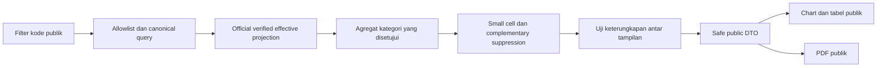

Allowlist mencakup total ASN, PNS, PPPK dan kategori, jenis kelamin, kelompok jabatan, jenjang pendidikan, pangkat/golongan sesuai ASN, jabatan fungsional, serta unit kerja. Field filter hanya kode publik; tidak menerima NIP, nama, UUID pegawai, tanggal lahir, arbitrary SQL, field path, sort field bebas, atau filter negasi.

Baseline usulan privacy threshold **N=5**, maksimum **dua dimensi filter** yang kombinasinya disetujui. Ini adalah nilai desain awal K-02, bukan jaminan kepatuhan atau nilai yang ditentukan PRD. Membatasi jumlah dimensi saja tidak cukup; setiap kombinasi perlu uji inferensi.

Aturan server:

1. Bangun kategori dari himpunan resmi yang terverifikasi dan efektif sekarang. Kategori kosong/hilang ditangani konsisten; jangan diam-diam menghapus unknown dari denominator statistik.
2. Gabungkan kategori kecil menjadi “Lainnya” hanya bila penggabungan secara substantif tepat dan kelompok hasil memenuhi threshold. Label “Lainnya” tidak memuat daftar subkategori yang membuka hitungan kecil.
3. Jika tidak dapat digabung, tampilkan `<N` dan `value:null`. Persentase, tooltip, label total, metadata chart, serta PDF tidak menyimpan hitungan aslinya.
4. Terapkan **complementary suppression**: sembunyikan satu atau lebih nilai tambahan/total/persentase jika small cell dapat dihitung dengan pengurangan. Contoh sintetis total 20, PNS 18, PPPK `<5` tidak aman karena PPPK dapat dihitung menjadi 2. Total atau angka pelengkap juga harus dilindungi.
5. Uji seluruh keluarga query yang diizinkan, termasuk unfiltered, filter unit, kategori, drill-down, URL share, dan PDF sebagai satu himpunan keluaran. Tolak kombinasi atau keluarkan panel lebih kasar jika sel kecil masih dapat dihitung dari kombinasi jawaban lain.
6. Label kategori langka dapat ikut digabung bila namanya sendiri mengungkap kelompok individu yang mudah dikenali. Jangan menganggap menyembunyikan angkanya selalu cukup.
7. Jika policy belum aktif atau pemeriksaan privasi gagal, endpoint gagal tertutup dengan pesan “Statistik belum tersedia”; tidak fallback ke raw aggregate.

Implementasi MVP memakai daftar query/cube terbatas dan pola suppression konsisten per dataset revision. Tidak menyediakan pembangun filter statistik bebas. Jika kombinasi dua dimensi tidak lolos uji, kombinasi tersebut tidak diaktifkan; multi-filter tetap tersedia hanya untuk kombinasi yang aman. Rate limit membantu mencegah scraping, tetapi bukan pengganti suppression.

Threshold agregat mengurangi pengungkapan statistik; ia tidak menjamin anonimitas absolut terhadap semua informasi eksternal atau pembandingan publikasi dari waktu berbeda. Karena PRD meminta statistik terkini, setiap perubahan revision perlu penilaian beda antar keluaran, dan kategori/filter yang berisiko harus diperbesar/disupresi. Sistem tidak menyediakan historical public API. Keputusan privacy release harus dicatat dan diuji, bukan sekadar menyembunyikan angka di frontend.

### 12.3 Safe public response dan URL

```json
{
  "data": {
    "as_of": "2026-09-10",
    "filters": { "unit": "UNIT-A" },
    "series": [
      { "code": "PNS", "label": "PNS", "value": null,
        "display_value": "Dilindungi", "suppressed": true },
      { "code": "PPPK", "label": "PPPK", "value": null,
        "display_value": "<5", "suppressed": true }
    ]
  },
  "meta": { "privacy_applied": true }
}
```

Contoh menunjukkan additional suppression; angka mentah tidak dikirim. Public response tidak memuat ID pegawai, raw rows, source-record IDs, detail missing field per orang, atau explanation internal.

URL seperti `/?unit=UNIT-A&jenis=PNS` hanya menyimpan kode publik. Saat dibuka, server memakai effective date sekarang dan official revision terbaru, bukan snapshot saat URL dibuat. Unknown/forbidden parameter ditolak. Canonical query membatasi variasi yang menghasilkan jawaban ekuivalen.

Halaman root tanpa filter boleh diindeks dan memuat wordmark NADI ASN, identitas DPMPTSP, tagline, deskripsi, “Data per [tanggal]”, dan Login Internal. Halaman filter/drill-down memuat `noindex` melalui metadata/HTTP header dan canonical yang sesuai. API/download tidak diindeks. `robots.txt` bukan mekanisme authorization.

### 12.4 Cache, aksesibilitas, dan search

Public cache berisi **DTO yang sudah dilindungi**, key berdasarkan canonical filter, tanggal kantor, data_revision, serta privacy-policy version. Tidak menggunakan cache raw response internal. Hasil yang tanggal/revision/policy-nya tidak sesuai tidak disajikan sebagai data terbaru; server membangun ulang atau memberi status sementara.

Public UX responsive penuh, filter kompleks berupa drawer, chart mempunyai alternatif tabel aman, keyboard navigation, label jelas, dan status bukan warna saja. Internal desktop-first, tabel pagination dan sticky header, light mode. Tidak memasukkan keputusan layout rinci Stage 2 ke logika domain.

Search menerima nama partial/fuzzy ringan, NIP exact dan partial, dengan exact NIP diprioritaskan. Authorization dan masking diterapkan sebelum serialisasi. Query default dibatasi minimal panjang, page size, rate limit, dan timeout; nama/NIP yang diketik tidak ditulis ke access log umum. Fuzzy nama hanya untuk search interaktif, bukan import matching.

## 13. Desain API

### 13.1 Konvensi

REST berprefix `/api/v1/internal` dan `/api/v1/public`, same origin. Endpoint authentication berada di `/auth`, CSRF bootstrap menggunakan `/sanctum/csrf-cookie`. Semua rute internal menerapkan session aktif + password finalized + TOTP completed + permission + object/field policy. Public API menggunakan controller/resource tersendiri dan tidak mengembalikan lebih banyak field meskipun pemanggil sedang login sebagai Admin.

JSON menggunakan snake_case, tanggal ISO `YYYY-MM-DD`, timestamp ISO 8601 UTC. Pagination default 25, maksimum 100, dengan allowlist sort/filter dan tiebreak UUID untuk daftar operasional. `as_of` hanya untuk endpoint internal yang mendukung effective truth; public selalu kini. Upload memakai multipart; download memakai stream setelah authorization.

Mutation yang dapat diulang memakai `Idempotency-Key`; input berbeda pada key sama menghasilkan 409. Edit memakai `base_version` atau `If-Match` yang mewakili lock_version. Idempotency tidak melewati policy check. Transactional command dan publication tidak boleh dipicu lewat GET.

### 13.2 Authentication endpoints

| Method dan path | Input / hasil utama | Guard |
|---|---|---|
| GET `/sanctum/csrf-cookie` | Cookie CSRF | Same-origin |
| POST `/auth/login` | identifier, password → limited challenge atau enrollment | CSRF, rate limit; tidak langsung membuat sesi internal penuh |
| POST `/auth/totp/challenge` | challenge, code → full session bila syarat lengkap | Binding sesi, expiry, replay check |
| POST `/auth/recovery-code/challenge` | challenge, code → sesi dengan recovery single-use | Password sebelumnya valid; rate limit |
| POST `/auth/totp/enroll` | Mulai setup → secret/QR hanya sekali dalam kanal aman | Limited enrollment session atau full session + reauth |
| POST `/auth/totp/confirm` | Kode untuk konfirmasi → recovery codes sekali tampil | Validasi setup; belum dapat membuka internal sebelum selesai |
| POST `/auth/password/complete-reset` | reset capability + password baru | Token/sesi terbatas, CSRF, expiry; lanjutkan/ulang TOTP sesuai keadaan |
| POST `/auth/password/change` | password lama/baru | Full session, validasi; revoke sesi lain |
| POST `/auth/reauthenticate` | password + TOTP/recovery → reauth timestamp | Full session, rate limit |
| POST `/auth/recovery-codes/regenerate` | Menghasilkan generasi kode baru | Reauth; seluruh kode lama dicabut |
| POST `/auth/logout` | Revoke sesi ini | Session, CSRF |
| GET `/auth/me` | user, role/permission efektif, state keamanan | Full session; tidak memuat secret/hash |

### 13.3 Pegawai, referensi, dan governance

Path tabel berikut relatif terhadap `/api/v1/internal`.

| Method dan path | Input / response | Permission |
|---|---|---|
| GET `/employees` | q, status, jenis, unit, page, as_of → daftar terotorisasi | personnel.view |
| GET `/employees/{id}` | Effective fields, version, data quality | personnel.view + field policy |
| GET `/employees/{id}/summary` | Ringkasan ASN 360 | personnel.view |
| GET `/employees/{id}/history` | domain, as_of → fakta dan state | personnel.view + kategori histori |
| GET `/search` | q, page → pegawai termasuk nonaktif | personnel.view |
| POST `/employee-change-requests` | CREATE/UPDATE + typed payload + base_version → DRAFT | personnel.create/update menurut operasi |
| PATCH `/employee-change-requests/{id}` | Perbaikan DRAFT sendiri | permission operasi + maker ownership |
| GET `/employee-change-requests` | Status/pending milik atau dapat diverifikasi | view proposal sesuai tugas |
| GET `/employee-change-requests/{id}` | Diff, impact, hash, policy version | view proposal + field policy |
| POST `/employee-change-requests/{id}/submit` | payload_hash → pending/applied nonkritis | permission operasi + maker |
| POST `/employee-change-requests/{id}/cancel` | Alasan penarikan | maker, belum diterapkan |
| POST `/employee-change-requests/{id}/approve` | reviewed_hash, base_version → applied | personnel.approve + bukan maker |
| POST `/employee-change-requests/{id}/reject` | reviewed_hash, reason | personnel.approve + bukan maker |
| GET `/references/{type}` | Kode/label aktif, type allowlist | references.view + field policy |
| POST `/references/{type}` | Master baru, klasifikasi terverifikasi | references.manage; kritis melalui policy proposal |
| GET, POST `/policies` | List atau create versi policy | configure untuk create, view sesuai role |
| GET `/policies/{id}` | Payload + impact | policies.configure |
| PATCH `/policies/{id}` | Edit draft | policies.configure + maker |
| POST `/policies/{id}/simulate` | Dampak konfigurasi pada revision | policies.configure |
| POST `/policies/{id}/submit` | Hash + impact terbaru | policies.configure + maker |
| POST `/policies/{id}/approve` | Hash + revision | policies.approve + bukan maker |
| POST `/policies/{id}/reject` | Hash + alasan | policies.approve + bukan maker |

Tidak menyediakan PATCH langsung ke official `employees`/history. UI “Perbarui Pangkat”, “Perbarui Jabatan”, “Batalkan Perubahan TMT”, dan “Perbarui Kontrak” membentuk proposal bertipe. Edit/nonaktifkan referensi existing menggunakan policy REFERENCE_CHANGE; tidak ada endpoint yang melewati review untuk klasifikasi massal.

### 13.4 Import, rules, DUK, dan export

| Method dan path internal | Input / hasil | Permission |
|---|---|---|
| POST `/imports` | file XLSX → batch 202 | imports.create |
| PUT `/imports/{id}/mapping` | mapping, blank semantics | imports.create + batch ownership |
| POST `/imports/{id}/validate` | Run validation → 202 | imports.review |
| GET `/imports/{id}` | Status/counters/file expiry | imports.review |
| GET `/imports/{id}/rows` | Status/page → diff/error | imports.review |
| POST `/imports/{id}/reconcile` | Row decision + reason | imports.review; audit maker |
| POST `/imports/{id}/confirm` | preview_hash, selected rows, duplicate acknowledgement | imports.confirm |
| POST `/imports/{id}/rollback-previews` | Reason → rollback plan | imports.rollback + reauth |
| POST `/rollbacks/{id}/submit` | Plan hash/revision | imports.rollback + maker |
| GET `/rollbacks/{id}` | Plan, dependencies, conflicts | imports.rollback |
| POST `/rollbacks/{id}/approve` | Plan hash → atomic compensation | imports.rollback + Super Admin berbeda + reauth |
| POST `/rollbacks/{id}/reject` | Reason | imports.rollback + bukan maker |
| GET, POST `/rulesets` | List/create version | rules.view / rules.create |
| GET, PATCH `/rulesets/{id}` | Detail/edit draft | rules.view / rules.create + maker |
| POST `/rulesets/{id}/simulate` | as_of → simulation 202 | rules.simulate |
| GET `/rule-simulations/{id}` | Summary + paged diff | rules.view |
| POST `/rulesets/{id}/submit` | simulation_id, parameters_hash | rules.submit |
| POST `/rulesets/{id}/approve` | Hash/revision → ACTIVE atau terjadwal | rules.approve + rules.activate + bukan maker + reauth |
| POST `/rulesets/{id}/reject` | Reason | rules.approve + bukan maker |
| POST `/rulesets/{id}/deactivation-requests` | Reason + impact → proposal policy | policies.configure; apply melalui policy approval |
| GET `/duk/live` | as_of, scope, filter, sort, page | duk.view |
| GET `/calculations/{id}/explanation` | Explanation menurut izin field | calculation.explain |
| POST `/duk/publication-candidates` | run_id, as_of, template, previous snapshot, notes | duk.prepare |
| GET `/duk/publication-candidates/{id}` | Candidate, diff, guards | duk.view + hak review |
| POST `/duk/publication-candidates/{id}/submit` | content_hash | duk.submit + maker |
| POST `/duk/publication-candidates/{id}/publish` | reviewed_hash → snapshot 201 | duk.publish + bukan maker + reauth |
| POST `/duk/publication-candidates/{id}/reject` | Reason | duk.publish + bukan maker |
| GET `/duk/snapshots`, GET `/duk/snapshots/{id}` | List/detail immutable dengan field projection | duk.view |
| POST `/exports` | Jenis, format, fields/filter, snapshot/as_of, signatory manual | Permission export sesuai jenis + field policy |
| GET `/exports/{id}` | Status, expiry | Owner + permission export terkini |
| GET `/exports/{id}/download` | Stream attachment | Owner + permission + expiry + security_version |

`DEACTIVATE_RULESET` ditambahkan sebagai kind policy administratif dengan payload `ruleset_id` dan alasan terstruktur; resolver mengecek status yang telah disetujui. Tidak membuat backdoor perubahan status ruleset lewat PATCH draft.

### 13.5 Dashboard, akun, audit, dan operasi

| Method dan path internal | Hasil/perubahan | Permission |
|---|---|---|
| GET `/dashboard/command` | Statistik + attention + quality + aktivitas | dashboard.command.view |
| GET `/dashboard/executive` | Ringkasan pimpinan | dashboard.executive.view |
| GET `/radars/kp`, `/radars/kgb` | Daftar + kategori + countdown | radar.view |
| GET `/quality/summary` | Ringkasan kualitas | dashboard.command.view |
| GET `/alerts` | Attention terurut | role sesuai dashboard |
| POST `/alerts/{id}/acknowledgements` | Generation + escalation_version | alerts.acknowledge |
| GET `/notifications` | Inbox pengguna sendiri | Full session |
| POST `/notifications/{id}/read` | Read timestamp pengguna sendiri | Full session + ownership |
| GET, POST `/users` | List/create akun | users.manage + reauth untuk create |
| PATCH `/users/{id}` | Username/email/display_name/disable; version | users.manage + reauth |
| PUT `/users/{id}/roles`, `/users/{id}/permissions` | Grant → revoke sessions | permissions.manage + reauth |
| POST `/users/{id}/password-reset` | One-use reset; reason/verifikasi | security.reset + reauth |
| POST `/users/{id}/totp-reset` | Revoke TOTP/recovery/sessions | security.reset + reauth |
| GET `/audit/operational` | Audit operasional terfilter | audit.operational.view |
| GET `/audit/security` | Security events | audit.security.view |
| GET `/audit/archives/{id}` | Metadata/pencarian arsip authorized | audit.archive.view |
| GET, PATCH `/settings` | Config nonsecret; lock_version | system.configure; perubahan kritis melalui policy |
| POST `/maintenance/enable`, `/maintenance/disable` | State, actor, reason | maintenance.manage + reauth |
| GET `/operations/health`, `/operations/backups` | Health detail/metadata backup | system.configure |

Tidak ada self-service signup, forgot-password, delete official employee, atau endpoint untuk bypass 2FA. Status akun di API tidak menerima perubahan langsung ke security_version/TOTP secret.

### 13.6 Public endpoints

| Method dan path | Hasil | Proteksi |
|---|---|---|
| GET `/api/v1/public/dashboard` | Safe aggregate DTO terbaru | Query allowlist, privacy engine, rate limit |
| GET `/api/v1/public/filters` | Kode kategori publik yang aman | Tidak ada jumlah/label kategori kecil yang membuka identitas |
| POST `/api/v1/public/pdf-exports` | Filter publik → 202, opaque capability token | Quota, ukuran output, safe DTO saja |
| GET `/api/v1/public/pdf-exports/{token}` | Status atau file PDF aman | Token acak ≥128 bit, hash tersimpan, expiry, noindex |

Public PDF tidak berbagi ID download internal. Token dikembalikan hanya ke requester, tidak dimasukkan access log; file tidak memuat data selain keluaran publik yang aman. Saat policy privasi berubah, cache/file publik lama yang belum kedaluwarsa diinvalidasi dan harus dibangun ulang. PDF yang sudah diunduh masyarakat tidak dapat ditarik kembali.

### 13.7 Response, validasi, dan error

```json
{
  "data": { "id": "uuid", "status": "PENDING_APPROVAL" },
  "meta": { "request_id": "uuid", "data_revision": 42 },
  "links": { "self": "/api/v1/internal/employee-change-requests/uuid" }
}
```

```json
{
  "error": {
    "code": "STALE_VERSION",
    "message": "Data telah berubah. Muat ulang perbandingan sebelum menyetujui.",
    "fields": {},
    "request_id": "uuid"
  }
}
```

| HTTP | Kode contoh | Makna |
|---|---|---|
| 200/201/202 | OK/CREATED/ACCEPTED | Berhasil / resource dibuat / job diterima |
| 401 | AUTHENTICATION_REQUIRED, MFA_REQUIRED | Sesi belum lengkap atau kedaluwarsa |
| 403 | PERMISSION_DENIED, SELF_APPROVAL_FORBIDDEN, REAUTH_REQUIRED | Izin atau syarat keamanan tidak terpenuhi |
| 404 | RESOURCE_NOT_FOUND | Resource tidak ada/tidak boleh diketahui keberadaannya |
| 409 | STALE_VERSION, DUPLICATE_NIP, INVALID_TRANSITION, IDEMPOTENCY_CONFLICT | Konflik keadaan, bukan retry buta |
| 413/415 | FILE_TOO_LARGE, UNSUPPORTED_FILE_TYPE | Upload tidak sesuai |
| 419 | CSRF_TOKEN_MISMATCH | Refresh CSRF sesuai alur klien, jangan retry mutation tanpa idempotency |
| 422 | VALIDATION_FAILED, PUBLICATION_BLOCKED, RULESET_UNVERIFIED | Input/guard tidak terpenuhi; hasil radar blocked dapat tetap menjadi data 200 |
| 429 | RATE_LIMITED | Sertakan Retry-After |
| 500/503 | INTERNAL_ERROR, MAINTENANCE, DEPENDENCY_UNAVAILABLE | Pesan aman + request_id; tidak ada stack trace/PII |

Kontrak ini menjadi dasar OpenAPI pada Stage 3: schema request/response per DTO, contoh sintetis, format error, enum, security scheme, dan permission endpoint. Tidak menganggap tabel endpoint ini sebagai spesifikasi OpenAPI yang sudah dihasilkan atau diuji.

## 14. Authentication dan keamanan

### 14.1 Session lifecycle

Keputusan desain menggunakan Laravel session authentication/Sanctum untuk SPA milik sendiri, dengan cookie session server-side dan CSRF. Dokumentasi Sanctum menjelaskan bahwa SPA authentication menggunakan session cookie, dan tidak memerlukan personal API token untuk frontend sendiri. TOTP tetap merupakan lapisan tersendiri yang wajib selesai sebelum akses internal diberikan. [Laravel Sanctum — SPA Authentication](https://laravel.com/framework/docs/13.x/sanctum#spa-authentication).

Urutan login: validasi identifier/password → buat sesi challenge terbatas → validasi TOTP/recovery → jika perlu, selesaikan penggantian password/setup faktor → regenerate session ID → tandai sesi lengkap. Kegagalan pada tahap mana pun tidak menghasilkan akses data internal. Session ID diregenerasi pada perpindahan privilege untuk menghindari session fixation.

Cookie session memakai Secure, HttpOnly, SameSite=Lax, scope host/path minimal; cookie CSRF sengaja dapat dibaca client sesuai mekanisme framework, bukan cookie session. Tidak menyimpan bearer token autentikasi di localStorage. CORS default hanya same origin. Full-session middleware juga mengecek status akun dan `security_version` pada setiap request.

Baseline inactivity timeout **90 menit**, absolute session lifetime **12 jam**, reauth freshness **5 menit**, challenge **5 menit**, dan bootstrap/reset password **30 menit**. Angka selain kisaran inactivity PRD adalah usulan K-07. Aktivitas pengguna yang terautentikasi memperpanjang idle timeout; polling lonceng/health pasif tidak membuat sesi bertahan tanpa aktivitas manusia.

Role/permission diubah, akun disabled, password/TOTP direset, atau indikasi compromise: increment security_version dan revoke sesi; export/download juga memeriksa versi tersebut. Tidak ada remember-me panjang pada MVP. Pimpinan tidak memiliki expiry akun otomatis.

### 14.2 Password, TOTP, dan recovery

Password minimal 12 karakter, mendukung passphrase dan Unicode dengan penanganan konsisten, maksimum panjang wajar untuk mencegah abuse, serta pemeriksaan daftar password lemah lokal. Tidak mengirim password ke layanan eksternal untuk pemeriksaan. Hash Argon2id dengan parameter yang dibenchmark pada VPS; upgrade hash saat login bila parameter diperbarui. Tidak ada rotasi berkala wajib tanpa alasan.

TOTP memakai library yang dipelihara, secret unik per akun, period/digits/window yang kompatibel dengan Authenticator standar dan diuji; baseline teknis 30 detik, 6 digit, toleransi ±1 step. Secret dienkripsi dengan kunci terpisah dari database; tidak cukup di-hash karena harus digunakan untuk verifikasi. `last_totp_step` diperbarui atomik agar OTP yang sama tidak bisa dipakai ulang, termasuk request paralel. Server disinkronkan waktunya. QR/secret tidak masuk log atau response API setelah enrollment selesai.

Recovery codes dihasilkan dengan CSPRNG, baseline 10 kode berentropi tinggi, ditampilkan sekali, disimpan dalam bentuk hash, dan dikonsumsi atomik single-use. Generasi baru membatalkan seluruh kode lama. Reset faktor memerlukan prosedur verifikasi identitas oleh Super Admin; sesi yang masih login saja tidak cukup untuk mengganti faktor tanpa reauth. Praktik single-use recovery dan pengamanan perubahan faktor juga dibahas OWASP. [OWASP — Multifactor Authentication](https://cheatsheetseries.owasp.org/cheatsheets/Multifactor_Authentication_Cheat_Sheet.html).

Reset password administratif menghasilkan capability satu kali, diserahkan oleh Super Admin melalui kanal kantor yang telah ditetapkan; aplikasi tidak mengirim email reset otomatis. Token di-hash, kedaluwarsa, dan dicabut saat digunakan. Pengguna tetap wajib menyelesaikan TOTP yang masih valid. Reset 2FA terpisah mencabut secret lama, recovery lama, serta semua sesi, lalu mewajibkan enrollment ulang; alasan/verifikasi masuk security audit.

### 14.3 Dua Super Admin dan break-glass

Bootstrap melalui CLI berwenang membuat dua akun Super Admin menggunakan secret sementara yang disampaikan terpisah. Sistem belum boleh dibuka operasional sebelum keduanya aktif dan setup TOTP selesai. Tidak ada akun/password default tertanam dalam repository.

Break-glass hanya melalui akses server terbatas, bukan endpoint web publik. Perintah memerlukan identitas operator, alasan/nomor insiden, target akun, serta autentikasi akses server. Ia mencabut sesi/faktor yang bermasalah dan menghasilkan kesempatan setup satu kali dengan expiry, bukan mematikan TOTP global. Perintah mencatat audit aplikasi serta log operasi terpisah; apabila database sedang mati, receipt lokal yang dilindungi disimpan dan direkonsiliasi setelah pulih.

Penggunaan break-glass ditinjau oleh Super Admin lain setelah pemulihan. Personel teknis instansi menguasai akses server dan material recovery, tidak bergantung pada developer awal. Rincian runbook dan daftar personel ditetapkan sebelum go-live.

### 14.4 Kontrol keamanan minimum

| Risiko | Kontrol yang dirancang |
|---|---|
| Unauthorized direct object access | Policy pada setiap resource ID, field allowlist, ownership download/proposal/inbox |
| Mass assignment | DTO dan validated fields eksplisit; client tidak mengisi actor/status/approved_at |
| CSRF | Framework middleware pada mutation cookie-auth; origin policy dan token |
| XSS | Escaping output, hindari HTML bebas, CSP, sanitasi label/template; Vue tidak merender raw user HTML |
| SQL injection | Parameterized query, allowlist filter/sort, tanpa SQL dari ruleset |
| Credential guessing | Rate limit kombinasi akun/IP/challenge; error generik, progressive backoff |
| Upload berbahaya | Private storage, validasi format/dekompresi, resource limit, no macro/formula execution |
| SSRF / file read via PDF | Renderer tanpa egress bebas, asset lokal allowlist, tidak menerima URL pengguna |
| Drive URL salah/berbahaya | HTTPS dan hostname persis `drive.google.com`, path folder yang diperbolehkan; tolak userinfo/redirect URL; tidak di-fetch server |
| Kebocoran link/PII | Referrer-Policy ketat, `noopener noreferrer`, query log disanitasi, response internal `Cache-Control: no-store` |
| Supply-chain | Lockfiles, image digest, dependency scan, patch release yang terkontrol |
| Secret bocor | Secret file terpisah, permissions host ketat, tidak masuk Git/image/log/backup plaintext |

Security headers: HSTS setelah domain HTTPS stabil, CSP yang diuji termasuk chart/font, `X-Content-Type-Options: nosniff`, frame-ancestors, dan Referrer-Policy. Header bukan pengganti authorization. Login rate limit baseline usulan 5 kegagalan per akun+IP per 5 menit dengan batas IP tambahan; perlu tuning untuk jaringan kantor bersama tanpa permanent account lockout.

Role database dipisah: runtime, migration, backup, archive/publish function sesuai kebutuhan. Runtime tidak menjadi database owner/superuser, tidak memiliki DDL atau hak penghapusan snapshot. Laravel app key, key TOTP, credentials DB/SMTP/Drive, dan private key backup tidak disatukan sebagai satu secret.

## 15. Audit, job, cache, dan observability

### 15.1 Audit event

Audit operasional menyimpan actor UUID dan nama saat kejadian, action, objek, before/after yang relevan, alasan, correlation ID, Batch ID/request/publication/ruleset, dan timestamp. Security audit menyimpan login gagal/penting, perubahan akun/permission, reset, break-glass, dan penggunaan aksi sensitif. Widget Aktivitas Terbaru hanya memilih ringkasan kategori operasional; tidak membaca security events.

Before/after diserialisasi melalui schema audit, bukan dump request. Password, OTP, TOTP secret, recovery codes, reset/download/session tokens, connection string, dan secret tidak pernah disimpan. Audit operasional yang mengandung PII tetap dibatasi sesuai permission; daftar aktivitas tidak menampilkan nilai sensitif.

Setiap audit penting memiliki canonical hash. Rantai hash diurutkan melalui append lock singkat dan previous hash terakhir; rollback transaksi boleh meninggalkan gap sequence, tetapi tidak memutus rantai record yang commit. Checkpoint/manifest terverifikasi dikirim ke penyimpanan off-server untuk mendeteksi penulisan ulang seluruh rantai. Hash sendiri tidak mencegah administrator server memalsukan log; pemisahan akses dan salinan eksternal diperlukan.

### 15.2 Retensi

| Data | Retensi desain |
|---|---|
| Official employee/history, ruleset terpakai, approval, published snapshots | Sepanjang umur sistem sesuai PRD; status menggantikan delete |
| Import metadata, mapped diff, keputusan rekonsiliasi, rollback evidence | Dipertahankan untuk traceability |
| File XLSX sumber | 14 hari configurable, lalu hapus |
| Export dan input sementara | 60 menit baseline usulan, lalu hapus |
| Audit penting operasional/security | Sepanjang umur sistem; dapat diarsipkan, tetap dapat ditelusuri |
| Login/logout rutin | 90 hari baseline usulan; event mencurigakan dinaikkan kelas penting |
| Notification yang selesai/dibaca | 90 hari baseline usulan; event sumber/audit penting tetap tersedia |
| Failed job dan application log tersanitasi | 30 hari baseline usulan; kegagalan security/operasional penting dicatat terpisah |
| Sessions/challenges/reset capabilities | Hapus setelah expiry + jendela cleanup singkat; security event tetap tersimpan |
| Backup rolling | 7 hari; satu bulanan 12 bulan configurable |

Backup 12 bulan bukan pengganti arsip audit sepanjang umur sistem. Jika audit lama dipindah dari database, arsipnya tetap mempunyai salinan off-server dan tidak ikut dihapus oleh rolling backup. Perubahan retensi harus mempertimbangkan kebijakan instansi yang diverifikasi; dokumen ini tidak menetapkan dasar hukum retensi baru.

### 15.3 Queue dan scheduler

Database queue dipakai untuk pekerjaan berat; satu worker normal dan satu worker export berat dapat dijalankan sebagai proses/container terpisah dari image aplikasi yang sama. Worker export memiliki Chromium/Node yang diperlukan. Queue prioritas `critical`, `default`, `exports` mencegah export besar menghalangi notifikasi/perhitungan.

Outbox memastikan event tidak hilang jika aplikasi mati setelah commit. Delivery bersifat at-least-once: consumer wajib idempotent dengan dedupe key dan pencatatan hasil. Lease/timeout pada job mencegah worker mati mengunci pekerjaan permanen; retry menggunakan backoff dan jumlah percobaan terbatas. Timeout worker harus lebih pendek dari retry reservation untuk menghindari dua eksekusi serentak.

| Job | Pemicu / frekuensi baseline | Perlindungan |
|---|---|---|
| Dispatch outbox | Setiap menit dan setelah commit jika tersedia | Lock/lease, dedupe |
| Refresh due effective changes | Saat tanggal kantor berganti, pemeriksaan ulang per 5 menit | Resolver read tetap benar tanpa job |
| Recalculate DUK/KP/KGB/quality | Perubahan approved, ruleset/policy aktif, tanggal berubah | Input hash + revision; hasil stale tidak dipasang |
| Rebuild safe public projection | Official revision/policy/tanggal berubah | Publish cache hanya setelah privacy check |
| Alert escalation dan inbox | Sesudah recalculation | generation/escalation + dedupe |
| Purge export/challenge/session | Per 15 menit | TTL, storage allowlist |
| Purge sumber import | Harian | File expiry, audit metadata |
| Backup | Setiap 4 jam, timer infrastruktur terpisah | Tidak bergantung pada queue Laravel sehat |
| Health/monitor | 1–5 menit sesuai metrik | Monitor eksternal untuk mendeteksi VPS mati |

Redis dapat ditambahkan kemudian bila pengukuran menunjukkan contention queue/cache; tidak boleh menjadi satu-satunya tempat menyimpan official data, approval, audit, atau snapshot. Tidak menambahkan komponen tersebut hanya karena tersedia dalam stack rekomendasi.

### 15.4 Observability

Log terstruktur membawa request/correlation ID, module/action, status, latency, dan error code. Metrics minimal: latency/error API, DB connection/query health, queue age/failure, scheduler heartbeat, CPU/RAM/disk, umur backup off-server yang valid, TLS expiry, dan jumlah critical errors. Health detail hanya internal; liveness publik tidak mengungkap versi/dependency/connection string.

Email alert teknis dikirim ke penerima configurable, terpisah dari notifikasi kepegawaian. Monitor eksternal mengirim alert bila VPS/Nginx/SMTP lokal gagal. Alert tidak menyertakan NIP, nama pegawai, atau isi dokumen. Baseline warning disk 70%, critical 85%; TLS warning 30 hari dan critical 7 hari; queue age threshold berdasarkan SLA job. Nilai dikalibrasi pada deployment.

## 16. Docker dan deployment

### 16.1 Topologi production

| Service / proses | Peran | Network/volume/secret |
|---|---|---|
| `nginx` | TLS termination, static Vue assets, proxy PHP | Publish 443; 80 hanya redirect/ACME; TLS/config read-only |
| `app` | Laravel PHP-FPM, REST/session | Network aplikasi dan database; private temp volume; runtime DB/TOTP/app secrets |
| `worker` | Import, domain jobs, notification, kalkulasi | Image aplikasi sama; network database; private temp |
| `export-worker` | Render XLSX/PDF dengan resource limit | Image export turunan release yang sama; tanpa egress umum; private temp |
| `scheduler` | Satu scheduler Laravel aktif | App image; singleton lock; tidak membuka port |
| `postgres` | Official database + queue/cache/session | Network database saja, tidak publish port host; persistent volume `pgdata` |
| `backup-agent` / host timer | Dump/enkripsi/transfer off-server | Read DB credential khusus, Drive credential, public encryption key, backup staging |
| Host/external monitor | Resource health, TLS, backup heartbeat | Akses minimum; SMTP credential teknis terpisah |

Public ingress hanya Nginx. SSH dibatasi personel/alamat yang diizinkan, key-based. PostgreSQL tidak dapat diakses internet. Network aplikasi dapat dibagi `edge`, `backend`, dan jalur egress khusus backup/monitor; layanan yang tidak memerlukan internet tidak mendapat akses bebas. Host firewall tetap diperiksa karena container port publishing dapat memengaruhi aturan jaringan host.

Persistent volume database bertahan saat image/container diperbarui. `docker compose down -v` bukan langkah deployment. Backup tidak dilakukan dengan menyalin volume database yang sedang aktif tanpa protokol konsistensi. Private file storage tidak dipasang sebagai direktori static Nginx.

Secret diberikan per-service melalui mounted secret files yang dibaca aplikasi/entrypoint. Compose mendukung grant secret per service dan mount file; file sumber pada host tetap harus dilindungi karena Compose bukan vault yang otomatis mengenkripsi penyimpanan secret. [Docker Compose — Secrets](https://docs.docker.com/compose/how-tos/use-secrets/).

Healthchecks dibedakan liveness dan readiness: app siap setelah database/migrasi sesuai, PostgreSQL dapat menerima koneksi, worker/scheduler mempunyai heartbeat. `depends_on` saja tidak menjamin dependency selalu sehat; aplikasi tetap membutuhkan retry terbatas dan error handling. Resource limit, restart policy, log rotation, dan disk monitoring ditetapkan untuk setiap service.

### 16.2 Environment dan build

Development/test memakai dummy atau anonymized data; secrets/domain/database terpisah dari production. Tidak menyalin dump ASN mentah ke laptop developer/CI. Source private repository dan akses registry berada di bawah akun organisasi instansi, minimal dua pengelola.

Build menghasilkan image versioned dari approved commit/tag dengan lockfile, asset Vue, dependency production, renderer/fonts, dan checksum. CI menjalankan test business-critical, lint/type check, dependency scan, serta build. Production deployment tetap dipicu eksplisit personel berwenang; merge/push tidak otomatis mengubah production.

### 16.3 Alur deployment dan rollback release

1. Preflight memeriksa approved tag/digest, kompatibilitas schema, kapasitas disk, secrets, health, dan kesiapan rollback.
2. Ambil backup baru; verifikasi dump dan salinan off-server. Simpan manifest release/schema.
3. Aktifkan maintenance write gate, catat alasan/actor; drain jobs yang menulis, hentikan scheduler penerapan sementara. In-flight transaction diberi kesempatan selesai atau dibatalkan terkontrol.
4. Terapkan migrasi kompatibel dan update container ke image release yang sama. Migrasi dijalankan satu proses berwenang, bukan setiap container startup.
5. Jalankan readiness, smoke test login/TOTP, akses publik aman, effective resolver, worker, serta export sintetis tanpa membocorkan data.
6. Bila lulus, buka maintenance dan resume jobs, pantau error/queue/backup. Simpan release notes dan operator.
7. Bila gagal, kembalikan image sebelumnya hanya jika schema kompatibel. Migrasi destruktif memerlukan strategi khusus; tidak menjalankan rollback schema otomatis secara buta.

Gunakan expand-then-contract: tambah schema lebih dahulu, migrasi data terkontrol, hapus schema lama pada release berikutnya setelah aman. Restore database pre-deploy merupakan opsi terakhir saat write gate masih tertutup. Jika transaksi pengguna telah berjalan setelah release, restore dapat menghilangkan transaksi baru; perlu rencana rekonsiliasi eksplisit dan pencatatan insiden.

Maintenance menolak transaksi pengguna biasa dan mutation dari worker yang tidak diizinkan. Halaman informasi tetap tersedia; bypass teknis berumur pendek dibatasi operator dan diaudit. Endpoint health dan backup tetap berfungsi bila aman.

## 17. Backup dan disaster recovery

### 17.1 Arsitektur backup

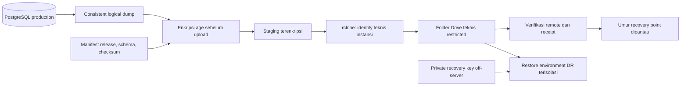

Keputusan desain: PostgreSQL logical dump format custom untuk database; `age` untuk enkripsi dengan recipient public key; `rclone` untuk transfer ke Google Drive teknis instansi. age menyediakan enkripsi file berbasis recipient; rclone memiliki backend Drive dengan konfigurasi scope dan identity. Tidak menggunakan obfuscation konfigurasi sebagai pengganti enkripsi backup. [age](https://github.com/FiloSottile/age), [rclone — Google Drive](https://rclone.org/drive/).

Gunakan OAuth client milik instansi dan identity khusus teknis. Pilih scope minimum yang mendukung upload, verifikasi, restore, serta retensi; folder root rclone hanya membatasi operasi tool dan tidak dengan sendirinya mempersempit OAuth permission. Folder dokumen ASN tidak menjadi bagian akses backup bila dapat dihindari. Uji akses/quota/renewal credential sebelum go-live. Agent ini menggunakan API Drive secara teknis; aplikasi Master Pegawai tetap hanya menyimpan URL manual.

Private key dekripsi disimpan off-server oleh personel berwenang dengan salinan recovery terpisah; server backup cukup memiliki public encryption key. Application/TOTP encryption keys yang diperlukan restore disimpan dalam escrow terenkripsi terpisah dengan akses terbatas. Database backup tanpa key tersebut tidak cukup untuk pemulihan aplikasi. Rotasi key mempertahankan kemampuan membuka backup dan secret historis yang masih dalam retensi.

### 17.2 Jadwal, verifikasi, dan retensi

Backup dijadwalkan setiap **4 jam**: baseline 00.00, 04.00, 08.00, 12.00, 16.00, dan 20.00 waktu kantor. Interval ini memberi margin dibanding target RPO ≤6 jam. Target durasi dump+upload+verifikasi ≤1 jam. RPO diukur dari **snapshot_at backup off-server terakhir yang sudah terverifikasi**, bukan waktu job mulai atau selesai lokal.

Gagal upload/verifikasi langsung memicu email alert; retry baseline 15 menit. Warning saat umur recovery point mendekati 5 jam, critical jika mencapai/melewati 6 jam. Satu jadwal gagal tidak boleh dibiarkan sampai jadwal 4 jam berikutnya tanpa retry/escalation. RPO adalah target operasional yang harus dipantau, bukan jaminan hanya dari cron.

Setiap backup menyimpan manifest: waktu snapshot, release version, schema version, DB version, size, checksum encrypted artifact, key ID, remote object locator, serta hasil verifikasi. Remote receipt juga disimpan di luar database agar tetap dapat ditemukan ketika database hilang. Verifikasi dilakukan dengan checksum yang didukung remote atau download ulang stream pembanding; jangan menganggap “upload sukses” sudah membuktikan restore.

Rolling backup 7 hari; satu backup bulanan disimpan 12 bulan configurable. Retention hanya menghapus item di prefix teknis yang terdaftar dan setelah ada backup baru yang valid; jangan menggunakan mirror delete yang mengikuti kehilangan data sumber. Salinan lokal terenkripsi membantu pemulihan cepat, tetapi bukan satu-satunya salinan.

Cakupan: official data, histori, proposal/approval, ruleset/policy, snapshot, audit aktif, template specification, dan metadata penting. Arsip audit lama serta template assets memiliki perlindungan off-server tersendiri. Source import dan export temporary tidak menjadi file backup permanen. Session/challenge/reset yang mungkin terbawa dump dinonaktifkan setelah restore.

### 17.3 Restore dan target RTO

Target RTO ≤8 jam, diukur dari deklarasi insiden sampai fungsi inti kembali dapat digunakan dengan verifikasi. Budget latihan awal: diagnosis/provision ≤2 jam; ambil backup/decrypt/restore ≤3 jam; validasi dan pembukaan layanan ≤3 jam. Kapasitas aktual wajib dibuktikan lewat restore drill; angka ini bukan hasil benchmark yang sudah terjadi.

Runbook restore:

1. Tetapkan insiden, bekukan akses/tulis bila perlu, pilih backup terakhir yang valid dan catat recovery point serta kemungkinan data setelahnya.
2. Provision host/environment DR terisolasi dengan versi release/schema kompatibel dan secret dari escrow.
3. Ambil artifact, cocokkan manifest/checksum, dekripsi, restore database dan assets/arsip yang diperlukan.
4. Cabut seluruh session, challenge, reset capability dan download token; gunakan namespace cache baru, buang cache lama. Pastikan jobs/outbox tidak mengirim atau mengulang pekerjaan sebelum ditinjau.
5. Validasi constraint, jumlah official per kategori, histori efektif, snapshot hash, ruleset, dua Super Admin/TOTP, privacy endpoint, dan satu export.
6. Bangun ulang cache/derived calculations, rekonsiliasi idempotency/outbox, lalu aktifkan worker secara bertahap.
7. Alihkan layanan/domain secara terkontrol, aktifkan monitoring/backup, dan dokumentasikan waktu pemulihan serta kehilangan data yang diketahui.

Restore drill minimal setiap **3 bulan**, dengan bukti success/failure, waktu, backup yang dipakai, masalah, dan tindak lanjut. Untuk mematuhi larangan data asli di development/test, restore dump asli hanya dilakukan pada **lingkungan DR yang termasuk perimeter keamanan production**, terisolasi dari developer/CI, tanpa akses publik dan tanpa outbound notification. Ini penafsiran K-08 yang perlu disepakati. Setelah drill, salinan data dan secret dibersihkan sesuai prosedur; development/test biasa tetap memakai data dummy/anonymized.

## 18. Kapasitas, pengujian, dan acceptance

### 18.1 Target nonfungsional yang dapat diuji

PRD tidak menetapkan angka latency/concurrency atau spesifikasi VPS. Nilai berikut adalah **target rekayasa usulan**, bukan jaminan vendor maupun hasil tes.

| Ukuran | Target awal untuk validasi |
|---|---|
| Dataset uji | 10.000 pegawai sintetis dengan histori bertahun-tahun; juga uji volume awal sekitar 170 |
| Beban interaktif | 25 pengguna internal bersamaan dan profil trafik publik terpisah |
| API daftar/detail ringan | p95 ≤1 detik pada jaringan uji terkontrol |
| Dashboard internal | p95 ≤2 detik saat derived data siap |
| Public aggregate | p95 ≤500 ms dari cache aman; cold path diukur terpisah |
| Import 10.000 baris | Target validasi/preview ≤5 menit; apply/approval dilaporkan terpisah |
| Export 10.000 baris | Async, progress/status tersedia; target ≤5 menit setelah worker menerima |
| Ketersediaan | Operasi 24/7 secara wajar, satu VPS; tidak menjanjikan HA atau SLA numerik yang tidak ada di PRD |
| Backup/recovery | RPO ≤6 jam, RTO ≤8 jam, diuji dengan clock dan artifact nyata |

Ukuran CPU/RAM/disk diputuskan setelah benchmark parser/PDF/PostgreSQL. Mulai dari profil uji yang memungkinkan worker export dibatasi terpisah; jangan membeli kapasitas hanya dari jumlah pegawai. Pertumbuhan histori, audit, backup, dan file sementara menjadi bagian sizing. Lakukan EXPLAIN pada query dominan, pantau N+1, batasi page size, dan gunakan batch read.

### 18.2 Matriks uji business-critical

| ID | Skenario | Hasil yang wajib dibuktikan saat implementasi |
|---|---|---|
| T-01 | Pegawai baru manual/import belum disetujui | Tidak masuk official dashboard, DUK, atau publik |
| T-02 | Satu field kritis bersama beberapa nonkritis | Seluruh perubahan pegawai tertahan sampai approval |
| T-03 | Maker mencoba approve/publish/rollback sendiri | Ditolak, termasuk Super Admin |
| T-04 | Dua checker / dua editor bersamaan | Hanya satu apply sah; lainnya conflict, tanpa data ganda |
| T-05 | TMT besok, pergantian hari, scheduler mati | Resolver berganti tepat menurut tanggal tanpa menunggu cron |
| T-06 | Retroaktif disetujui dan future record dibatalkan/diganti | Effective truth benar; snapshot lama tidak berubah |
| T-07 | Ruleset draft/belum terverifikasi/scope tidak sesuai | Tidak menghasilkan hasil resmi atau tanggal tebakan |
| T-08 | Ruleset baru terjadwal dan aturan lama | Versi tepat dipilih sebelum/saat/sesudah TMT; snapshot lama konsisten |
| T-09 | Simulasi/hash/revision berubah sebelum approval | Stale; review ulang wajib |
| T-10 | DUK dengan data hilang, tie belum terpecahkan, ASN di luar scope | Semua aktif terlihat dengan label tepat; publikasi blocked bila syarat gagal |
| T-11 | Ulang tahun, 29 Februari, akhir bulan, masa kerja/batas horizon | Sesuai kontrak tanggal dan fixture regulasi terverifikasi |
| T-12 | NIP Excel numerik kehilangan presisi, duplicate NIP, nama mirip | Tidak fuzzy match; masalah ditahan untuk manual repair |
| T-13 | File identik diunggah ulang | Warning batch lama; lanjut hanya dengan acknowledgement tersimpan |
| T-14 | Worker crash sebelum/sesudah commit import | Retry idempotent; tidak setengah pegawai/duplikasi operation |
| T-15 | Rollback ada perubahan lanjutan/pending/snapshot dependency | Konflik terlihat; tidak overwrite lanjutan atau mutasi snapshot |
| T-16 | Publish paralel atau setelah edit referensi/data | Revision/series guard mencegah stale/duplicate revision |
| T-17 | UPDATE/DELETE snapshot dari runtime DB | Ditolak; regenerasi memakai salinan label/nilai/aturan lama |
| T-18 | Public small count dan pengurangan dari total/percent/filter/PDF | Tidak ada hitungan kecil yang dapat diperoleh dari keluarga keluaran yang disetujui |
| T-19 | Pimpinan mengakses detail/search/explanation/export | NIP/PII/Drive sesuai field policy; view tidak memberi export |
| T-20 | Role dicabut setelah export dibuat | Download ditolak; sesi lama tidak berlaku |
| T-21 | TOTP replay paralel, recovery code dipakai dua kali | Maksimal satu konsumsi; challenge terbatas tidak dapat mengakses API internal |
| T-22 | Deaktivasi/pencabutan role mengurangi Super Admin di bawah dua | Ditolak dalam transaksi, termasuk dua request bersamaan |
| T-23 | Urgensi radar meningkat setelah acknowledged | Kembali Belum Dilihat; official state tetap sama |
| T-24 | Field PPPK dinilai pada PNS dan denominator quality nol | Field tidak relevan dikecualikan; tidak memberi skor palsu |
| T-25 | XLSX/PDF, nama panjang, banyak halaman, karakter formula | Data akurat, layout terbaca, header berulang, tidak mengeksekusi formula |
| T-26 | Backup off-server gagal, DB hilang, key diperlukan | Alert terkirim; restore berhasil dalam target menggunakan salinan eksternal |
| T-27 | Maintenance dan deployment gagal | Transaksi ditahan, worker terkontrol, rollback release tidak merusak data |
| T-28 | Browser/keyboard/mobile public | Chrome/Edge prioritas internal; Firefox/Safari modern; target WCAG 2.1 AA komponen utama |

Unit test untuk evaluator/date/quality/privacy, feature/integration test dengan PostgreSQL nyata untuk constraint/transaksi/policy, serta browser test untuk workflow utama. Uji privasi tidak berhenti pada snapshot JSON; lakukan pemeriksaan seluruh query yang diizinkan dan request adversarial. Uji tampilan memakai fixture sintetis, termasuk nama/jabatan panjang dan data kosong.

### 18.3 Gerbang production sesuai PRD

Sebelum go-live, simpan bukti untuk 20 acceptance criteria PRD §99: auth/TOTP; authorization; public data allowlist; privacy threshold; migrasi direkonsiliasi; critical approval; audit; verifikasi DUK; gating KP/KGB; snapshot immutable; preview import; rollback import; XLSX/PDF; backup otomatis; backup off-server; restore berhasil; monitoring/email; browser; responsive publik; serta dokumentasi lengkap.

Baseline desain boleh disetujui sebelum seluruh hasil tes ada. Production tidak boleh dinyatakan siap berdasarkan dokumen desain saja. Verifikasi regulasi tidak digantikan oleh unit test yang hanya cocok dengan formula buatan developer.

## 19. Traceability PRD dan dokumentasi

### 19.1 Pemetaan kebutuhan ke desain

| Bagian PRD | Kebutuhan | Bagian desain utama |
|---|---|---|
| 1–7 | Visi, pengguna, delapan fitur, prinsip | 1–2, 7 |
| 8–16 | Master, nama, ASN 360, Drive, histori, effective/published, pendidikan, kontrak | 4–6, 8, 11–12 |
| 17–22 | Import, update, duplikasi, retensi, rollback, migrasi | 6.5, 9 |
| 23–30 | DUK, ruleset governance, simulasi, incomplete, publish, revisi | 8, 10–11 |
| 31–39 | KP/KGB, explanation, acknowledgement, notifikasi, command, quality | 6.7, 10, 12, 15 |
| 40–48 | Public dashboard, privacy, drill-down, URL, PDF, indexing, tanpa tren | 11–13 |
| 49–56 | Pimpinan, search, status, laporan tanggal, export, trace, penandatangan | 4.4, 7, 11–13 |
| 57–67 | Auth, akun, password, TOTP/recovery, session, role, maker-checker | 6.2, 7–8, 14 |
| 68–71 | Audit, akses/retensi audit, aktivitas terbaru | 6.7, 15 |
| 72–78 | Arah UI, branding, accessibility, responsive, browser, visualisasi, locale | 3–4, 12, 18; detail visual Stage 2 |
| 79–86 | Security/privacy, PostgreSQL/stack, Docker/env/deploy/Git | 2–6, 13–16 |
| 87–93 | Maintenance, availability, backup, off-server, DR, monitoring, performance | 15–18 |
| 94–95 | Testing dan seluruh dokumentasi wajib | 18–19 |
| 96–98 | Batas MVP, roadmap, success metrics | 1, 18, 20 |
| 99–102 | Acceptance, prioritas keputusan, definisi akhir, keluaran Stage 1 | Seluruh dokumen, terutama 18 dan 20 |

### 19.2 Kelengkapan keluaran Stage 1 dari PRD §102

| Keluaran | Lokasi |
|---|---|
| Arsitektur final sebagai baseline review dan module boundaries | 1–2 |
| Folder/project structure | 3 |
| ERD, tabel/field, tipe, PK/FK, index, constraint, enum/reference | 5–6 |
| Permission matrix dan critical-field matrix | 7 |
| Ruleset model | 6.6, 8.3, 10 |
| Workflow state machines | 8–9 |
| Import architecture | 9 |
| Audit architecture | 6.7, 15 |
| Snapshot architecture | 6.6, 11 |
| API design | 13 |
| Authentication/security design | 14 |
| Backup architecture | 17 |
| Docker topology dan deployment architecture | 16 |

### 19.3 Deliverable dokumentasi produk

Dokumen Stage 1 ini memberi landasan, tidak menggantikan seluruh panduan operasional final PRD §95. Panduan final perlu disesuaikan dengan UI, command, schema, dan endpoint yang benar-benar diimplementasikan.

| Panduan wajib | Isi yang harus dihasilkan/dilengkapi selama pembangunan |
|---|---|
| User Guide | Master, approval, import, dashboard, DUK, radar, laporan; screenshot UI final |
| Super Admin Guide | Akun/grant, reset, ruleset/policy, audit, rollback, maintenance |
| Technical/Developer Guide | Module ownership, actions, coding convention, dependencies, test |
| Database & Data Dictionary | Kamus pada §6 diturunkan ke migration aktual, diagram dan perubahan schema |
| API Documentation | OpenAPI, contoh sintetis, permission/error, versi endpoint |
| Deployment Guide | Compose/secrets nyata, release, health, migration, rollback |
| Git Guide untuk Pemula | Repository, clone, branch, commit, pull/push, merge, tag/release, pemulihan kesalahan |
| Backup & DR Guide | Jadwal, key custody, Drive, retensi, restore, bukti RPO/RTO dan latihan |
| Security Operations Guide | User lifecycle, verifikasi identitas, 2FA recovery, break-glass, incident response, permission review |
| Import & Migration Guide | Workbook/mapping final, validation, reconciliation, batch, rollback, troubleshooting |
| Ruleset Administration Guide | Dasar regulasi, fixture, simulasi, maker-checker, activation dan supersession |
| Maintenance & Troubleshooting Guide | Health, logs, disk, DB, backup/TLS/deploy failure, rollback |
| Release Notes / Changelog | Versi, ringkasan perubahan, migration, dampak, known limitations tiap release |

Dokumentasi dan repository dimiliki instansi. Workflow Git sederhana: branch fitur → review → merge main → approved release tag → deployment manual berwenang. Kredensial production tidak dibagikan lewat commit/issue/chat repository.

## 20. Register keputusan dan gerbang persetujuan

### 20.1 Hal yang belum ditetapkan oleh PRD

Register ini membedakan kebutuhan informasi lanjutan dari kekurangan arsitektur. Pekerjaan Stage 2 dapat memakai baseline setelah disetujui; nilai yang memengaruhi hasil resmi harus selesai sebelum fungsi terkait diaktifkan.

| ID | Keputusan/input | Baseline desain / kebutuhan verifikasi | Penanggung jawab yang disarankan | Batas penyelesaian |
|---|---|---|---|---|
| K-01 | Regulasi dan scope DUK/KP/KGB, kriteria urutan, eligibility PNS/PPPK, tie-break, basis tanggal | Belum diberikan; semua ruleset tetap draft/unverified sampai bukti tersedia | Pengelola kepegawaian + pejabat/verifier regulasi | Sebelum hasil resmi/radar dihitung; DUK terverifikasi sebelum go-live |
| K-02 | Field Pimpinan, threshold privasi, filter yang diperbolehkan | Matriks §7; N=5; maksimal 2 dimensi yang lolos privacy test | Pemilik data + Super Admin | Sebelum public release dan UAT permission |
| K-03 | Referensi instansi dan arti status, terutama Tugas Belajar | Struktur tersedia; counts_as_active belum ditebak untuk status ambigu | Admin Kepegawaian | Sebelum migrasi/rekap resmi |
| K-04 | Pendidikan yang ditampilkan: tertinggi atau terakhir | Satu record summary dengan selection_basis; usulan organisasi menggunakan HIGHEST secara konsisten | Admin Kepegawaian | Sebelum mapping pendidikan dan ruleset |
| K-05 | Workbook sumber, template DUK/BKD dan laporan resmi | Belum dilampirkan; profiling/mapping/kolom/pengesahan mengikuti sumber final | Admin + pihak penerima laporan | Sebelum migrasi final dan UAT export |
| K-06 | Google Drive backup dan identity teknis | Agent rclone terpisah; transfer backup boleh memakai API, modul dokumen tetap URL manual | Pengelola TI + pemilik Drive instansi | Sebelum setup backup off-server |
| K-07 | Timezone, nama/domain instansi, timeout/TTL, critical policy, bobot quality | Timezone usulan Asia/Makassar; nilai baseline diberi label di dokumen | Super Admin + pengelola TI | Saat konfigurasi awal sebelum UAT |
| K-08 | Lingkungan restore berdata asli | DR terisolasi dalam perimeter production; dev/test tetap dummy/anonymized | Pengelola TI + pemilik data | Sebelum restore drill pertama |
| K-09 | Daftar checker/publisher dan dua Super Admin | Grant eksplisit, maker-checker tanpa bypass; rollback dua Super Admin | Pimpinan/pengelola sistem | Sebelum UAT workflow dan bootstrap production |
| K-10 | Versi dependency, kapasitas VPS, SMTP monitor, key custody, retensi log | Dikunci sesudah compatibility check dan benchmark; tidak mengubah stack PRD | Pengelola TI | Stage 3 dan sebelum deployment |

### 20.2 Persetujuan Stage 1

Review desain dianggap selesai bila pemilik produk dan penanggung jawab teknis menerima: batas MVP; module ownership; pemisahan proposal/official/snapshot; model waktu/histori; dictionary/constraint; matrix permission/critical fields; transaksi import/rollback; ruleset verification; privacy gate; serta deployment/backup/recovery.

Keputusan baseline yang disepakati dicatat beserta reviewer, tanggal, dan catatan. Register K-01 sampai K-10 dapat tetap memiliki tindak lanjut yang jelas selama tidak dianggap sudah diverifikasi. Perubahan besar terhadap keputusan tersebut memperbarui versi System Design dan traceability; tidak disisipkan diam-diam saat coding.

Setelah System Design disetujui, **Stage 2 — UI/UX Blueprint** menerjemahkan state dan permission ini menjadi sitemap, screen flow, layout, komponen, tabel/form, empty/error/loading/blocked states, serta prototype. **Stage 3 — Development Plan** kemudian memecahnya menjadi backlog modul, dependency, acceptance/test, estimasi, release, dan penanggung jawab. Implementasi dilakukan module by module setelah tahap rancangan yang disyaratkan PRD disetujui.

## 21. Referensi

Sumber utama: **PRD NADI ASN DPMPTSP.md**, versi 1.0, seluruh bagian 1–102, file yang diberikan pengguna. PRD adalah acuan kebutuhan produk; instruksi kerja tahap selanjutnya ditentukan oleh permintaan pengguna. Tidak ada workbook, regulasi terverifikasi, atau template laporan resmi tambahan yang digunakan pada penyusunan ini.

Referensi teknis primer diperiksa pada 10 September 2026 dan dipakai untuk mendukung pilihan teknis yang ditautkan pada bagian terkait:

- [Laravel Sanctum](https://laravel.com/framework/docs/13.x/sanctum) — mekanisme SPA session authentication.
- [PostgreSQL Constraints](https://www.postgresql.org/docs/current/ddl-constraints.html) — constraint relasional, unique, dan integritas data.
- [Docker Compose Secrets](https://docs.docker.com/compose/how-tos/use-secrets/) — pembagian mounted secrets per service.
- [OWASP Multifactor Authentication](https://cheatsheetseries.owasp.org/cheatsheets/Multifactor_Authentication_Cheat_Sheet.html) — lifecycle faktor dan recovery.
- [PhpSpreadsheet](https://phpspreadsheet.readthedocs.io/en/latest/) — komponen spreadsheet.
- [Playwright Page PDF](https://playwright.dev/docs/api/class-page#page-pdf) — kemampuan rendering PDF.
- [rclone Google Drive](https://rclone.org/drive/) — transport backup dan scope akses Drive.
- [age](https://github.com/FiloSottile/age) — enkripsi artifact backup.

Referensi ini tidak memverifikasi regulasi ASN atau menetapkan formula DUK/KP/KGB. Aturan resmi tetap melalui governance, sumber regulasi, simulasi, dan maker-checker sebagaimana diwajibkan PRD.
