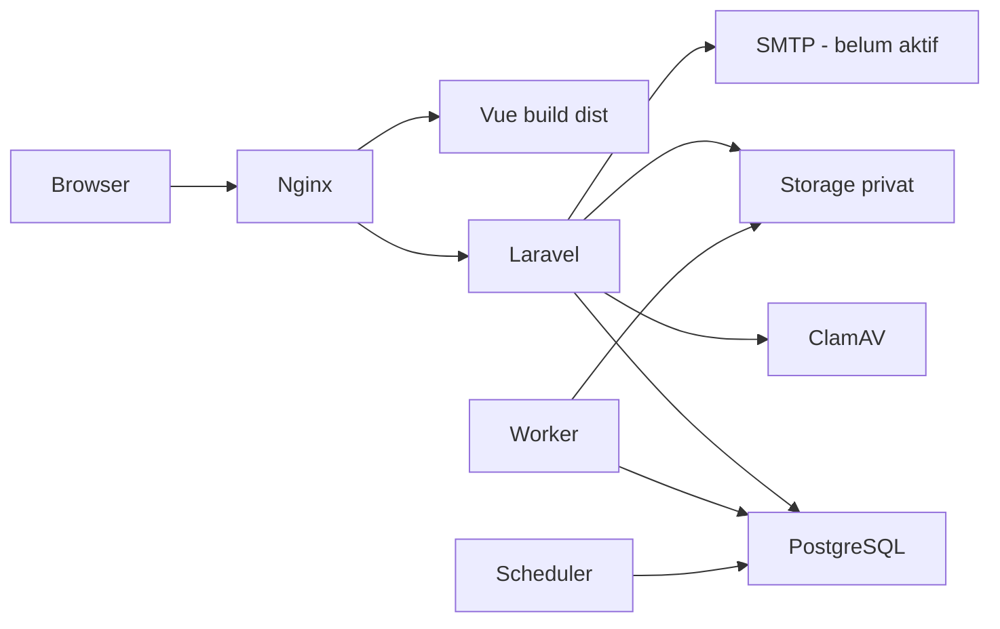
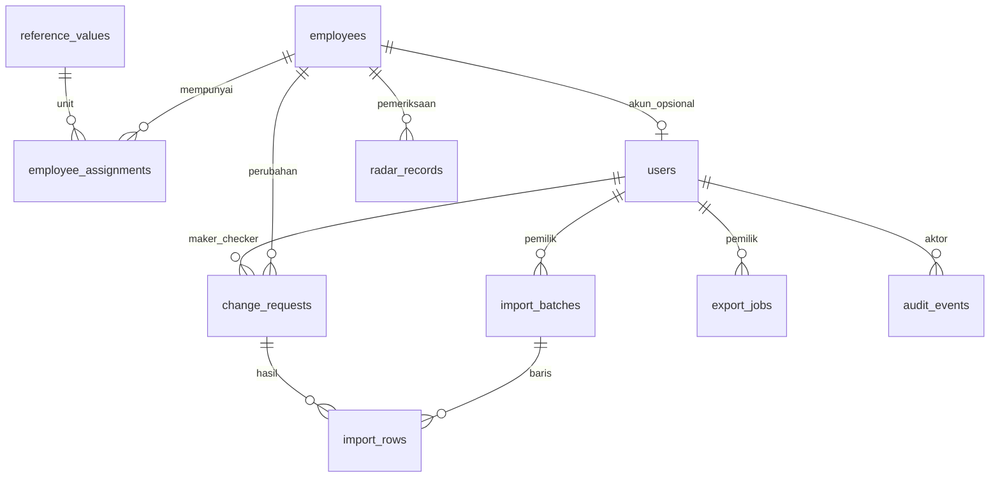

# Dokumentasi Teknis Sistem dan Panduan Serah Terima NADI ASN

DPMPTSP Prov. Sulawesi Tengah | Edisi 1.0 | 29 September 2026

Baseline: `5b1b70ae786ec4384614cebd41b50041cc1979df`. Distribusi internal.

## Identitas dokumen & batas bukti

Dokumentasi Teknis Sistem dan Panduan Serah Terima NADI ASN.

*Bab 01 / Orientasi; halaman PDF 2.*

| Atribut | Nilai |
| --- | --- |
| Pemilik sistem | DPMPTSP Prov. Sulawesi Tengah |
| Produk | NADI ASN - Navigasi dan Analitik Data Internal ASN |
| Versi dokumen | 1.0 / 29 September 2026 |
| Baseline kode | 5b1b70ae786ec4384614cebd41b50041cc1979df |
| Versi paket / aturan Radar | 0.1.0 / 2026-09-22.1 |
| Pembaca | Pengembang frontend/backend, DBA, operator VPS, tim keamanan dan penerus pengelola. |
| Klasifikasi | Internal. Tidak memuat password, token, kunci enkripsi, NIP atau database pegawai nyata. |

### Apa yang menjadi dasar

Perilaku aktif ditelusuri dari kode, route, konfigurasi dan migrasi pada baseline di atas. Status pemasangan dan hasil pengujian mengacu pada catatan operasional 28 September 2026. Penyusunan dokumen ini tidak melakukan audit keamanan ulang, pengujian beban, atau perubahan VPS.

> **Tiga label yang harus dibedakan**
> AKTIF = tersedia dalam kode. TERCATAT = pernah diverifikasi pada tanggal bukti. BELUM = memerlukan pekerjaan atau pengujian lanjutan. Keberadaan kelas atau tabel tidak selalu berarti tersedia sebagai fitur melalui API.

Dokumen ini melengkapi Buku Panduan Penggunaan 36 halaman. Simpan versi Markdown bersama kode; perbarui dokumen ketika route, skema, aturan, atau prosedur operasi berubah.

Sumber: `package.json`, `composer.json`, `docs/operations/SECURITY_REVIEW_2026-09-28.md`.

## Daftar isi

Klik judul bab atau gunakan bookmark pada pembaca PDF.

*Bab 01 / Navigasi; halaman PDF 3.*

- 4. Tujuan, lingkup & pengguna
- 5. Keputusan desain yang berlaku
- 6. Arsitektur aplikasi
- 7. Topologi deployment & jaringan
- 8. Teknologi & dependensi
- 9. Peta repository
- 10. Frontend & kontrak tampilan
- 11. Autentikasi & siklus sesi
- 12. Akun, aktivasi & pemulihan
- 13. Matriks otorisasi backend
- 14. Model data & hubungan inti
- 15. Kamus data: pegawai & unit
- 16. Kamus data: penugasan
- 17. Kamus data: identitas akses
- 18. Kamus data: perubahan & audit
- 19. Kamus data: impor & laporan
- 20. Infrastruktur data & komponen lama
- 21. Proyeksi data, waktu & kualitas
- 22. Transaksi perubahan pegawai
- 23. DUK manual & unit organisasi
- 24. Pipeline impor XLSX
- 25. Pipeline laporan & statistik
- 26. Mesin aturan KP & KGB
- 27. Radar: data, revisi & pengingat
- 28. Konvensi API & respons error
- 29. API publik, sesi & aktivasi
- 30. API pegawai, persetujuan & DUK
- 31. API impor & ekspor
- 32. API akun, unit & Radar
- 33. Contoh payload & kontrak perubahan
- 34. Keamanan: kontrol 1-10
- 35. Keamanan: kontrol 11-20
- 36. Konfigurasi & pengelolaan secret
- 37. Menyiapkan pengembangan lokal
- 38. Pengujian & penerimaan perubahan
- 39. VPS privat: akses & pemeriksaan
- 40. Runbook rilis & migrasi
- 41. Domain, HTTPS & SMTP
- 42. Pemantauan & tugas rutin
- 43. Strategi backup & retensi
- 44. Runbook pemulihan bencana
- 45. Troubleshooting & respons insiden
- 46. Kapasitas, batas & backlog teknis
- 47. Checklist serah terima tim IT
- 48. Indeks sumber & istilah teknis

## Tujuan, lingkup & pengguna

Satu aplikasi kepegawaian dengan pemisahan tegas antara statistik publik dan data individu.

*Bab 02 / Sistem; halaman PDF 4.*

### Tujuan operasional

Menyediakan direktori pegawai yang dapat dipertanggungjawabkan, alur perubahan dengan persetujuan, urutan DUK manual, pemeriksaan administrasi KP/KGB, serta laporan untuk kebutuhan instansi.

| Area | Tanggung jawab |
| --- | --- |
| Portal publik | Agregat pegawai aktif berdasarkan unit dan jenis pegawai; tidak mengirim identitas individu. |
| Admin Kepegawaian | Membaca data, mengajukan perubahan, impor Excel, mengedit isi DUK dan memperbarui pemeriksaan Radar. |
| Super Admin | Seluruh kegiatan Admin, keputusan usulan, urutan DUK, laporan, unit kerja dan akun Admin. |
| Pengelola teknis | Menjaga runtime, konfigurasi, backup, keamanan, deployment dan pemulihan. Akses SSH/Docker berbeda dari peran akun aplikasi. |

### Batas fungsi

- Tidak ada akun Pimpinan, API penghapusan pegawai, integrasi penggajian, SSO, ataupun sinkronisasi otomatis dengan sistem kepegawaian eksternal.

- Radar adalah pemeriksaan administrasi berdasarkan aturan instansi; hasilnya tidak menerbitkan keputusan kenaikan pangkat/gaji.

- Tautan Google Drive merupakan referensi folder. Aplikasi tidak mengunggah atau mengubah izin dokumen Drive.

> **Definisi rekap aplikasi**
> Total ASN pada NADI ASN = PNS + PPPK Penuh Waktu. PPPK Paruh Waktu direkap terpisah. Ini definisi pengelompokan produk, bukan penetapan status hukum kepegawaian.

Sumber: `routes/api_internal.php`, `resources/js/apps/internal/InternalApp.vue`, `app/Modules/Analytics/Services/PublicReleaseReader.php`.

## Keputusan desain yang berlaku

Revisi kebutuhan setelah PRD/Stage 1 menjadi acuan perilaku aplikasi saat ini.

*Bab 02 / Sistem; halaman PDF 5.*

| Topik | Implementasi aktif |
| --- | --- |
| DUK | Manual melalui employees.duk_order. Kepala Dinas/sekretaris tidak otomatis dipindahkan oleh algoritme hierarki. |
| Persetujuan | Super Admin boleh menyetujui usulan sendiri; Admin tidak boleh memutuskan. |
| Publik | Agregat langsung dari proyeksi pegawai aktif. Kelompok kecil tetap ditampilkan; rilis publik lama bukan sumber dashboard aktif. |
| Login | NIP 18 digit + password + TOTP. Email hanya untuk pemulihan Super Admin. |
| Data sumber | Masa kerja PDF adalah masa kerja keseluruhan beracuan September 2026; bukan MKG. |
| Penyajian | Tema awal light, tema dark tersimpan di browser; filter jenis jabatan; pilihan 10/30/50/All. |
| Pelaporan | Urutan Excel mengikuti DUK; Unit kerja muncul lebih awal pada PDF; kredit developer tidak dimasukkan dalam laporan. |
| Hosting | Enam layanan sudah tercatat dipasang privat di VPS; domain publik dan SMTP belum siap. |

> **Dokumen historis bukan spesifikasi tunggal**
> PRD, Stage 1, STATUS_IMPLEMENTASI dan VALIDASI memiliki bagian lama. Jika bertentangan, periksa revisi kebutuhan, route aktif, kode dan bukti operasional terbaru. Jangan mengaktifkan kembali fitur lama hanya karena tabelnya masih ada.

Status versi 0.1.0 pada paket adalah identitas paket, bukan tanda bahwa sistem masih menggunakan data simulasi.

Sumber: `docs/STATUS_IMPLEMENTASI.md`, `docs/VALIDASI.md`, `docs/operations/VPS_PRIVATE.md`, `app/Modules/Rules/Services/CalculationGate.php`.

## Arsitektur aplikasi

Modular monolith: satu backend Laravel, dibagi menurut domain; bukan kumpulan microservice.

*Bab 03 / Arsitektur; halaman PDF 6.*



### Batas kepercayaan

- Browser dianggap tidak tepercaya. Hak akses, validasi, revisi, kepemilikan berkas dan keputusan tetap diperiksa Laravel.

- Portal hanya memperoleh DTO agregat. Identitas, sumber mentah, password dan secret tidak masuk bundle frontend.

- PostgreSQL dan penyimpanan privat merupakan sumber data runtime. Repository hanya membawa kode, migrasi dan fixture sintetis.

> **Antrean memakai database**
> Tidak ada Redis, RabbitMQ, Elasticsearch, Kubernetes atau layanan object storage yang diwajibkan implementasi ini. Session, cache, lock dan queue menggunakan fasilitas database Laravel.

Sumber: `infra/compose.yaml`, `routes/web.php`, `config/session.php`, `config/cache.php`, `config/queue.php`.

## Topologi deployment & jaringan

Web menjadi pintu masuk; service internal tidak dipublikasikan langsung ke host.

*Bab 03 / Arsitektur; halaman PDF 7.*

| Layanan | Proses / hubungan | Batas RAM |
| --- | --- | --- |
| web | Nginx TLS 8443; host 127.0.0.1:18443 -> 8443. Meneruskan FastCGI ke app:9000. | 128 MiB |
| app | PHP-FPM; koneksi DB, storage privat, SMTP keluar, ClamAV. | 768 MiB |
| worker | queue:work; 3 percobaan, timeout 90 detik, proses diperbarui tiap 3.600 detik. | 768 MiB |
| scheduler | schedule:work; heartbeat satu menit. | 256 MiB |
| db | PostgreSQL 16; hanya jaringan backend; healthcheck pg_isready. | 768 MiB |
| antivirus | ClamAV; TCP 3310 internal, pembaruan signature keluar; healthcheck. | 3 GiB |

Network **backend** bertipe internal. Network **outbound** dipakai web/app/worker/scheduler/antivirus untuk kebutuhan keluar. DB hanya bergabung dengan backend. Tidak ada published port untuk DB, ClamAV atau PHP-FPM.

### Data persisten

Volume Compose: **database**, **private_files**, **app_logs**, **signatures**. Konfigurasi TLS dipasang read-only dari .deploy/tls. Owner DB password hanya dipasang pada container db melalui Docker secret.

> **Kapasitas perlu diukur**
> Batas RAM di Compose adalah limit per service, bukan hasil sizing atau jaminan konsumsi. Total limit sekitar 5,6 GiB di luar OS dan aplikasi kantor lain. Periksa headroom dan OOM sebelum menambah beban.

Sumber: `infra/compose.yaml`, `infra/nginx/default.conf`, `infra/docker/clamd.conf`.

## Teknologi & dependensi

Versi berikut menjelaskan baseline proyek; lockfile menentukan versi instalasi yang dapat diulang.

*Bab 03 / Arsitektur; halaman PDF 8.*

| Lapisan | Teknologi / fungsi |
| --- | --- |
| Frontend | Vue 3, TypeScript 5.9, Vue Router 4, Vite 7, Tailwind CSS 4. Plus Jakarta Sans lokal dan Lucide untuk ikon. |
| Backend | Laravel 13; composer mensyaratkan PHP ^8.3. Docker memakai PHP 8.4 FPM. |
| Database | PostgreSQL 16; JSONB, transaksi, row lock, trigger dan partial unique index. |
| MFA | pragmarx/google2fa; secret dienkripsi AES-256-CBC memakai kunci khusus TOTP. |
| Excel server | PhpSpreadsheet 5 untuk XLSX yang divalidasi dan ekspor bertipe string. |
| PDF server | Dompdf 3; remote resource dan eksekusi PHP dimatikan. |
| Ekspor browser | ExcelJS, jsPDF dan jspdf-autotable untuk template serta keluaran publik/simulasi. |
| Pengujian | PHPUnit 12 dan Vitest 4; vue-tsc saat build; parser PHP tambahan. |
| Build/hosting | Node 24, Composer 2, Docker Compose, Nginx dan ClamAV. |

Runtime yang tercatat diuji: PHP 8.4.25, Laravel 13.31.0, PostgreSQL 16.15 dan PHPUnit 12.5.35. Angka ini adalah bukti historis proyek, bukan klaim versi terbaru di internet.

> **Reproduksi rilis**
> Gunakan npm ci dan composer install dengan lockfile. Jangan menjalankan pembaruan dependency massal sebagai bagian deployment rutin. Base image Docker memakai digest; pembaruan harus menghasilkan rilis yang diuji kembali.

Sumber: `package.json`, `package-lock.json`, `composer.json`, `composer.lock`, `infra/docker/Dockerfile`, `docs/VALIDASI.md`.

## Peta repository

Mulai dari route dan entry point, lalu ikuti controller, service, model dan pengujiannya.

*Bab 04 / Kode; halaman PDF 9.*

| Lokasi | Isi dan penggunaan |
| --- | --- |
| resources/js/ | SPA Vue: apps/public, apps/internal, modules, components, domain, api dan types. |
| resources/css/app.css | Token tema, layout, tabel, responsivitas dan animasi. |
| app/Modules/ | Domain IdentityAccess, Personnel, Governance, Duk, Radar, Imports, SnapshotsReports, Analytics, References, Rules dan Audit. |
| app/Shared/ | Audit append dan canonical JSON/hash. |
| routes/ | web.php: sesi/CSRF; api_public.php; api_internal.php; console.php; provisioning lokal. |
| database/migrations/ | Sebelas migrasi domain/infrastruktur. PostgreSQL diperlukan oleh SQL khususnya. |
| resources/views/ | Template PDF statistik dan email pemulihan. |
| scripts/ | Server/fixture demo, ekstraksi PDF sumber, kalkulator Radar demo dan pemeriksaan sintaks PHP. |
| infra/ | Docker, Compose, Nginx, grant DB dan contoh backup. |
| tests/ | Laravel integration, Vitest unit dan pengujian API demo. |
| docs/ | Keputusan implementasi, panduan pengguna, setup, operasi dan bukti validasi. |

**Jangan disalin ke repository:** .env, .deploy, .runtime, dump DB, token aktivasi, source personnel privat dan berkas storage operasional. Folder runtime Laravel di Git hanya berisi penanda direktori kosong.

Saat menambahkan artefak dokumentasi, tinjau konteks build Docker agar PDF/sumber dokumentasi atau file sementara tidak ikut masuk image runtime tanpa kebutuhan.

Sumber: `.gitignore`, `.dockerignore`, `bootstrap/app.php`, `resources/js/main.ts`.

## Frontend & kontrak tampilan

Komponen mengambil data melalui API; mode data ditentukan server.

*Bab 04 / Kode; halaman PDF 10.*

| Bagian | Perilaku |
| --- | --- |
| Router | /, /tentang, /login, /aktivasi, /internal/:page? dan fallback 404. InternalApp memilih modul berdasarkan halaman. |
| Session store | Reactive session berisi user, ready, demo. loadSession membaca GET /api/session. Tidak memakai JWT di localStorage. |
| API client | fetch same-origin, Accept JSON; X-XSRF-TOKEN berasal dari cookie. FormData tidak dipaksa menjadi JSON. |
| Pagination | allEmployees mengikuti page/per_page backend. Master kemudian memfilter/memaginasi tampilan, termasuk positionType dan 10/30/50/All. |
| Pekerjaan asinkron | waitForResult memeriksa status tiap 1 detik hingga 60 kali. Batas tunggu UI bukan pembatalan job server. |
| Tema | localStorage nadi-theme hanya preferensi tampilan; default light. Tidak memberi hak akses atau mengubah mode data. |
| WebMCP opsional | Dua tool browser untuk membaca agregat dan menerapkan filter publik; tidak memberi akses tulis internal. |

### Prinsip perubahan UI

- Gunakan schema JSON bersama agar kolom Master, DUK, template dan ekspor tidak menyimpang. Perubahan label tetap harus diuji terhadap mapping impor.

- Pertahankan label status berbentuk teks, fokus keyboard, dialog native, scroll tabel dalam kontainer dan dukungan reduced motion.

> **Perhatian skala**
> Pagination API daftar pegawai membatasi respons, tetapi controller saat ini memuat proyeksi seluruh pegawai terlebih dahulu. Tampilan All tidak berarti query database sudah efisien untuk puluhan ribu pegawai.

Sumber: `resources/js/main.ts`, `resources/js/api/client.ts`, `resources/js/api/webmcp.ts`, `resources/js/domain/personnel-schema.json`, `app/Modules/Personnel/Http/EmployeeController.php`.

## Autentikasi & siklus sesi

Password yang benar hanya menghasilkan challenge; akses internal mensyaratkan TOTP selesai.

*Bab 05 / Identitas; halaman PDF 11.*

**CSRF**: Ambil cookie → **Password**: Challenge 5 menit → **TOTP**: Verifikasi 6 digit → **Sesi penuh**: Role + versi akun

| Tahap | Detail teknis |
| --- | --- |
| Login | Cari users.login_name dengan NIP 18 digit, akun aktif, role ADMIN/SUPER_ADMIN, Hash::check. Challenge menyimpan user, security_version dan kedaluwarsa. |
| TOTP | Lock user; validasi versi challenge; decrypt secret memakai NADI_TOTP_KEY; verifyKeyNewer dengan window 1; simpan last_totp_step untuk mencegah replay. |
| Sesi penuh | Auth::login lalu regenerasi session ID. Simpan totp_completed, security_version, absolute_expires_at. |
| Setiap API internal | RequireFullSession memeriksa user aktif, role, TOTP, versi akun dan batas absolut. Gagal: invalidasi sesi, token CSRF baru, HTTP 401. |
| Durasi | Idle default 30 menit melalui SESSION_LIFETIME; maksimum absolut 8 jam. Cookie nadi_session: HttpOnly, SameSite Strict dan Secure pada produksi. |
| Logout | Auth logout, invalidasi session dan regenerasi CSRF. |

> **APP_KEY berbeda dari NADI_TOTP_KEY**
> APP_KEY melindungi fasilitas enkripsi Laravel/sesi. NADI_TOTP_KEY adalah 32 byte acak dalam base64 untuk secret autentikator. Kehilangan kunci TOTP membuat ciphertext tidak dapat dibaca; mengganti kunci begitu saja bukan prosedur reset.

GET /api/session mengembalikan user ringkas atau null dan demo:false. Informasi ini untuk UI; otorisasi tetap dievaluasi ulang pada tiap endpoint internal.

Sumber: `app/Modules/IdentityAccess/Http/AuthController.php`, `app/Modules/IdentityAccess/Middleware/RequireFullSession.php`, `config/session.php`.

## Akun, aktivasi & pemulihan

Tautan aktivasi dan tautan pemulihan memakai alur akhir yang sama, tetapi dampak penerbitannya berbeda.

*Bab 05 / Identitas; halaman PDF 12.*

| Alur | Perilaku saat ini |
| --- | --- |
| Akun Admin | Super Admin memilih pegawai aktif. employee_id dan login_name harus unik; role payload dilarang dan server menetapkan ADMIN. |
| Reset Admin | Akun langsung nonaktif; security_version bertambah, password acak dan secret TOTP baru. Tautan berlaku 24 jam, hash SHA-256 disimpan. |
| Pemulihan Super Admin | Cari recovery_email. Token 32 byte acak -> 64 karakter hex; secret baru disimpan terpisah. Berlaku 30 menit; akun lama tetap bekerja sampai aktivasi berhasil. |
| Aktivasi | URL /aktivasi#token. Client mengirim X-Activation-Token; password minimal 12, konfirmasi password dan OTP wajib. Token dihapus setelah berhasil. |
| Penonaktifan | Admin nonaktif, versi keamanan bertambah dan tautan aktivasi dicabut. Data pegawai tidak dihapus. |
| Proteksi Super Admin | UI akun tidak membuat, mereset atau menonaktifkan Super Admin. Akun pertama melalui provisioning operator. |

### Batas dan implikasi

- QR enrollment, recovery codes dan reauthentication khusus belum tersedia. Secret ditambahkan manual ke autentikator.

- Perubahan NIP/nama di Master tidak otomatis menyinkronkan login_name/nama akun. Perlakukan koreksi identitas login sebagai pekerjaan pengelola yang diverifikasi.

> **Pengiriman email belum operasional**
> RecoveryController mengirim email sinkron di dalam transaksi. SMTP gagal -> token baru di-rollback dan respons 503. Keberhasilan mail fake di tes bukan bukti pengiriman SMTP nyata.

Sumber: `app/Modules/IdentityAccess/Http/AccountController.php`, `app/Modules/IdentityAccess/Http/ActivationController.php`, `app/Modules/IdentityAccess/Http/RecoveryController.php`.

## Matriks otorisasi backend

P = publik, A = Admin Kepegawaian, S = Super Admin. Semua mutasi membutuhkan CSRF.

*Bab 05 / Identitas; halaman PDF 13.*

| Operasi | P | A | S |
| --- | --- | --- | --- |
| Statistik/daftar unit publik | Ya | Ya | Ya |
| Data individu, dashboard, DUK, Radar | - | Ya | Ya |
| Mengajukan / batch perubahan | - | Ya | Ya |
| Memutuskan usulan | - | - | Ya |
| Mengubah urutan DUK | - | - | Ya |
| Impor: unggah/validasi/konfirmasi | - | Milik sendiri | Milik sendiri |
| Detail batch milik Admin lain | - | - | Baca saja |
| Ekspor internal / unduhan | - | - | Milik sendiri + versi akun |
| Baca audit / penjelasan rules | - | Ya | Ya |
| Kelola unit dan akun Admin | - | - | Ya |
| Edit pemeriksaan KP/KGB | - | Ya | Ya |

### Pemeriksaan berlapis

Middleware full-session menolak sesi parsial dan akun yang tidak sah. Controller/service memeriksa peran dan kepemilikan; constraint, transaction dan trigger menjaga integritas DB. Tautan langsung ke halaman atau menyembunyikan tombol tidak menggantikan kontrol ini.

> **Tidak ada pembatasan Admin per unit**
> Role ADMIN saat ini boleh membaca dan mengajukan perubahan lintas unit. Jika organisasi membutuhkan pembatasan per unit, tambahkan policy dan tes backend; filter dropdown bukan kontrol akses.

Daftar audit hanya 100 kejadian terakhir; daftar usulan 100, daftar impor milik sendiri 100, riwayat ekspor 50. Batas ini perlu diperhatikan ketika menelusuri kejadian lama.

Sumber: `routes/api_internal.php`, `app/Modules/Imports/Services/ImportService.php`, `app/Modules/SnapshotsReports/Http/ExportController.php`.

## Model data & hubungan inti

UUID menjadi identitas mayoritas entitas; relasi berikut merangkum domain aktif.

*Bab 06 / Data; halaman PDF 14.*



### Kaidah hubungan

- Satu employee dapat memiliki banyak assignment dan change request; users.employee_id bersifat nullable dan unik.

- Unit kerja disimpan di reference_values dengan kind=unit; assignment menyimpan unit_id serta label historis unit.

- Radar memakai primary key gabungan employee_id + kind. Kolom updated_by menunjuk user pemeriksa.

- Import row dapat menunjuk change_request yang dihasilkan saat konfirmasi. ExportJob menyimpan pemilik dan salinan parameter/data laporan.

> **Bukan model histori bitemporal penuh**
> Identitas di employees diperbarui langsung setelah persetujuan. Histori assignment tersedia, tetapi tidak seluruh atribut identitas dapat direkonstruksi secara point-in-time. Audit/changes menyimpan bukti perubahan, bukan pengganti resolver histori lengkap.

Sumber: `database/migrations/`, `app/Modules/Personnel/Models/Employee.php`, `app/Modules/Governance/Services/ChangeService.php`.

## Kamus data: pegawai & unit

Nama kolom database memakai snake_case; DTO frontend memakai camelCase.

*Bab 06 / Data; halaman PDF 15.*

| Tabel / kolom | Tipe dan makna |
| --- | --- |
| employees.id; nip | UUID PK; varchar(18) unik + CHECK 18 digit. NIP selalu teks. |
| name; gender | varchar(200); varchar(20), CHECK Perempuan/Laki-laki. |
| birth_place; birth_date | varchar(100) nullable; date nullable. Dasar perhitungan usia. |
| education; institution; graduation_date | varchar(30); text nullable; date nullable. Tingkat, institusi/nama pendidikan dan tanggal lulus. |
| drive_url; revision | text nullable; bigint default 1. Revisi kontrol konkurensi. |
| source_order; duk_order | integer nullable; integer unsigned secara deklarasi Laravel, nullable dan berindeks. Urutan sumber terpisah dari urutan aktif. |
| age_at_reference; source_payload; source_issues | integer nullable; JSONB nullable; JSONB nullable. Arsip sumber/masalah; usia DTO dihitung ulang. |
| created_at; updated_at | Timestamp with time zone. |
| reference_values | id UUID PK; kind varchar(30), code varchar(50), label varchar(200); verified/active boolean; metadata JSONB nullable; timestamps. Unique(kind,code). |

### Unit kerja dan rename

Proyeksi membaca label dari relasi unit_id, dengan fallback label assignment. Rename menghubungkan assignment lama tanpa unit_id ke referensi yang sama. Daftar urutan tampilan berada pada unit-order.json dan diurutkan konsisten oleh PHP/TypeScript.

> **Catatan penonaktifan unit**
> Pemeriksaan occupied menelusuri seluruh assignment berstatus OFFICIAL, tidak hanya assignment terbaru. Riwayat OFFICIAL lama dapat tetap menghalangi penonaktifan meski pegawai sudah pindah. Jangan menghapus histori; evaluasi aturan/proyeksi jika kondisi ini muncul.

Sumber: `database/migrations/2026_09_11_000002_create_personnel_and_governance.php`, `database/migrations/2026_09_14_000005_personnel_directory_update.php`, `app/Modules/References/Http/UnitController.php`.

## Kamus data: penugasan

employee_assignments menyimpan kondisi jabatan dan kepegawaian yang disahkan.

*Bab 06 / Data; halaman PDF 16.*

| Kolom | Tipe / aturan |
| --- | --- |
| id; employee_id; approved_by | UUID PK; FK employees; FK users. Relasi utama restrict-on-delete. |
| type; status; record_status | varchar(30), varchar(30), varchar(20). Jenis pegawai, status kepegawaian dan OFFICIAL/SUPERSEDED. |
| unit; unit_id | varchar(150); FK reference_values nullable. |
| position; position_type; grade | varchar(200), varchar(50), varchar(20). |
| effective_date | date wajib. Tanggal berlakunya record histori, ditetapkan hari persetujuan. |
| position_tmt; rank_tmt; rank_name | date nullable; date nullable; varchar(200) nullable. |
| service_years; service_months; service_reference | integer nullable; integer nullable; varchar(7), default 2026-09. |
| contract_start; contract_end | date nullable. CHECK: tanggal akhir memerlukan tanggal mulai dan tidak boleh lebih awal. |
| duk_position_level; training_level; training_date | varchar(60), varchar(40), date nullable. Sisa dukungan hierarki DUK lama; tidak mengurutkan DUK manual. |
| created_at; updated_at | Timestamp with time zone. |

### Indeks dan pemilihan record

Indeks employee_id/record_status/effective_date membantu pemilihan assignment. Partial unique index membatasi satu OFFICIAL per pegawai per effective_date. Proyeksi memilih OFFICIAL terakhir dengan effective_date <= tanggal acuan.

> **Tiga tanggal yang berbeda**
> DTO effectiveDate adalah TMT jabatan dari position_tmt. Kolom DB effective_date adalah tanggal penerapan histori. rank_tmt adalah TMT pangkat untuk Radar. Jangan memetakan ketiganya ke satu tanggal ketika membuat integrasi.

Sumber: `database/migrations/2026_09_11_000002_create_personnel_and_governance.php`, `database/migrations/2026_09_14_000006_separate_position_date.php`, `app/Modules/Personnel/Services/EmployeeProjection.php`.

## Kamus data: identitas akses

Secret tidak boleh ditampilkan pada log, dump publik, tiket atau tangkapan layar dokumentasi.

*Bab 06 / Data; halaman PDF 17.*

| Tabel | Kolom penting dan invariannya |
| --- | --- |
| users | id UUID; name; email nullable/unique; login_name nullable/unique; employee_id nullable/unique FK; password; role; is_active; security_version; totp_secret; last_totp_step; remember_token; recovery_email; timestampsTz. |
| account_activations | user_id PK/FK; token_hash varchar(64); expires_at timestamptz. Satu tautan terakhir per akun. |
| account_recoveries | user_id PK/FK; token_hash unique; totp_secret terenkripsi; security_version bigint; expires_at dan created_at timestamptz. |
| sessions | id string PK; user_id nullable FK; ip_address; user_agent; payload; last_activity integer berindeks. |

### Hash, enkripsi dan revokasi

- User model memakai cast password hashed dan Hash::check. Password tidak disimpan dalam teks asli; algoritme mengikuti hasher Laravel yang aktif.

- totp_secret dienkripsi memakai kunci khusus, sedangkan token aktivasi/pemulihan disimpan sebagai SHA-256. Token mentah hanya tersedia saat diterbitkan/dikirim.

- security_version dibandingkan pada sesi, challenge TOTP, pemulihan dan ekspor. Kenaikan versi membatalkan kewenangan lama tanpa mengandalkan browser menutup halaman.

> **Provisioning pertama memiliki langkah lanjutan**
> nadi:create-admin membuat akun dengan NIP, password dan secret dari proses enrollment, tetapi tidak mengisi recovery_email atau employee_id. Kaitan pegawai dan email pemulihan perlu ditetapkan pengelola tepercaya; jangan menganggap email biasa otomatis menjadi email pemulihan.

Sumber: `app/Modules/IdentityAccess/Models/User.php`, `database/migrations/2026_09_15_000008_manual_duk_and_accounts.php`, `database/migrations/2026_09_16_000009_super_admin_recovery.php`, `routes/console.php`.

## Kamus data: perubahan & audit

Semua keputusan yang diterapkan harus dapat ditelusuri ke pembuat, pemeriksa dan alasan.

*Bab 06 / Data; halaman PDF 18.*

| Tabel | Kolom / fungsi |
| --- | --- |
| change_requests | id UUID; employee_id nullable; maker_id; checker_id nullable; status default PENDING; before JSONB; changes JSONB; base_revision bigint; content_hash SHA-256; reason; decision_reason; applied_at; timestampsTz. |
| audit_events | id UUID; actor_id FK; actor_name; action; subject; metadata JSONB; created_at. Indeks actor_id/created_at. |
| outbox_events | id UUID; kind; aggregate_id UUID; payload JSONB; created_at; processed_at nullable berindeks. |
| radar_records | PK(employee_id UUID,kind varchar(3)); data JSONB; revision integer; employee_revision integer; updated_by FK users; created_at/updated_at. |

### Integritas dan batasnya

- content_hash dihitung dari canonical JSON: key object diurutkan; urutan array dipertahankan; SHA-256 dihitung atas representasi deterministik.

- Trigger nadi_prevent_mutation menolak UPDATE/DELETE audit. Role runtime juga tidak diberi hak mengubah/menghapus audit atau TRUNCATE.

- Trigger check_self_approval mengizinkan maker=checker hanya jika role checker adalah SUPER_ADMIN. Validasi akun aktif tetap di aplikasi.

- Outbox PERSONNEL_CHANGED ditulis dalam transaksi persetujuan. Consumer outbox belum tersedia; jangan menganggap notifikasi/sinkronisasi sudah berjalan.

> **Audit bukan hash-chain bertanda tangan**
> Canonical hash digunakan pada objek tertentu, bukan rantai kriptografis seluruh audit. Operator DB owner tetap merupakan pihak berprivilege tinggi; pisahkan pengelolaan owner, akses runtime dan backup.

Sumber: `app/Shared/CanonicalJson.php`, `app/Shared/Audit.php`, `database/migrations/2026_09_15_000008_manual_duk_and_accounts.php`, `database/migrations/2026_09_22_000011_create_radar_records.php`.

## Kamus data: impor & laporan

Berkas disimpan pada disk local privat; database menyimpan metadata, preview dan status.

*Bab 06 / Data; halaman PDF 19.*

| Tabel | Kolom penting |
| --- | --- |
| import_batches | id; maker_id; filename; file_path; checksum; status; mapping JSONB; headers JSONB; row_count; preview_hash; error_message; duplicate_of nullable UUID; confirmed_at; expires_at; timestampsTz. |
| import_rows | id; batch_id FK; row_number; status; source JSONB; diff JSONB; errors JSONB; change_request_id nullable FK; timestampsTz. Unique(batch_id,row_number). |
| export_jobs | id; owner_id FK; status; format; kind; file_path nullable; parameters JSONB; expires_at nullable; timestampsTz. |

**File privat**: Checksum bytes → **Preview**: Hash isi/diff → **Usulan**: Revisi pegawai → **Hasil**: Audit + metadata

### Masa simpan bukan penghapusan otomatis

expires_at impor diisi berdasarkan NADI_IMPORT_RETENTION_DAYS, default 14 hari. Namun authorize/confirm saat ini tidak memeriksa expiry; belum ada purge terjadwal. Jangan menyebut impor otomatis terblokir atau terhapus setelah 14 hari.

Laporan READY memperoleh expiry tujuh hari dari waktu render. Endpoint unduh memeriksa expiry dan keberadaan berkas. Penghapusan file fisik setelah expiry belum dijadwalkan; pemantauan kapasitas dan kebijakan retensi tetap perlu dibuat.

> **Pisahkan metadata dan file**
> Backup DB saja tidak memulihkan berkas imports/exports di volume private_files. Sebaliknya, menyalin file tanpa metadata DB tidak memulihkan kepemilikan dan status unduh.

Sumber: `database/migrations/2026_09_11_000003_create_rules_imports_and_publication.php`, `database/migrations/2026_09_12_000004_extend_import_workflow.php`, `app/Modules/Imports/Services/ImportService.php`.

## Infrastruktur data & komponen lama

Katalog ini mencegah salah tafsir bahwa semua tabel memiliki menu atau API aktif.

*Bab 06 / Data; halaman PDF 20.*

| Tabel / komponen | Status dan kegunaan |
| --- | --- |
| jobs; failed_jobs | Queue database Laravel. jobs menyimpan payload/reservasi/attempt; failed_jobs menyimpan exception kegagalan. Log/payload tetap data internal. |
| cache; cache_locks | Cache key/value/expiry dan distributed lock. Digunakan juga rate limiter, restart worker dan heartbeat scheduler. |
| migrations | Catatan migrasi Laravel; runtime hanya SELECT. |
| rulesets | Skema versi aturan, parameters JSONB, hash, maker/checker, status dan effective_date. UI aktif hanya penjelasan rules; kalkulator Radar menggunakan konstanta kode. |
| duk_candidates | Payload kandidat DUK hierarki lama dengan ruleset/as_of/hash/maker; immutable. Bukan sumber DUK manual aktif. |
| published_snapshots | Payload publikasi historis, ruleset, template, pembuat/penerbit, hash dan duk_candidate_id opsional. Immutable. |
| public_releases | safe_payload historis, data_revision, policy_version, approver, expiry dan hash. Bukan sumber portal aktif. |
| notifications | Skema user/kind/title/payload/read_at tersedia, belum ada alur notifikasi lengkap melalui API aktif. |

> **Jangan membuka route lama tanpa review**
> DukController, DukRanking dan cabang renderer kind=duk masih ada. routes/api_internal.php aktif memakai ManualDukController; POST exports hanya menerima employees/statistics. Constraint publisher!=maker pada tabel publikasi lama tidak sama dengan kebijakan self-approval change request.

Sebelas migrasi tersusun dari 000001 sampai 000011. Beberapa down() sengaja menolak rollback karena membawa histori/kebijakan. Gunakan migrasi lanjutan yang ditinjau; jangan mengandalkan migrate:rollback untuk memulihkan produksi.

Sumber: `database/migrations/`, `routes/api_internal.php`, `app/Modules/Duk/Http/DukController.php`, `app/Modules/SnapshotsReports/Jobs/RenderExport.php`.

## Proyeksi data, waktu & kualitas

Nilai tampilan dapat berubah mengikuti tanggal tanpa menulis ulang semua record database.

*Bab 07 / Aturan bisnis; halaman PDF 21.*

### Masa kerja keseluruhan

```text
selisih_bulan = max(0, (tahun_kini - tahun_acuan) * 12
                      + bulan_kini - bulan_acuan)
total_bulan = tahun_sumber * 12 + bulan_sumber + selisih_bulan
tahun_tampil = total_bulan // 12
bulan_tampil = total_bulan % 12
```

PersonnelClock memakai service_reference YYYY-MM, dengan acuan awal 2026-09. Jika bulan sumber di luar 0-11, anomali dipertahankan agar diperiksa petugas. Data acuan tidak digeser setiap kali dibaca. Saat masa kerja diubah, referensi baru default bulan pengajuan.

| Contoh | Nilai |
| --- | --- |
| September 2026 | 13 tahun 1 bulan |
| Oktober 2026 | 13 tahun 2 bulan |
| Juli 2029 | 15 tahun 11 bulan |

### Usia dan kelengkapan

Usia dihitung dari birth_date ke tanggal acuan, dibulatkan ke tahun penuh; tanggal lahir kosong/di masa depan menghasilkan null. APP_TIMEZONE adalah Asia/Makassar. Halaman yang tetap terbuka perlu dimuat ulang agar proyeksi baru terlihat.

Kelengkapan = persentase isian relevan yang tidak null/kosong/“-”. Schema 18 kolom, usia dikecualikan; PPPK Paruh Waktu juga mengecualikan rankName, serviceYears, serviceMonths. Angka 0 sah. Skor tidak menjamin kebenaran dokumen.

> **Batas histori waktu**
> asOf pada proyeksi memilih assignment menurut tanggal, tetapi identitas employees tetap nilai terbaru. Fungsi service tidak menghitung mundur sebelum bulan acuan. Hindari menyebut keluaran ini arsip historis penuh.

Sumber: `app/Modules/Personnel/Services/PersonnelClock.php`, `app/Modules/Personnel/Services/EmployeeProjection.php`, `resources/js/domain/personnel-schema.json`.

## Transaksi perubahan pegawai

Data resmi hanya berubah ketika proposal APPROVED berhasil diterapkan.

*Bab 07 / Aturan bisnis; halaman PDF 22.*

**Submit**: revision + changes → **PENDING**: before + hash → **Decide**: Role + lock → **Apply**: Histori + audit

### Saat usulan dikirim

- Lock employee jika ada; base revision harus sama. Perubahan umur otomatis dibuang. Tolak field di luar allowlist; validasi kandidat gabungan before + changes.

- Periksa NIP unik, enum, tanggal, unit aktif terverifikasi dan URL Drive HTTPS yang diizinkan. Simpan proposal PENDING, canonical content_hash dan alasan.

### Saat diputuskan

- Hanya Super Admin. Lock proposal, pastikan masih PENDING dan hash cocok. APPROVED memeriksa revisi employee dan validasi kandidat sekali lagi.

- TMT jabatan masa depan ditolak saat penerapan. Update identitas, naikkan revision; assignment OFFICIAL pada hari yang sama menjadi SUPERSEDED, lalu buat assignment OFFICIAL baru.

- Simpan status APPROVED/REJECTED, checker, alasan, applied_at jika disetujui, audit dan outbox dalam transaksi. Kegagalan membatalkan penerapan parsial.

> **Penanganan 409**
> Muat ulang, bandingkan data terbaru dan susun usulan baru. Jangan menimpa revision/hash untuk memaksa lewat. Proposal yang ditolak tidak diedit langsung; perbaikan diajukan lagi.

Batch edit isi DUK dibatasi 500 baris dan dibungkus transaksi. Bila satu baris konflik, pengajuan batch dibatalkan seluruhnya. Pembuatan pegawai memakai employeeId kosong dengan nilai wajib lengkap.

Sumber: `app/Modules/Governance/Http/ChangeController.php`, `app/Modules/Governance/Services/ChangeService.php`.

## DUK manual & unit organisasi

Urutan pegawai dan urutan unit adalah dua konsep yang berbeda.

*Bab 07 / Aturan bisnis; halaman PDF 23.*

### Kontrak urutan DUK

GET /api/duk menghasilkan rows, daftar seluruh employee ID dalam order, dan hash canonical dari order. Penyimpanan Super Admin harus mengirim seluruh ID tepat satu kali, hash awal, alasan serta rows perubahan isi jika ada.

**Hash awal**: Snapshot order → **Lock tabel**: Cegah balapan → **Validasi set**: Tidak hilang/ganda → **Commit**: Order + usulan

ManualDukController menggunakan LOCK TABLE employees IN SHARE ROW EXCLUSIVE MODE. Hash yang berbeda menghasilkan 409. Jika set ID tidak sama, respons 422. Urutan disimpan sebagai duk_order 1..N dan audit before/after; perubahan sel tetap berupa proposal.

### Perilaku filter

Panah menaikkan/menurunkan menukar pegawai dengan tetangga pada hasil filter, termasuk lintas halaman. Pegawai di luar filter tetap pada posisi globalnya. Nomor urut terlihat dapat melompat; ekspor mengikuti urutan global tersimpan.

### Urutan unit

Kepala Dinas, Sekretaris, TIM 1-7, lalu Sekretariat Kepegawaian dan Umum, Keuangan dan Aset, Program. Nama/urutan acuan berada di resources/js/domain/unit-order.json; PHP UnitOrder dan frontend memakainya. Unit tambahan diurutkan setelah acuan.

> **Implikasi integrasi**
> Jangan menafsirkan source_order sebagai nomor DUK aktif. Pegawai baru yang belum diberi duk_order ditempatkan sesudah yang sudah diurutkan. Mengubah label unit tidak mengubah urutan pegawai.

Sumber: `app/Modules/Duk/Http/ManualDukController.php`, `app/Modules/Personnel/Models/Employee.php`, `resources/js/modules/duk/DukPage.vue`, `resources/js/domain/unit-order.json`.

## Pipeline impor XLSX

Upload, validasi preview dan konfirmasi adalah tahap berbeda dengan hak pemilik.

*Bab 07 / Aturan bisnis; halaman PDF 24.*

**UPLOADED**: Scan + staging → **VALIDATING**: Worker → **PREVIEW**: VALID / INVALID → **CONFIRMED**: Usulan dibuat

| Tahap | Jaminan / batas |
| --- | --- |
| Upload | XLSX 5 MiB; ClamAV sebelum parsing; satu worksheet, 1.000 baris data, 50 kolom; 2.000 entry ZIP, 25 MiB terurai. File bernama acak disimpan privat. |
| Mapping | Field tujuan allowlist; NIP wajib dipetakan; nama header harus ada dan satu kolom tidak dipakai dua field. |
| Validasi | Worker membaca staging, menolak formula/NIP numerik/duplikat; mencari NIP untuk update atau insert; sel kosong tidak menghapus nilai existing. |
| Preview | Baris VALID, INVALID atau UNCHANGED; preview_hash mencakup status/diff. Error tersedia per baris. |
| Konfirmasi | Hash harus cocok; unggahan identik butuh confirmDuplicate. Baris VALID menjadi proposal; konflik revisi membatalkan seluruh konfirmasi. |
| Ulang konfirmasi | Batch CONFIRMED dengan hash sama mengembalikan jumlah proposal sebelumnya; tidak menggandakan usulan. |

ValidateImport memiliki tries=3 dan timeout=90. Setelah gagal permanen, batch berubah FAILED dengan pesan generik. Konfirmasi sukses tidak berarti perubahan pegawai telah disetujui.

> **Template dan status tambahan**
> Template UI berisi 17 isian, tidak termasuk usia otomatis. Backend masih menerima beberapa field lama/opsional dalam allowlist untuk kompatibilitas; itu bukan alasan menambahkan kolom sumber kembali ke UI. Tidak ada rollback kompensasi massal setelah proposal disetujui.

Sumber: `app/Modules/Imports/Services/ImportService.php`, `app/Modules/Imports/Jobs/ValidateImport.php`, `app/Modules/Imports/Services/UploadScanner.php`.

## Pipeline laporan & statistik

Input laporan dibekukan ketika permintaan dibuat, bukan ketika worker mulai merender.

*Bab 07 / Aturan bisnis; halaman PDF 25.*

**Request**: Super Admin → **QUEUED**: Salinan parameter → **Render**: XLSX / PDF → **READY**: Unduh 7 hari

### Laporan internal

kind=employees menghasilkan XLSX, default pegawai Aktif kecuali allStatuses. Filter unit/type/positionType/status/search/quality diterapkan; baris mengikuti DUK. kind=statistics menghasilkan PDF agregat per unit; controller statistik saat ini meneruskan unit saja, bukan seluruh filter ekspor pegawai.

parameters menyimpan actor, securityVersion, filter dan rows atau statistics. XLSX memakai tipe string eksplisit untuk semua nilai, mempertahankan NIP dan mencegah formula. PDF memakai Blade escaped, remote resource false dan isPhpEnabled false.

### Unduh dan daftar riwayat

Pemilik, role Super Admin, security_version, status READY, expiry dan keberadaan file diperiksa. Permintaan dan unduhan masuk audit. Renderer dapat diulang dan berhenti jika job sudah READY. Gagal permanen menjadi FAILED.

### Statistik publik

PublicReleaseReader membaca proyeksi aktif lalu membentuk DTO agregat. Default grafik mengikuti kelompok ASN; filter Paruh Waktu membuat grafik kelompok itu, sementara total ASN tetap nol. Tidak ada nama/NIP/tanggal lahir/source dalam DTO publik.

> **Jangan tertukar dengan rilis lama**
> NADI_PUBLIC_RELEASE_ENABLED dan tabel public_releases tidak mengendalikan dashboard aktif. Nama PublicReleaseReader bersifat historis; kelas ini sekarang membaca agregat langsung. Angka tepat kelompok kecil tetap berpotensi dikaitkan dengan pengetahuan eksternal.

Sumber: `app/Modules/SnapshotsReports/Http/ExportController.php`, `app/Modules/SnapshotsReports/Jobs/RenderExport.php`, `app/Modules/Analytics/Services/PublicReleaseReader.php`.

## Mesin aturan KP & KGB

Kalkulator PHP menjadi acuan pemeriksaan administrasi versi 2026-09-22.1.

*Bab 07 / Aturan bisnis; halaman PDF 26.*

| Jalur | Aturan utama yang diterapkan |
| --- | --- |
| KP Pelaksana | Minimal 4 tahun dari rankTmt pada target; pendidikan diakui dan tidak melampaui batas; ujian dinas/pembebasan untuk transisi relevan; kinerja dua tahun minimal Baik. |
| KP Fungsional | Minimal 2 tahun; jenjang Ahli dibaca dari nama jabatan dan sesuai golongan tujuan; AK/PAK dan verifikasi fungsional; kinerja minimal Baik. |
| KP Struktural | Target ditetapkan pengelola; rentang pangkat, jalur dan riwayat pelantikan diverifikasi. Tidak menggunakan rumus umum empat tahun. |
| KGB | lastKgbTmt + 2 tahun (tanpa overflow tanggal). lastKgbDate terpisah sebagai tanggal SK. Kinerja dua tahun minimal Cukup; dokumen diverifikasi. |
| Batas pendidikan KP | SD II/a; SMP II/c; SMA/SMK/D1/D2 III/b; D3 III/c; S1/D4 III/d; S2 IV/a; S3 IV/b. |
| AK fungsional | Golongan terakhir III/a-b: 50; III/c-d: 100; IV/a-c: 150; IV/d-e: 200. Tambahan kumulatif III/b:100, III/d:200, IV/c:450. |

KP memakai tanggal target 1 sejak Oktober 2025. Perkiraan otomatis dibulatkan ke periode yang memenuhi masa pangkat dan belum melewati tenggat baseline. Target yang telah diperiksa dibekukan saat save agar siklus tidak bergeser diam-diam.

> **Cakupan terbatas**
> Hanya PNS aktif. Perhitungan fungsional berfokus pada jenjang Ahli; jabatan yang tidak dikenali membutuhkan penanganan aturan, bukan menebak jenjang. Ruleset ini mendokumentasikan implementasi instansi; validasi kebijakan baru harus disertai perubahan kode dan tes.

Sumber: `app/Modules/Radar/Services/RadarCalculator.php`, `NADI-ASN-Rules-KP dan KGB.md`, `docs/user/RADAR.md`.

## Radar: data, revisi & pengingat

Kesiapan administratif berbeda dari status proses usulan.

*Bab 07 / Aturan bisnis; halaman PDF 27.*

| Kelompok data JSON | Field |
| --- | --- |
| Waktu | lastKgbDate, lastKgbTmt, targetDate, deadline, correctionDeadline. |
| Kinerja dan AK | performance1/2, performanceYear1/2, credit, cumulativeCredit. |
| Verifikasi | documentsVerified, educationRecognized, examVerified, functionalVerified, managerialVerified. |
| Referensi | documentReference, appointmentReference, pakReference, scheduleReference. |
| Proses | process, processNote, reason; employeeRevision disisipkan dari Master. |

Simpan memakai revision Radar dan employeeRevision. Server mengunci employee dan record Radar; mismatch menghasilkan 409. data disaring allowlist, audit menyimpan before/after serta versi aturan. Perubahan Radar berlaku langsung tanpa antrean persetujuan Master.

### Keluaran kalkulator

status, checks (pass/fail/missing), reasons, targetDate, earliestDate, nextGrade, level, creditNeeded, cumulativeNeeded, reminderDate, reminderActive, submissionOpen, deadline, performanceYears, asOf dan version.

Fail memiliki prioritas terhadap missing: Belum memenuhi -> Data belum lengkap -> Siap diusulkan. Tahun kinerja harus target-2 dan target-1. Perubahan revision Master menambahkan kebutuhan verifikasi ulang.

> **Pengingat bukan pengirim notifikasi**
> KP baseline berkas 16 bulan M-2 sampai 15 bulan M-1; tenggat khusus memerlukan surat acuan. Pengingat mulai target minus dua bulan dan berhenti pada Keputusan terbit/Ditolak. Evaluasi saat data dibaca; tidak ada pengiriman email/WhatsApp otomatis. Status keputusan tidak mengubah Master.

Sumber: `app/Modules/Radar/Http/RadarController.php`, `app/Modules/Radar/Services/RadarCalculator.php`, `app/Modules/Analytics/Http/DashboardController.php`.

## Konvensi API & respons error

Base URL /api. Endpoint browser memakai session cookie Laravel dan CSRF, bukan bearer token.

*Bab 08 / API; halaman PDF 28.*

| Aspek | Kontrak |
| --- | --- |
| Transport | JSON UTF-8 untuk request/response, kecuali upload multipart dan unduh biner. Accept: application/json. |
| Autentikasi | Cookie nadi_session same-origin; ambil GET /api/csrf sebelum mutasi. Kirim X-XSRF-TOKEN hasil decode cookie XSRF-TOKEN. |
| ID dan tanggal | UUID sebagai ID; YYYY-MM-DD untuk tanggal dan YYYY-MM untuk bulan acuan. NIP 18 digit dikirim sebagai string. |
| Versi | Mayoritas route tidak memakai /v1; alias v1 hanya dashboard publik dan daftar pegawai. Belum ada kontrak OpenAPI yang dipelihara. |
| Error validasi | Umumnya {message, errors:{field:[pesan]}}. Error lain mengandung message; frontend merangkai errors untuk pengguna. |
| Cache | API no-store dan noindex. Aset build diberi cache immutable; data pegawai tidak boleh dimasukkan cache CDN publik. |

| HTTP | Makna dan tindakan |
| --- | --- |
| 401 / 403 | Sesi tidak penuh/berakhir atau hak ditolak. Login ulang atau periksa role/owner. |
| 409 | Revisi, hash, status, duplikat atau urutan berkonflik. Baca kondisi terbaru. |
| 410 | Tautan/unduhan tidak berlaku atau belum tersedia sesuai endpoint. |
| 413 / 419 | Request terlalu besar / CSRF tidak cocok. |
| 422 / 429 | Input/aturan ditolak / rate limit tercapai. |
| 500 / 503 | Error generik / layanan, scanner atau konfigurasi belum tersedia. |

Jangan mengulang mutasi otomatis tanpa memahami idempotensi endpoint. Idempotensi konfirmasi impor tersedia; semua POST lain tidak otomatis mempunyai idempotency key.

Sumber: `routes/web.php`, `bootstrap/app.php`, `resources/js/api/client.ts`.

## API publik, sesi & aktivasi

P = tanpa login internal, tetapi POST tetap memerlukan CSRF. Semua path di bawah relatif terhadap /api.

*Bab 08 / API; halaman PDF 29.*

| Metode / path | Input utama -> hasil |
| --- | --- |
| GET /csrf | Tidak ada -> {ok:true}, bootstrap cookie CSRF. |
| GET /session | Tidak ada -> {user:{id,name,role}\|null, demo:false}. |
| POST /auth/login | nip, password -> {challenge:true}. Membuat challenge lima menit. |
| POST /auth/totp | code enam digit -> DTO sesi penuh. |
| POST /logout | Tidak ada -> {ok:true}; invalidasi sesi. |
| GET /activation | Header X-Activation-Token -> name, role, login, secret untuk enrollment. Respons ini sensitif. |
| POST /activation | Header token; password, password_confirmation, code -> {ok:true}. |
| POST /auth/recovery | email -> pesan umum; token dikirim ke email terdaftar jika konfigurasi aktif. |
| GET /public/statistics | Query unit, jenis -> DTO agregat. Alias: /v1/public/dashboard. |
| GET /public/units | Tidak ada -> array {id,label} unit aktif terurut. |

### Rate limit

Login/TOTP/aktivasi: 5 per menit per IP serta 30 per jam per identitas input + IP. Recovery: 3 per menit per IP dan 5 per jam per email. Statistik publik: 60 per menit per IP. /public/units tidak dipasangi throttle:public khusus di route saat ini.

> **Jangan log header aktivasi**
> Secret enrollment dikembalikan hanya setelah token valid. Jangan merekam X-Activation-Token, isi respons aktivasi, body password atau URL fragment ke telemetry/screenshot. Token fragment tidak ikut request URL HTTP, lalu dikirim sebagai header oleh client.

Sumber: `routes/web.php`, `routes/api_public.php`, `app/Providers/AppServiceProvider.php`, `app/Modules/Analytics/Http/DashboardController.php`.

## API pegawai, persetujuan & DUK

A/S = Admin dan Super Admin. S = Super Admin. Semua endpoint membutuhkan sesi penuh.

*Bab 08 / API; halaman PDF 30.*

| Metode / path / akses | Kontrak ringkas |
| --- | --- |
| GET /employees · A/S | search, unit, type, status, page, per_page (1-100). Hasil {data,total,page,per_page}; alias /v1/internal/employees. |
| GET /dashboard · A/S | Ringkasan internal untuk Command Center. |
| GET /proposals · A/S | 100 usulan terbaru dengan before/changes/revision/status/alasan. |
| POST /proposals · A/S | employeeId opsional, revision, changes, reason 5-1.000 karakter -> DTO usulan (201). |
| POST /proposals/batch · A/S | rows 1-500 berisi employeeId/revision/changes; reason -> {count,ids} (201). |
| POST /proposals/{id}/decide · S | decision APPROVED atau REJECTED, reason -> DTO keputusan. |
| GET /duk · A/S | {rows,order,hash}; order seluruh ID, bukan hanya hasil filter. |
| POST /duk/order · S | order 1-10.000 UUID unik, hash 64 karakter, reason, rows maksimal 500 -> {count,saved:true}. |
| GET /rules · A/S | Penjelasan status DUK/KP/KGB; bukan endpoint pengeditan aturan. |
| GET /audit · A/S | 100 audit terbaru: id, actor, action, subject, createdAt. |

> **Perbedaan UI dengan API daftar pegawai**
> positionType dan quality dipakai filter frontend/ekspor, tetapi bukan filter tervalidasi GET /employees. Integrasi yang memerlukan jenis jabatan harus memfilter DTO atau menambah kontrak backend dengan tes. Jangan menganggap semua filter UI diterjemahkan ke query SQL.

Tidak tersedia PATCH /employees/{id} atau DELETE pegawai pada route aktif. Semua perubahan isi Master melalui proposal; penonaktifan pegawai memakai status kepegawaian.

Sumber: `routes/api_internal.php`, `app/Modules/Personnel/Http/EmployeeController.php`, `app/Modules/Governance/Http/ChangeController.php`, `app/Modules/Duk/Http/ManualDukController.php`.

## API impor & ekspor

Hak berkas dibatasi pemilik, bukan hanya UUID yang sulit ditebak.

*Bab 08 / API; halaman PDF 31.*

| Metode / path | Input -> hasil / akses |
| --- | --- |
| GET /imports | A/S: daftar 100 batch sendiri. |
| POST /imports | A/S: multipart file XLSX -> metadata batch (201). |
| GET /imports/{batch} | Pemilik atau Super Admin baca -> metadata + rows/diff/errors. |
| POST /imports/{batch}/validate | Pemilik: mapping dengan nip wajib -> {status:VALIDATING} (202). |
| POST /imports/{batch}/confirm | Pemilik: previewHash, reason 5-900 karakter, confirmDuplicate opsional -> {count,status:CONFIRMED}. |
| GET /exports | S: 50 job sendiri pada securityVersion kini. Expiry ditampilkan EXPIRED pada daftar. |
| POST /exports | S: kind employees/statistics dan filter -> {id,status:QUEUED} (202). |
| GET /exports/{export} | S + owner + versi akun -> id/status/expiresAt. |
| GET /exports/{export}/download | S + owner + versi akun + READY + belum kedaluwarsa -> file biner; gagal kondisi berkas: 410. |

### Filter ekspor pegawai

unit, type, positionType, status, search, quality boolean dan allStatuses boolean. allStatuses menghapus pembatasan status; tanpa itu default Aktif. kind menentukan format sehingga client tidak memilih format arbitrer.

### Pola integrasi

Unggah -> simpan batch ID -> validasi -> polling GET batch hingga PREVIEW -> tampilkan hasil -> konfirmasi hash yang sama. Untuk laporan: POST exports -> simpan ID -> polling hingga READY -> unduh. Jika UI timeout, periksa riwayat; jangan otomatis membuat permintaan baru.

> **Hak Super Admin bukan hak tulis semua batch**
> Super Admin dapat membaca detail batch orang lain jika mengetahui ID, tetapi validasi/konfirmasi tetap hanya pembuat batch. Daftar impor UI juga hanya menampilkan batch milik sendiri.

Sumber: `app/Modules/Imports/Http/ImportController.php`, `app/Modules/Imports/Services/ImportService.php`, `app/Modules/SnapshotsReports/Http/ExportController.php`.

## API akun, unit & Radar

Kontrol administrasi ditetapkan server; client tidak boleh memilih role arbitrer.

*Bab 08 / API; halaman PDF 32.*

| Metode / path / akses | Input -> hasil |
| --- | --- |
| GET /accounts · S | Akun ADMIN/SUPER_ADMIN: id, employeeId, name, login, role, status, expiresAt. |
| POST /accounts · S | employeeId UUID; role dilarang -> id, activationPath, expiresAt (201). |
| POST /accounts/{id}/activation · S | Reset/terbitkan tautan Admin -> id, activationPath, expiresAt. |
| POST /accounts/{id}/disable · S | Nonaktifkan akun Admin -> {ok:true}. |
| GET /units · A/S | Unit aktif terurut, sama format daftar unit publik. |
| POST /units · S | label maksimal 150 karakter -> {id,label} (201). |
| PATCH /units/{id} · S | label dan/atau active boolean -> {ok:true}. |
| GET /radar/{kind} · A/S | kind kp atau kgb -> {rows,version}; per baris employee,data,revision,result. |
| POST /radar/{kind}/{id} · A/S | revision, employeeRevision, data -> {ok:true,revision,result}. |

### Validasi Radar yang perlu diperhatikan

- data.process wajib: Belum diusulkan, Diusulkan, Perbaikan, Keputusan terbit, Ditolak. data.reason 5-1.500 karakter.

- Perbaikan membutuhkan correctionDeadline dan processNote. Diusulkan/Keputusan terbit/Ditolak membutuhkan processNote. Tenggat khusus membutuhkan target, acuan, dan tanggal sebelum target.

- Performance: Buruk, Kurang, Cukup, Baik, Sangat Baik. Angka kredit 0-1.000.000. Tanggal SK/TMT KGB tidak boleh di masa depan.

Status akun DTO: ACTIVE, PENDING, EXPIRED, DISABLED. Reset/penonaktifan Super Admin melalui endpoint akun ini ditolak 403.

Sumber: `app/Modules/IdentityAccess/Http/AccountController.php`, `app/Modules/References/Http/UnitController.php`, `app/Modules/Radar/Http/RadarController.php`.

## Contoh payload & kontrak perubahan

Contoh sintetis untuk pengembang; ID dan revisi harus diperoleh dari lingkungan uji.

*Bab 08 / API; halaman PDF 33.*

### Usulan koreksi nama jabatan

```text
POST /api/proposals
{
  "employeeId": "11111111-1111-4111-8111-111111111111",
  "revision": 7,
  "changes": { "position": "Analis Perizinan Ahli Muda" },
  "reason": "Koreksi jabatan sesuai dokumen yang diverifikasi"
}
```

Berhasil: HTTP 201 dengan status PENDING. Data Master tetap revision 7 sampai disetujui. Jika revisi sudah berubah, respons 409 dan client harus mengambil data terbaru.

### Keputusan dan permintaan ekspor

```text
POST /api/proposals/{id}/decide
{ "decision": "APPROVED", "reason": "Dokumen telah diperiksa" }

POST /api/exports
{ "kind": "employees", "positionType": "Fungsional",
  "allStatuses": true }
```

### Respons error validasi

```text
{
  "message": "The given data was invalid.",
  "errors": { "reason": ["Alasan perubahan wajib diisi."] }
}
```

> **Perhatikan envelope endpoint**
> Tidak semua GET mengembalikan {data:...}. employees memakai envelope pagination, duk/radar memakai rows, sedangkan accounts/proposals/units/audit berupa array. Jangan menggunakan satu parser pagination untuk seluruh API.

Contoh pesan di atas menggambarkan struktur; bahasa/pesan validator dapat berbeda. Buat contract test berdasarkan field dan status HTTP, bukan hanya kalimat error.

Sumber: `routes/api_internal.php`, `resources/js/api/client.ts`, `app/Modules/Governance/Http/ChangeController.php`.

## Keamanan: kontrol 1-10

Ringkasan kontrol yang tercatat pada audit 28 September 2026, disertai lokasi implementasi.

*Bab 09 / Keamanan; halaman PDF 34.*

| No. / pemeriksaan | Kontrol dan pemeliharaan |
| --- | --- |
| 1. API key | Kunci backend privat; tidak dibundel ke frontend. Inventarisasi layanan/kunci baru sebelum menambah integrasi. |
| 2. ENV tidak publik | Git/Docker ignore dan Nginx deny. app.env 0600, direktori .deploy 0700. Jangan menaruh secret pada variabel VITE_*. |
| 3. Hardcoded secret | Tidak ditemukan secret nyata pada pemindaian baseline. Placeholder/fixture uji tidak boleh dipakai produksi. |
| 4. Git secret | Gitleaks dan pemeriksaan blob tercatat bersih. Pemindaian harus diulang untuk commit/rilis baru. |
| 5. Debug OFF | APP_ENV=production, APP_DEBUG=false; PHP display_errors off dan expose_php off. |
| 6. Error tidak bocor | API 500 generik dan no-store; log detail hanya untuk operator. Jangan membagikan stack trace mentah. |
| 7. Validasi input | Allowlist, enum, regex NIP, panjang, tanggal, referensi, revision/hash. |
| 8. Sanitasi/output | Vue/Blade escape; folder Drive HTTPS dibatasi; XLSX menolak konten aktif; ekspor string eksplisit. |
| 9. SQL injection | Eloquent/binding; raw SQL ekspresi tetap/placeholder. Semua query baru wajib ditinjau. |
| 10. XSS | CSP self, object-src none, nosniff, frame DENY; inline style masih diizinkan, inline script tidak. |

> **Ruang lingkup hasil audit**
> Lulus pemeriksaan pada satu baseline bukan jaminan bebas seluruh kerentanan. Dokumen ini merangkum bukti historis proyek; pentest independen, audit dependency baru dan uji proxy publik tetap pekerjaan tersendiri.

Sumber kebocoran operasional yang harus dijaga: body request aktivasi, payload jobs/failed_jobs, audit metadata, log mail, dump DB, screenshot internal dan arsip deployment.

Sumber: `docs/operations/SECURITY_REVIEW_2026-09-28.md`, `infra/nginx/security-headers.conf`, `.gitignore`, `.dockerignore`, `bootstrap/app.php`.

## Keamanan: kontrol 11-20

Pemindaian unggahan dan sesi harus tetap berjalan saat sistem dibuka untuk umum.

*Bab 09 / Keamanan; halaman PDF 35.*

| No. / pemeriksaan | Kontrol dan batas |
| --- | --- |
| 11. Server-side auth | RequireFullSession memeriksa sesi penuh + TOTP + akun aktif + security_version. |
| 12. Akses pengguna | Role, ownership batch/ekspor dan versi keamanan diperiksa server. Admin belum dibatasi per unit. |
| 13. Role admin | Super Admin saja kelola Admin; request role arbitrer ditolak; akun Super Admin dilindungi pada menu akun. |
| 14. DB privat | PostgreSQL hanya network internal; tidak ada published port. |
| 15. DB least privilege | nadi_runtime bukan owner/superuser/DDL; hak audit/snapshot dibatasi; grant diulang setelah migrasi. |
| 16. Password hash | Hash Laravel; secret TOTP terenkripsi memakai kunci terpisah. |
| 17. Session | Secure, HttpOnly, SameSite Strict, terenkripsi; idle 30 menit/absolut 8 jam; CSRF dan rate limiter. |
| 18. Reset aman | Token acak/hash, expiry dan sekali pakai, MFA baru; SMTP riil belum aktif. |
| 19. Batas upload | XLSX 5 MiB; Nginx request 6 MiB; satu sheet/1.000 baris/50 kolom/2.000 ZIP entries/25 MiB terurai. |
| 20. Antivirus | ClamAV INSTREAM sebelum parser; infeksi 422, scanner gagal 503. Production tidak boleh bypass scan. |

Penolakan struktur XLSX meliputi ZIP traversal, entry ganda/terenkripsi, external relationships, DTD/entity, makro, embedded object dan formula. Scanner bersih bukan alasan melewati validasi struktur.

> **Pisahkan kewenangan operator**
> Akses root/grup Docker dapat membaca data container. Batasi personel dan serah terima kunci melalui jalur privat. Grant SQL runtime tidak melindungi data dari operator host yang sepenuhnya berwenang.

Sumber: `app/Modules/Imports/Services/UploadScanner.php`, `app/Modules/Imports/Services/ImportService.php`, `infra/docker/runtime-grants.sql`, `config/session.php`.

## Konfigurasi & pengelolaan secret

Nilai rahasia tidak dicantumkan. .env.example adalah daftar struktur, bukan konfigurasi siap produksi.

*Bab 10 / Konfigurasi; halaman PDF 36.*

| Variabel / kelompok | Fungsi dan nilai yang diharapkan |
| --- | --- |
| APP_ENV / APP_DEBUG | production / false pada VPS. APP_TIMEZONE=Asia/Makassar. |
| APP_KEY / NADI_TOTP_KEY | Dua kunci berbeda. TOTP tepat 32 byte base64. Cadangkan secara terenkripsi terpisah; jangan regenerate pada upgrade. |
| APP_URL / NADI_FRONTEND_URL | URL pengguna dan tautan aktivasi; harus HTTPS dengan host publik sama saat launch. |
| DB_* | Koneksi PostgreSQL dengan user runtime. Password owner tidak dimasukkan ke env aplikasi. |
| SESSION_* | Database, idle 30 menit, Secure true produksi. Encrypt dan SameSite dipatok oleh config/session.php; bukan semua nama ENV example dibaca dinamis. |
| QUEUE_CONNECTION / CACHE_STORE | database untuk runtime. Worker harus memakai konfigurasi/image yang sama dengan app. |
| NADI_UPLOAD_SCAN_ENABLED / CLAMAV_* | true produksi; host antivirus, port 3310. Timeout scan 30 detik di config. |
| NADI_TRUSTED_PROXIES | IP proxy yang benar-benar dipercaya; jangan wildcard. |
| MAIL_* / NADI_RECOVERY_MAIL_ENABLED | Transport, pengirim dan kredensial SMTP privat; aktifkan setelah uji pengiriman. |
| NADI_PRODUCTION_READY | Gate pemeriksaan peluncuran, bukan firewall. |
| NADI_IMPORT_RETENTION_DAYS | Default 14; metadata expiry, belum purge/enforcement lengkap. |

NADI_PUBLIC_RELEASE_ENABLED masih ada untuk jalur lama dan tidak menutup statistik aktif. NADI_INITIAL_RECOVERY_NIP/EMAIL hanya provisioning migrasi satu kali, bukan sinkronisasi konfigurasi akun.

> **Rotasi harus direncanakan**
> Rotasi DB/SMTP melibatkan perubahan privat dan restart/recreate service. Rotasi APP_KEY/TOTP membutuhkan analisis ciphertext dan migrasi kunci; jangan menjalankan key:generate pada instalasi yang memiliki akun aktif.

Sumber: `.env.example`, `config/nadi.php`, `config/session.php`, `config/trustedproxy.php`, `config/uploads.php`.

## Menyiapkan pengembangan lokal

Lakukan pada clone dan database development terpisah, bukan database operasional.

*Bab 11 / Pengembangan; halaman PDF 37.*

### Prasyarat dan instalasi baru

Node 24, Composer 2, PHP 8.4 dan PostgreSQL 16. Ekstensi PHP: pdo_pgsql, mbstring, openssl, xml, ctype, json, bcmath, intl, zip, gd dan pcntl untuk worker. Jalankan perintah dari root repository.

```text
npm ci
composer install
# Hanya instalasi BARU tanpa .env:
cp .env.example .env
php artisan key:generate
```

Isi DB development privat dan NADI_TOTP_KEY acak yang berbeda. Siapkan role owner untuk migrasi, runtime untuk aplikasi; jalankan php artisan migrate menggunakan owner. Konfigurasi .env lama tidak boleh ditimpa. Bootstrap akun baru melalui nadi:create-admin dengan enrollment oleh pemilik.

### Tiga proses untuk backend asli lokal

```text
php artisan serve --host=127.0.0.1 --port=8000
php artisan queue:work --tries=3 --timeout=90
npm run dev:backend
```

Jalankan setiap proses pada terminal berbeda. Browser http://127.0.0.1:5173; Vite meneruskan /api ke Laravel 8000. Untuk pengujian HTTPS/produksi gunakan stack Docker, bukan mengekspos Vite.

### Simulasi terpisah

```text
npm run dev:demo
# Buka http://127.0.0.1:5176
```

> **Data asli tidak ikut clone**
> Demo memakai fixture dan .runtime/demo-state.json; bukan sakelar menuju DB asli. Untuk lingkungan baru gunakan fixture sintetis. Memulihkan data nyata membutuhkan arsip DB/files/kunci yang diserahkan melalui jalur privat.

Sumber: `docs/operations/SETUP.md`, `package.json`, `vite.config.ts`, `routes/console.php`.

## Pengujian & penerimaan perubahan

Gunakan PostgreSQL testing khusus. Jangan menjalankan suite pada database produksi.

*Bab 11 / Pengembangan; halaman PDF 38.*

### Perintah verifikasi

```text
npm test
npm run build
npm run check:php
# Setelah koneksi testing dan izin migrasi disiapkan:
APP_ENV=testing DB_DATABASE=nadi_testing php artisan migrate --force
php vendor/bin/phpunit
```

| Area | Bukti / cakupan |
| --- | --- |
| PHPUnit | phpunit.xml memaksa APP_ENV testing dan DB_DATABASE nadi_testing. Tes meliputi auth, recovery, role, proposal, impor, DUK, export, Radar, waktu, upload dan HTTP security. |
| Vitest | Unit privacy dan API demo terisolasi; server tes 5174. Tidak menguji DB Laravel asli. |
| Build | vue-tsc --noEmit lalu Vite. Waspadai chunk ExcelJS besar; dimuat dinamis. |
| Bukti 28 Sep 2026 | 77 tes backend / 375 assertion, 17 tes frontend, build lokal dan Docker berhasil; npm/Composer audit tanpa advisory saat itu. |
| Belum dibuktikan lengkap | Stress konkurensi/beban, aksesibilitas menyeluruh, UAT organisasi, SMTP nyata dan recovery offsite berkala. |

### Kasus regresi minimum untuk rilis

Login -> TOTP -> logout; Admin ditolak dari keputusan/akun/ekspor; Super Admin self-approval; konflik revision/hash; DUK dan Excel sama urutan; impor formula ditolak; umur/masa kerja pergantian tanggal; Radar setelah perubahan Master; unduhan expiry/owner; DTO publik tanpa identitas.

> **Jangan campur bukti historis dan baru**
> Angka tes di atas diambil dari laporan proyek, bukan dijalankan ulang untuk pembuatan dokumen ini. Pada rilis berikutnya simpan commit, konfigurasi uji, tanggal, hasil dan catatan kegagalan baru.

Sumber: `phpunit.xml`, `tests/Laravel/`, `tests/Feature/demo-api.test.ts`, `docs/operations/SECURITY_REVIEW_2026-09-28.md`.

## VPS privat: akses & pemeriksaan

Status tercatat: Ubuntu 24.04 LTS, stack NADI ASN terisolasi; belum menjadi portal publik.

*Bab 12 / Deployment; halaman PDF 39.*

| Identitas operasi | Nilai / lokasi |
| --- | --- |
| Direktori / project Compose | /home/anggauser/nadi-asn / nadi-asn |
| Endpoint host | 127.0.0.1:18443 HTTPS -> service web |
| Konfigurasi | Root proyek .deploy/app.env; .deploy/db-owner-password; .deploy/tls/server.crt dan server.key. |
| Kondisi layanan | Enam service tercatat berjalan; 19 container aplikasi kantor lain tidak diubah saat pemasangan. |
| Domain / email | Domain belum ditetapkan; sertifikat localhost sementara. SMTP pemulihan belum tersedia. |

### Akses operator melalui tunnel

```text
ssh -N -L 18443:127.0.0.1:18443 <operator>@<host-vps>
# Browser: https://localhost:18443
```

Ganti placeholder dengan inventaris akses kantor. Detail host yang sudah disepakati tersedia di docs/operations/VPS_PRIVATE.md. Verifikasi sertifikat privat melalui SSH sebelum memberi pengecualian khusus localhost; jangan menonaktifkan validasi TLS global.

### Pemeriksaan tanpa mengubah data

```text
cd /home/anggauser/nadi-asn
docker compose -f infra/compose.yaml ps
docker compose -f infra/compose.yaml exec app php artisan nadi:preflight
curl --cacert .deploy/tls/server.crt https://localhost:18443/api/session
```

> **Tidak ada sinkronisasi lokal <-> VPS**
> VPS membawa salinan data/akun, bukan database bersama. Tentukan sumber utama saat cutover dan rekonsiliasi perubahan sebelum perpindahan. Jangan restore menimpa data yang sudah diubah di VPS.

Sumber: `docs/operations/VPS_PRIVATE.md`, `infra/compose.yaml`, `docs/operations/SECURITY_REVIEW_2026-09-28.md`.

## Runbook rilis & migrasi

Prosedur yang disarankan untuk rilis berikutnya; bukan perintah untuk dijalankan tanpa persiapan.

*Bab 12 / Deployment; halaman PDF 40.*

| Langkah | Tindakan dan bukti selesai |
| --- | --- |
| 1. Siapkan rilis | Tetapkan commit/tag, changelog, hasil tes dan kompatibilitas skema. Catat image sebelumnya serta inventaris service kantor. |
| 2. Cadangkan | Backup DB, private_files dan konfigurasi/kunci privat; verifikasi pemulihan pada lingkungan terisolasi. |
| 3. Hentikan penulisan | Umumkan jendela perubahan, kendalikan akses tulis dan drain/stop worker yang memproses mutasi. |
| 4. Bangun image | docker compose -f infra/compose.yaml build. Tinjau .dockerignore dan kapasitas disk sebelum build. |
| 5. Migrasi | Gunakan one-off proses migrasi dengan role owner yang disuplai privat. Runtime sengaja tidak punya DDL. Gunakan migrasi maju yang kompatibel. |
| 6. Perbarui hak | Jalankan infra/docker/runtime-grants.sql sebagai owner setelah migrasi. Verifikasi owner tidak bocor ke app.env. |
| 7. Jalankan service | docker compose -f infra/compose.yaml up -d. Recreate app/worker/scheduler agar memakai image dan env yang sama. |
| 8. Verifikasi | Preflight, login/TOTP, hak Admin, statistik, usulan, Radar, impor bersih, render/unduh laporan, log dan audit. |
| 9. Buka layanan | Simpan catatan rilis, waktu, operator dan hasil; pantau sesudah perubahan. |

> **Rollback kode tidak sama dengan rollback data**
> Jangan mengasumsikan down() semua migrasi tersedia. Image lama hanya aman jika kompatibel dengan skema kini. Restore DB adalah keputusan recovery yang dapat membuang transaksi setelah backup; dokumentasikan cut-off dan rekonsiliasi.

Jangan menjalankan down -v, migrate:fresh atau reset database pada instalasi operasional. Batasi perintah restart/stop pada project/service NADI ASN agar container kantor lain tetap berjalan.

Sumber: `infra/docker/Dockerfile`, `infra/docker/runtime-grants.sql`, `database/migrations/`, `docs/operations/SETUP.md`.

## Domain, HTTPS & SMTP

Tiga pekerjaan ini harus selesai sebelum peluncuran publik disetujui.

*Bab 12 / Deployment; halaman PDF 41.*

### Domain dan reverse proxy

Tetapkan domain kantor, DNS dan sertifikat tepercaya. Buat virtual host khusus menuju NADI ASN, tanpa mengubah aplikasi lain. Tentukan APP_URL dan NADI_FRONTEND_URL pada host HTTPS yang sama. Isi NADI_TRUSTED_PROXIES hanya untuk IP proxy aktual; uji header scheme/client IP, cookie, CSRF dan rate limit dari luar.

### SMTP pemulihan

```text
MAIL_MAILER=smtp
MAIL_HOST=<server-pengirim>
MAIL_PORT=<port-penyedia>
MAIL_SCHEME=<smtp-atau-smtps>
MAIL_USERNAME=<akun-pengirim>
MAIL_PASSWORD=<rahasia-disimpan-privat>
MAIL_FROM_ADDRESS=<pengirim-diizinkan>
NADI_RECOVERY_MAIL_ENABLED=true
```

Alamat penerima Super Admin tersimpan di users.recovery_email, bukan otomatis pengirim SMTP. Gunakan skema/port TLS sesuai penyedia; jangan transport array untuk produksi. Kredensial tidak dimasukkan ke Git atau dokumen.

### Menerapkan konfigurasi dengan benar

Pada Compose env_file, perubahan app.env memerlukan recreate service yang memakai env; restart saja tidak selalu memuat env baru. Bersihkan/bangun kembali cache konfigurasi bila sebelumnya dipakai. Pastikan worker dan scheduler menerima nilai yang sama.

> **Uji oleh pemilik akun**
> Periksa inbox/spam, URL HTTPS, expiry dan aktivasi OTP baru. Jangan mereset akun asli hanya untuk smoke test tanpa koordinasi. Gate NADI_PRODUCTION_READY baru diaktifkan setelah persyaratan, UAT dan persetujuan operasional terpenuhi.

Preflight memeriksa beberapa konfigurasi, bukan kepercayaan sertifikat dari browser, keberhasilan SMTP end-to-end, backup offsite, atau keseluruhan readiness.

Sumber: `config/mail.php`, `config/trustedproxy.php`, `app/Modules/IdentityAccess/Http/RecoveryController.php`, `routes/console.php`, `docs/operations/SETUP.md`.

## Pemantauan & tugas rutin

Pisahkan health proses, health dependensi, keberhasilan pekerjaan dan kebenaran data.

*Bab 13 / Operasi; halaman PDF 42.*

| Yang dipantau | Cara dan tindak lanjut |
| --- | --- |
| Container / resource | compose ps, docker stats dan log service; periksa restart loop, OOM, disk/inode, RAM dan penggunaan CPU. |
| HTTP | /up dan /api/session melalui TLS. Health HTTP saja tidak membuktikan worker/scan/SMTP sehat. |
| Antrean | jobs/failed_jobs, umur job tertua dan status import/export. Worker 90 detik timeout; retry_after database 120 detik. |
| Scheduler | Key cache nadi_scheduler_heartbeat diperbarui per menit, expiry 5 menit. Heartbeat bukan bukti backup berjalan. |
| Antivirus | Healthcheck ClamAV dan freshness signature. Ketidaktersediaan menyebabkan upload fail-closed. |
| TLS / domain | Pantau expiry sertifikat dan uji akses dari jaringan pengguna. Sertifikat privat sementara memiliki masa berlaku terbatas. |
| Backup | Waktu sukses terakhir, checksum, lokasi offsite, kapasitas dan tanggal restore drill terakhir. |
| Keamanan | Audit perubahan akun/unit/data; lonjakan 401/403/419/429; perubahan konfigurasi dan dependensi. |

### Perintah diagnostik terarah

```text
docker compose -f infra/compose.yaml logs --tail=100 app worker scheduler
docker compose -f infra/compose.yaml logs --tail=100 antivirus
docker compose -f infra/compose.yaml exec app php artisan queue:failed
```

> **Retensi log belum seragam**
> Docker stdout/stderr memakai json-file 10 MB × 3 per container. Laravel default LOG_CHANNEL=single menyimpan file di volume app_logs; batas Docker tidak merotasi file Laravel. Tetapkan rotasi/retensi dan akses terpisah untuk log aplikasi.

Sumber: `infra/compose.yaml`, `routes/console.php`, `config/queue.php`, `config/logging.php`.

## Strategi backup & retensi

Backup yang dapat dipulihkan mencakup database, berkas privat dan kunci yang diperlukan.

*Bab 13 / Operasi; halaman PDF 43.*

| Komponen | Yang dicadangkan / disimpan |
| --- | --- |
| Database | Dump custom PostgreSQL; employee, assignment, akun terenkripsi, audit, reference dan metadata. |
| Berkas privat | Volume private_files: impor dan hasil laporan yang masih harus dipertahankan. |
| Konfigurasi/kunci | APP_KEY, NADI_TOTP_KEY, konfigurasi DB/SMTP, sertifikat/key dan konfigurasi runtime; arsip terenkripsi dengan akses terpisah. |
| Kode/infrastruktur | Commit/tag, lockfile, Dockerfile/digest, Compose, Nginx, migrasi dan grant DB. |
| Akses dekripsi | Private key age dan tata kelola akses di luar server produksi. |

Contoh infra/backup/backup.sh melakukan pg_dump custom -> enkripsi age -> checksum SHA-256 -> rclone copy -> rclone check. Timer contoh setiap empat jam. PRD menargetkan RPO <= 6 jam dan RTO <= 8 jam; pencapaiannya harus diukur melalui latihan.

> **Template backup belum menjadi layanan lengkap**
> Script hanya mencadangkan DB, tidak private_files/kunci. Service template memakai /opt/nadi, user nadi-backup dan /etc/nadi/backup.env, sedangkan instalasi aktif ada di /home/anggauser/nadi-asn. Adaptasi path, akses DB internal, izin, dependency, remote, retensi dan alarm diperlukan.

PGPASSFILE dan rclone config harus privat. Role backup hanya diberi akses yang diperlukan. Karena DB tidak publish port, tentukan eksekusi dump melalui container/jaringan terkontrol; jangan membuka port DB publik demi backup.

Jadwal offsite, retensi dan notifikasi kegagalan belum tercatat aktif. Menetapkan jadwal empat jam saja tidak menjamin RPO bila job gagal atau salinan belum terverifikasi.

Sumber: `infra/backup/backup.sh`, `infra/backup/nadi-backup.service`, `infra/backup/nadi-backup.timer`, `PRD NADI ASN DPMPTSP.md`, `docs/operations/SECURITY_REVIEW_2026-09-28.md`.

## Runbook pemulihan bencana

Lakukan restore drill pada lingkungan terisolasi sebelum prosedur ini diperlukan dalam insiden nyata.

*Bab 13 / Operasi; halaman PDF 44.*

| Tahap | Keluaran yang harus diperiksa |
| --- | --- |
| 1. Tetapkan recovery point | Pilih backup sebelum kerusakan; identifikasi transaksi yang mungkin hilang dan catat keputusan pemulihan. |
| 2. Verifikasi arsip | Periksa checksum file terenkripsi, sumber/akses, kunci dekripsi dan kelengkapan DB/files/config. |
| 3. Siapkan lingkungan kosong | Gunakan project/volume/DB terpisah, commit kompatibel dan network privat. Nonaktifkan pengiriman email/pengguna eksternal selama drill. |
| 4. Pulihkan DB dan file | Decrypt ke ruang privat, pg_restore dengan role owner ke DB tujuan. Pulihkan private_files pada path/izin yang tepat. |
| 5. Pulihkan kunci dan grant | Gunakan APP_KEY/TOTP key yang cocok dengan data; terapkan runtime-grants.sql. Jangan generate ulang kunci lama. |
| 6. Bersihkan state sementara | Tinjau sesi, challenge/token, cache dan antrean lama sebelum layanan aktif. Jangan replay job mutasi tanpa rekonsiliasi. |
| 7. Verifikasi teknis | Migrasi sesuai, constraint/trigger ada, row count/checksum sesuai, login/TOTP, urutan DUK, Radar dan laporan bekerja. |
| 8. UAT dan cutover | Pemilik data memeriksa sampel. Catat RPO/RTO aktual, buka akses bertahap, pantau dan simpan laporan drill. |

### Kriteria berhasil

Tidak cukup pg_restore selesai tanpa error. Operator harus membuktikan akun bisa digunakan dengan kunci benar, data/riwayat tetap konsisten, ownership berkas berlaku, dan ekspor baru berhasil. Bandingkan hitungan dengan manifest backup, bukan angka pegawai yang ditulis statis di dokumen.

> **Jangan menimpa sumber yang sedang sehat**
> Recovery tidak dijalankan ke DB produksi sebagai percobaan. Setelah validasi, perpindahan endpoint dilakukan dalam jendela yang terkoordinasi; simpan salinan kondisi sebelum cutover untuk investigasi.

Sumber: `docs/operations/SETUP.md`, `docs/operations/VPS_PRIVATE.md`, `infra/docker/runtime-grants.sql`.

## Troubleshooting & respons insiden

Urutan penanganan: tentukan dampak, kumpulkan bukti minimum, pulihkan terarah, lalu verifikasi.

*Bab 13 / Operasi; halaman PDF 45.*

| Gejala | Pemeriksaan / tindakan |
| --- | --- |
| Login berulang / 419 | Periksa URL/scheme/proxy, cookie Secure, domain, CSRF baru, waktu dan cache browser. Jangan mematikan CSRF sebagai perbaikan. |
| OTP selalu gagal | Jam perangkat, secret/kunci TOTP yang cocok, replay last_totp_step dan challenge expiry. Jangan menulis secret ke log. |
| Impor 503 | ClamAV health, signature, koneksi internal dan timeout. Pulihkan scanner; jangan mem-bypass production scan. |
| Import VALIDATING / export QUEUED | Periksa worker, failed_jobs dan image/env. UI timeout tidak berarti job gagal. Retry hanya setelah penyebab dipahami. |
| Perubahan 409 | Data atau order sudah berubah. Muat ulang dan ajukan ulang; jangan mengubah revision/hash secara manual. |
| Ekspor 403 / 410 | Owner, security_version, expiry dan file privat. Buat laporan baru jika tidak lagi berlaku. |
| Unit tidak bisa nonaktif | Periksa assignment OFFICIAL termasuk historis; jangan menghapus bukti histori untuk melewati aturan. |
| API 500 / 502 | Log privat app/web, koneksi FPM/DB, migrasi, izin storage, kapasitas dan OOM. |
| Email 503 | Flag, transport, sender, kredensial, jaringan keluar dan env setelah recreate. Jangan log body/tautan. |

> **Dugaan kebocoran atau pengambilalihan**
> Batasi akses komponen terdampak, pertahankan audit/log dan catat waktu. Cabut akun/sesi atau rotasi kredensial yang relevan melalui prosedur terverifikasi. Koordinasikan pemilik sistem/tim keamanan sebelum restore atau menghapus bukti.

Belum ada fitur break-glass Super Admin siap pakai. Ketika SMTP belum aktif dan akses Super Admin hilang, pemulihan memerlukan pengelola tepercaya serta prosedur backend yang direview; jangan mengubah APP_ENV produksi menjadi local agar perintah lokal bisa dijalankan.

Sumber: `docs/operations/VPS_PRIVATE.md`, `app/Modules/IdentityAccess/Http/RecoveryController.php`, `routes/personnel_setup.php`, `config/queue.php`.

## Kapasitas, batas & backlog teknis

Daftar ini membedakan kebutuhan sebelum launch dengan peningkatan sesudahnya.

*Bab 14 / Pemeliharaan; halaman PDF 46.*

| Prioritas | Pekerjaan / alasan |
| --- | --- |
| Sebelum publik | Domain/TLS tepercaya, SMTP teruji, backup offsite + restore drill, monitor/alarm, UAT dan keputusan sumber data utama. |
| Operasi berkelanjutan | Retensi/purge imports/exports/log/queue; audit dependency/image; pemilik kunci, prosedur recovery dan patch terjadwal. |
| Integritas layanan | Enforce expiry impor sesuai kebijakan; review penonaktifan unit terhadap histori OFFICIAL; rekonsiliasi login saat NIP berubah. |
| Skalabilitas | Dorong filter/proyeksi/pagination ke query terukur; hindari pemuatan seluruh data berulang pada statistik/DUK/Radar/ekspor. |
| Pengalaman frontend | Tinjau ukuran chunk ExcelJS; uji tabel besar, keyboard/screen reader dan kontras seluruh tema. |
| Model histori | Resolver identitas future-effective/bitemporal lengkap, bila kebutuhan organisasi memang memerlukannya. |
| Integrasi / rules | Outbox consumer, notifikasi terkelola, kontrak OpenAPI dan rule governance UI belum tersedia. |
| Pembersihan kode | Review dan deprecate jalur DUK publikasi lama tanpa merusak arsip; jangan menghapus migrasi historis. |

Belum ada angka throughput, pengguna serentak atau SLA yang dibuktikan. Lakukan load test di staging dengan pola baca, impor 1.000 baris, laporan dan update bersamaan sebelum menetapkan kapasitas layanan.

> **Perubahan aturan wajib terlacak**
> Jika instansi mengubah aturan KP/KGB, simpan dokumen acuan, contoh kasus, versi kalkulator, tes batas tanggal/jenjang/kinerja dan keputusan migrasi pemeriksaan yang sudah tersimpan. Jangan hanya mengubah teks UI.

Sumber: `app/Modules/Personnel/Http/EmployeeController.php`, `app/Modules/References/Http/UnitController.php`, `docs/STATUS_IMPLEMENTASI.md`, `docs/operations/SECURITY_REVIEW_2026-09-28.md`.

## Checklist serah terima tim IT

Gunakan checklist ini untuk menetapkan penanggung jawab; nama personel diisi oleh instansi.

*Bab 14 / Pemeliharaan; halaman PDF 47.*

| Item | Bukti yang diserahkan |
| --- | --- |
| Pemilik produk/data | Penanggung jawab kebutuhan, persetujuan aturan dan UAT; daftar Admin aktif. |
| Repository dan rilis | Akses GitHub privat, branch utama, commit/tag operasional, lockfile dan cara build. |
| Akses infrastruktur | Inventaris VPS, SSH keys, hak Docker, direktori, service, volume dan reverse proxy melalui jalur privat. |
| Konfigurasi / secret | Daftar pemilik kunci, lokasi secret store, prosedur rotasi dan recovery; bukan salinan secret di buku. |
| Database dan data | Versi skema, owner/runtime role, manifest data, sumber utama lokal/VPS dan prosedur koreksi. |
| Backup/recovery | Remote offsite, jadwal/retensi, pemilik kunci dekripsi, hasil drill dan RPO/RTO aktual. |
| Operasi | Monitor, alarm, log, restart, patch window, runbook insiden dan daftar kontak eskalasi. |
| Pengujian | Hasil otomatis per commit, UAT, kasus regresi dan daftar batas yang diterima. |
| Dokumentasi | Buku pengguna, dokumen teknis ini, perubahan aturan, security review dan catatan deployment. |

### Penerimaan yang disarankan

Tim penerima mampu membangun clone, menjalankan mode sintetis, menjelaskan alur proposal, menjalankan tes di DB terpisah, membaca log, memulihkan backup staging dan menemukan konfigurasi tanpa meminta password lewat chat.

> **Status penerimaan**
> Dokumen ini belum menjadi berita acara serah terima yang ditandatangani. Tanggal penerimaan, nama pemberi/penerima, batas layanan, kontak eskalasi dan jadwal piket harus disepakati organisasi.

Sumber: `docs/operations/SETUP.md`, `docs/operations/VPS_PRIVATE.md`, `docs/user/PANDUAN.md`.

## Indeks sumber & istilah teknis

Semua path relatif terhadap root repository; source of truth adalah baseline kode yang dicatat di awal.

*Bab 15 / Referensi; halaman PDF 48.*

| Pertanyaan tim penerus | Sumber yang dibaca |
| --- | --- |
| Bagaimana route dan sesi bekerja? | routes/web.php; routes/api_internal.php; bootstrap/app.php; IdentityAccess/. |
| Bagaimana data disahkan? | Governance/Services/ChangeService.php; Personnel/Services/EmployeeProjection.php; database/migrations/. |
| Bagaimana DUK/Radar dihitung? | Duk/Http/ManualDukController.php; Radar/Services/RadarCalculator.php; NADI-ASN-Rules-KP dan KGB.md. |
| Bagaimana file diamankan? | Imports/Services/ImportService.php dan UploadScanner.php; SnapshotsReports/Http/ExportController.php. |
| Bagaimana menjalankan dan memulihkan? | infra/; docs/operations/SETUP.md; VPS_PRIVATE.md; SECURITY_REVIEW_2026-09-28.md. |
| Apa yang sudah diuji? | tests/; docs/VALIDASI.md; security review terbaru. |

### Istilah

**DTO:** bentuk data yang sengaja dikirim ke client. **Revision:** nomor versi untuk mencegah penimpaan perubahan. **Canonical hash:** sidik isi deterministik, bukan enkripsi. **Fail-closed:** operasi ditolak ketika prasyarat keamanan tidak tersedia.

**Worker:** pemroses antrean. **Scheduler:** pelaksana tugas berjadwal. **Outbox:** catatan event dalam transaksi untuk diproses kemudian. **RPO:** batas kehilangan data berdasarkan waktu. **RTO:** target waktu pemulihan layanan. **Cutover:** perpindahan terencana ke sumber/lingkungan operasional baru.

> **Cara memperbarui dokumen**
> Ubah content.py pada docs/architecture/technical-handbook, lalu jalankan build.py dengan Python yang memiliki ReportLab dan Pillow. Hasil Markdown dan PDF dibuat ulang bersama; periksa semua halaman PDF sebelum menerbitkan versi baru.

Tanggal/hasil validasi lama tidak boleh diganti menjadi “lulus terbaru” tanpa pengujian baru. Simpan catatan perubahan dokumentasi bersama perubahan sistem yang mendasarinya.

Sumber: `docs/architecture/technical-handbook/content.py`, `docs/architecture/technical-handbook/build.py`.
